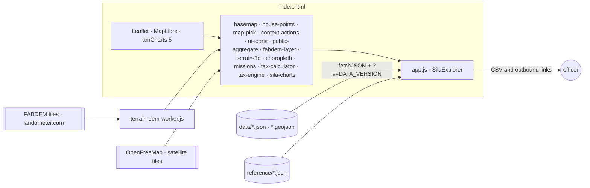

# Handoff: แผนที่งานเจ้าหน้าที่ศิลา

> ฉบับ 1 · 2026-10-21 · ไซต์ revision 2.0.2 (ฐาน 2.0.1 commit `4b32208`) · สร้างจาก `tools/handoff/` ห้ามแก้ไฟล์นี้ด้วยมือ · ขนาดไฟล์และจำนวนบรรทัดอยู่ใน [FACTS.md](FACTS.md)

เอกสารนี้บอกว่าตอนนี้มีอะไร อยู่ที่ไหน ทำงานอย่างไร ตรวจอย่างไร และออก release อย่างไร งานที่ต้องทำต่ออยู่ใน [IMPLEMENTATION_PLAN.md](IMPLEMENTATION_PLAN.md) และกติกาสำหรับ agent อยู่ใน [AGENTS.md](../../AGENTS.md)

## สถานะ

| หัวข้อ | ค่า | ป้าย |
|---|---|---|
| เว็บ | https://montri-th.github.io/sila/ | Observed fact |
| Repository | montri-th/sila · branch main · GitHub Pages จาก main | Observed fact |
| รุ่นที่ตรวจบนเว็บจริงล่าสุด | 2.0.1 · commit 4b32208 · ไฟล์ตรง manifest 404/404 เมื่อ 2026-10-20T17:14:20Z | Observed fact |
| รุ่นของชุดนี้ | 2.0.2: เอกสาร เครื่องมือ และแก้ข้อความหนึ่งจุดใน data/parcel-tax.json · สถานะเผยแพร่ดูจาก build-manifest.json และผล verify-live ล่าสุด | Observed fact |
| ระบบจริง | ไม่มีการเข้าสู่ระบบ ไม่เขียนข้อมูลกลับ ไม่เชื่อมข้อมูล production | Observed fact (README front matter) |
| ผลตรวจ accessibility-checks | views 34, notReadyViews 0, violations 0, tool axe-core 4.10.2 · qa/revision-2.0.2-accessibility-checks.json | Observed fact |
| ผลตรวจ browser-checks | cases 36, notReadyCases 0, pageErrors 0, horizontalOverflowCases 0, legendOverMapCases 0, flowsPassed 8 of 8, browser Chromium 141.0.7390.37 · qa/revision-2.0.2-browser-checks.json | Observed fact |
| ผลตรวจ phone-overflow | runs 112, bad 0 · qa/revision-2.0.2-phone-overflow.json | Observed fact |
| ผลตรวจ publication-audit | result pass, filesScanned 45, notScanned 0 · qa/revision-2.0.2-publication-audit.json | Observed fact |

## เริ่มงานใน 15 นาที

```sh
git clone https://github.com/montri-th/sila.git && cd sila
python3 server.py --port 8768 > /dev/null 2>&1 &   # loopback preview in the background: http://127.0.0.1:8768/
until curl -sf -o /dev/null http://127.0.0.1:8768/; do sleep 0.5; done   # wait until the preview answers
sh qa/run-unit-checks.sh
python3 -m pip install playwright==1.56.0 && python3 -m playwright install chromium
npm install --prefix qa/browser axe-core@4.10.2
python3 qa/browser/run_matrix.py --base http://127.0.0.1:8768/ --out release-evidence/matrix.json
python3 tools/handoff/build_handoff.py --check
```

## สถาปัตยกรรม

หน้าเว็บ static ไม่มีขั้น build สคริปต์แต่ละไฟล์เป็น IIFE ที่ประกาศ global ของตัวเอง โหลดตามลำดับใน index.html และ app.js ต้องอยู่ท้ายสุด



| ไฟล์ | Global | หน้าที่ |
|---|---|---|
| index.html | — | page shell; the order of styles and scripts and their ?v= cache keys |
| app.js | SilaExplorer | SilaExplorer: state, URL sync, data loading, every layer, panels, record cards, charts and CSV (to be split by R-10 to R-12) |
| missions.js | SilaMissions | SilaMissions: the 5 missions and the layer definitions (labels, kind, benefit, supplements, tools) |
| tax-engine.js | SilaTaxEngine | SilaTaxEngine 2.0.0: per-title land-tax engine (prepare, run, agriWatch, ownerRanking, vacancyFromRoll) |
| tax-calculator.js | SilaTaxCalculator | SilaTaxCalculator: one-parcel calculator under the Act 2562 and Royal Decree 2564 rates; inputs never leave the tab |
| choropleth.js | SilaScales | SilaScales: LDS 0.9.7 analytical classes and the 41-sample LUT from reference/lds-analytical-subset.json |
| sila-charts.js | SilaCharts | SilaCharts: amCharts 5 wrappers; colours come from the host (LDS series or scales); captions carry what, unit, basis, scope, time |
| public-aggregate.js | SilaPublicAggregates | SilaPublicAggregates: municipality-level summary views (tax, business, animals, health services, care groups) from data/municipal-summary.json |
| ui-icons.js | SilaIcons | SilaIcons: Material Symbols Rounded subset as inline SVG paths (approved glyphs only) |
| basemap.js | SilaBasemap | SilaBasemap: street (OpenFreeMap), satellite, satellite archive (EOX 2016) and none, with OSM raster fallback |
| terrain-3d.js | SilaTerrain3D | SilaTerrain3D: MapLibre 3D terrain from FABDEM (colour relief, contours, shading), north-up default, exaggeration 2 |
| terrain-dem-worker.js | — | Web Worker for terrain-3d.js: fetches and decodes FABDEM terrarium tiles, overzoom and shading |
| fabdem-layer.js | SilaFabdem | SilaFabdem: 2D height colours and shading from FABDEM tiles (district 4001 coverage) |
| house-points.js | SilaHousePoints | SilaHousePoints: every house record as one canvas point at every zoom |
| map-pick.js | SilaMapPick | SilaMapPick: picks source geometries under the pointer; the host chooses among overlaps |
| context-actions.js | SilaContextActions | SilaContextActions: search sources and prepare editable AI questions; no AI runtime, no uploads, no personal data |
| server.py | — | loopback preview (127.0.0.1) with a file allowlist |

ลำดับโหลด (ค่า ?v= อยู่ใน FACTS.md)

| ชนิด | ลำดับ |
|---|---|
| styles | assets/fonts.css → vendor/leaflet/leaflet.css → vendor/maplibre-gl/maplibre-gl.css → basemap.css → styles.css → house-points.css → context-actions.css → platform-shell.css → missions.css → tax-calculator.css → map-layers.css → shell.css → assets/brand/citychat-motif-motion.css → assets/brand/citychat-header-logo.css |
| scripts | assets/brand/citychat-header-logo.js → vendor/leaflet/leaflet.js → basemap.js → house-points.js → map-pick.js → context-actions.js → ui-icons.js → public-aggregate.js → fabdem-layer.js → terrain-3d.js → choropleth.js → missions.js → tax-calculator.js → tax-engine.js → sila-charts.js → vendor/amcharts5/amcharts5-sila.min.js → app.js |

การเริ่มระบบ: start() fetches catalog, metadata, document catalog, design tokens, municipal summary, terrain source and coverage, analytical scales, parcel-tax.json, population structure and the optional Street View coverage in parallel; prepares the tax model; loads boundaries; reads the URL; then binds events, creates the map, renders the panel and draws.

พารามิเตอร์ใน URL (สถานะทั้งหมดอยู่ใน URL จึงเปิดมุมมองเดิมซ้ำได้)

| พารามิเตอร์ | ค่า |
|---|---|
| mission | tax, flood, care, works, area |
| dataset | layer id |
| boundary | municipality, village, election |
| scope | sila or a village/election id |
| lang | th or en |
| theme | dark or light |
| basemap | street, satellite, satellite-archive, none |
| mode | 2d or 3d (terrain) |
| record | selected record id |
| scenario | assessed69, old70, new70, delta (tax map) |
| adj | land appraisal change %, -30 to 100 |
| badj | building value change %, -30 to 100 |
| fix | selected fixes joined by a dot |
| pm | pct for percent on properties |
| init | negotiation initiative id |
| owner | owner code T-XXXXXX |
| metric | population grid metric t, c, a, o, m, f |
| view | buildings view type, tax, registry, roll, straddle, use |
| pal, bands, map, lock, ct, low, step | terrain colour and contour options |
| ex, ext | 3D exaggeration (number or auto) and auto target |

จุดต่อสำหรับทดสอบ: `window.SilaExplorer: getState(), setDataset(id), setMission(id), selectScope(id), setTerrainMode(mode), closeRecord()`

## งานและชั้นข้อมูล

| งาน | ชั้นข้อมูลตามลำดับ |
|---|---|
| ภาษีและรายได้ / Tax and revenue (tax) | negotiate, properties, portfolio, agriwatch, taxmap, appraisal, buildings, houses, businesses |
| น้ำท่วมและภัยพิบัติ / Flood and disaster (flood) | floodsites, terrain, waterways, popgrid, roads, cctv |
| ดูแลคนและสาธารณสุข / Care and public health (care) | popgrid, caregroups, population, health, education, animals |
| โยธาและบริการสาธารณะ / Public works and services (works) | roads, publicfacilities, cctv, education, religion, buildings |
| ข้อมูลพื้นฐานพื้นที่ / Area basics (area) | overview, population, houses, buildings, appraisal |

| ชั้น | ชื่อ | ชนิด | ไฟล์ข้อมูล | ข้อมูลประกอบ | เครื่องมือ | สถานะในบัญชี |
|---|---|---|---|---|---|---|
| negotiate | แผนการเจรจา: เก็บเพิ่มได้ตามกลุ่มข้อเสนอ | parcel-choropleth | data/parcels.geojson, data/parcel-tax.json | tax | tax-calculator | derived_20261020 |
| taxmap | ภาษีที่ดินรายแปลง | parcel-choropleth | data/parcels.geojson, data/parcel-tax.json | tax | tax-calculator | source_supplied_20261019 |
| properties | ทรัพย์สินรายเจ้าของ: ภาษีที่เพิ่มได้ | parcel-choropleth | data/parcels.geojson, data/parcel-tax.json | tax | tax-calculator | source_supplied_20261020 |
| portfolio | เจ้าของรายใหญ่ เรียงตามราคาประเมินรวม | parcel-choropleth | data/parcels.geojson, data/parcel-tax.json | tax | — | derived_20261020 |
| agriwatch | เกษตรบนที่ดินราคาสูง ควรเพ่งเล็ง | parcel-choropleth | data/parcels.geojson, data/parcel-tax.json | tax | — | derived_20261020 |
| businesses | ธุรกิจนิติบุคคลที่จดทะเบียน VAT | points | data/businesses.geojson | — | — | open_data_20261017 |
| appraisal | ราคาประเมินที่ดินรายแปลง | parcel-choropleth | data/parcels.geojson, data/parcel-tax.json | — | — | source_supplied_20261019 |
| buildings | อาคาร บ้านเลขที่ และบัญชีภาษี | polygons | data/buildings.geojson | business | — | source_supplied_20261019 |
| houses | หมุดบ้านที่สำรวจ | points | data/houses.geojson | — | — | source_supplied_20261019 |
| terrain | ที่สูงที่ต่ำ 2D และ 3D | terrain | data/terrain-source.json, data/terrain-coverage.geojson, external FABDEM tiles | flood | — | external_team_pending |
| waterways | ลำห้วยและแหล่งน้ำ | polygons | data/waterways.geojson | flood | — | ready_with_caveats |
| floodsites | จุดศึกษาน้ำท่วม 16 จุด | points | data/flood-sites.geojson | flood | — | ready_with_caveats |
| popgrid | คนในพื้นที่ แยกเพศและอายุ | grid-choropleth | data/population-grid.geojson | healthservices | — | source_supplied_20261019 |
| caregroups | กลุ่มเปราะบางและผู้รับการดูแล (ยอดรวม) | aggregate | data/municipal-summary.json | healthservices | — | — |
| animals | สัตว์เลี้ยง: สุนัขและแมว (ยอดรวม) | aggregate | data/municipal-summary.json | — | — | — |
| population | ประชากรรายหมู่บ้าน | village-choropleth | data/villages.geojson | — | — | needs_reconciliation |
| health | สถานพยาบาล | points | data/health.geojson | healthservices, caregroups | — | ready_with_caveats |
| education | สถานศึกษา | points | data/education.geojson | — | — | ready_with_caveats |
| roads | ถนนขึ้นทะเบียน | lines | data/roads.geojson | — | — | ready_with_caveats |
| cctv | กล้อง CCTV | points | data/cctv.geojson | — | — | ready_with_caveats |
| publicfacilities | สาธารณูปการ | polygons | data/publicfacilities.geojson | — | — | ready_with_caveats |
| religion | ศาสนสถาน | points | data/religion.geojson | — | — | ready_with_caveats |
| overview | ขอบเขตและภาพรวมพื้นที่ | boundaries | data/municipality.geojson, data/villages.geojson, data/election.geojson | — | — | — |

## สัญญาข้อมูล

| ไฟล์ | ความหมาย | ความเป็นส่วนตัว | สถานะในบัญชี |
|---|---|---|---|
| data/catalog.json | dataset register: ids, labels, counts (count = source records, mappedCount = drawn), statuses, caveats, source links | public metadata; sourceUrl values point to restricted Google Drive folders (P-17) | — |
| data/metadata.json | municipality, villages, elections, totals per scope, quality flags, transforms, privacy and data-currency notes | public metadata | — |
| data/parcels.geojson | parcel polygons (WGS84) with record id parcels-NNNNNN, tax-map code, area, village and election membership | no deed numbers, owners or tax ids | derived_20261020, source_supplied_20261019, source_supplied_20261020 |
| data/parcel-tax.json | per-title tax rows (see parcelTaxFields), taxpayer summaries keyed by random owner code, properties, building groups, summary with method notes and city totals | random owner codes only; no names, ids or roll record ids | — |
| data/buildings.geojson | building footprints with house numbers, survey attributes in published groups, links to parcels and the building roll | survey status not published; use in groups only | source_supplied_20261019 |
| data/houses.geojson | surveyed house points with house number and survey attributes in published groups | house numbers only, no notes or register codes | source_supplied_20261019 |
| data/businesses.geojson | juristic VAT registrants placed on parcels or buildings | natural persons not published | open_data_20261017 |
| data/population-grid.geojson | 250 m cells with counts by sex and age group, small groups masked | aggregate; >=10 people and >=3 households per shown cell; <5 masking; secondary suppression | source_supplied_20261019 |
| data/population-structure.json | village and city totals by sex and age group with the same masking | aggregate | — |
| data/municipal-summary.json | municipality-level aggregates for tax, business, animals, health services and care groups | exposure municipality_aggregate_only; no record details | — |
| data/flood-sites.geojson | 16 flood study points (study v7, 17 Oct 2569) with cause, options, receiving waterway and start order (field receiver), first action, coordinate status, survey-route length | place names only | ready_with_caveats |
| data/flood-evidence.json | document evidence from the earlier 16-site flood plan (2564-2567) | public document facts | — |
| data/terrain-source.json | FABDEM tile service metadata: URL template, zooms, encoding, licence, attribution | public metadata | — |
| data/terrain-coverage.geojson | coverage outline of the terrain service used by the site | public metadata | — |
| data/villages.geojson | 28 village boundaries with reported population and its reconciliation status | aggregate | needs_reconciliation, ready_with_caveats |
| data/municipality.geojson | municipal boundary | public | ready_with_caveats |
| data/election.geojson | 3 election districts derived for display (not legally certified) | public | derived_display |
| data/election-source-lines.geojson | source lines the election polygons were derived from | public | — |
| data/roads.geojson | registered roads with names and surface | bracketed personal aliases removed from soi names | ready_with_caveats |
| data/waterways.geojson | streams and water bodies | public | ready_with_caveats |
| data/cctv.geojson | CCTV camera points (no streams) | no live links | ready_with_caveats |
| data/education.geojson | schools | public | ready_with_caveats |
| data/health.geojson | health facilities | public | ready_with_caveats |
| data/religion.geojson | religious places | public | ready_with_caveats |
| data/publicfacilities.geojson | public facilities | public | ready_with_caveats |
| data/source-manifest.json | source file hashes and transforms of the 1.2 data build | hashes and names of source files | — |
| data/data-validation.json | validation counts and privacy flags of the data build | public metadata | — |

ฟิลด์ใน `data/parcel-tax.json` (แถวละหนึ่งโฉนด เรียงตาม `fields`)

| Field | ความหมาย |
|---|---|
| id | parcel record id parcels-NNNNNN; joins data/parcels.geojson |
| v | village id vNN |
| price | land appraisal, THB per square wah |
| sqwa | area in square wah |
| landValue | land value, THB |
| use | use on the roll: res, agri, other, vacant, mixed (null = unknown) |
| shares | use shares for mixed titles, e.g. {res: 0.06, other: 0.94}; null when single use |
| mainHome | 1 when the roll marks the title as a main home |
| bldValue | value of buildings the roll links to this title, THB |
| tp | random public owner code T-XXXXXX, or null |
| tax69 | 2569 bill from PDS 7, THB; 0 only where the roll proves full exemption; null = unknown |
| grp | property id: adjoining titles of the same owner (two or more), used by the combine fix |
| rented | 1 when the survey says rented or used by others |
| comShare | commercial share of residential use from the survey, 0 to 1 |
| surveyBld | estimated value of surveyed buildings missing from the roll, THB |
| link | how the parcel was matched to the roll title: deed, pds63 (deed number from the 2563 list via map code and area) or house (house numbers; weakest) |
| rollBld | number of buildings on this title's roll |
| missBld | surveyed buildings whose house number is absent from the building roll |
| own | owner evidence code (ds, dl, dc, du, ca, d69; suffix h = house numbers agree); labels in app.js OWN_EVIDENCE |
| h63 | what the 2563 list noted about homes on the title: m main home, o other home, r rented |
| ex | 1 when the roll prints an exemption on the title; null otherwise (none printed, or not known). The engine treats only 1 as a printed exemption; 0 does not occur |
| bgrp | building group: index + 1 into buildingGroups (titles joined by one building, s.42 para 2 proxy) |
| code | tax-map parcel code |

### กติกาฐานภาษีรุ่น 2.0 (VERBATIM จาก reference/tax-map-method.md, SHA-256 `f82c48be28e92e24…`)

> ตั้งแต่รุ่น 2.0 ส่วนเพิ่มของทุกแปลงคิดเทียบกับ **ยอดที่เทศบาลเรียกเก็บปี 2569 ของแปลงนั้น (ภ.ด.ส.7)** ไม่ใช่ภาษีที่เครื่องคำนวณขึ้นใหม่จากข้อมูลเดียวกัน ตามที่เจ้าของงานยืนยันเมื่อ 20 ต.ค. 2569 (`tax-engine.js` 2.0.0)
>
> - **วิธีเดิม 2570** = ยอดที่เรียกเก็บปี 2569 × (ภาษีตามกฎหมายด้วยราคาที่สมมติ ÷ ภาษีตามกฎหมายด้วยราคาเดิม) เหมือนรุ่นก่อน
> - **ตามข้อเสนอ 2570** = ค่ามากกว่าระหว่าง วิธีเดิม กับ ภาษีตามกฎหมายเมื่อใช้ข้อเสนอที่เลือก (ไม่ใช่ "วิธีเดิม + ส่วนต่างของข้อเสนอ" อีกต่อไป) **ส่วนเพิ่ม = ตามข้อเสนอ − วิธีเดิม** จึงเป็นเงินที่เก็บได้มากกว่าที่เรียกเก็บจริง
> - ถ้าบัญชีเรียกเก็บ **ต่ำกว่า** ภาษีตามกฎหมายจากข้อมูลเดียวกันอยู่แล้ว ส่วนต่างนั้นแยกเป็นรายการ **"บัญชีต่ำกว่าที่คำนวณ (ต้องตรวจ)"** ไม่ใช่ข้อเสนอ อาจเป็นข้อมูลอาคารหรือเนื้อที่ที่ต่างกัน ข้อยกเว้นเฉพาะราย หรือการเรียกเก็บผิด ต้องตรวจทีละโฉนด ส่วนต่างต่ำกว่า 100 บาทต่อโฉนด (7,415 โฉนด รวม 100,143 บาท) ไม่นำมานับ เพราะเป็นผลของการปัดเศษและค่าเสื่อม
> - ส่วนเพิ่มของแปลงจัดสรรให้ข้อเสนอแต่ละข้อตามผลของข้อนั้นเมื่อคิดทีละข้อ (ไม่เกินส่วนเพิ่มที่เหลือ) ที่เหลือจึงเป็นรายการต้องตรวจ แปลงหนึ่งจึงมีกลุ่มข้อเสนอที่อธิบายส่วนเพิ่มได้มากที่สุด ("กลุ่มเด่น") ใช้ระบายสีแผนการเจรจา
> - ถ้าบัญชีเรียกเก็บ **สูงกว่า** ที่คำนวณได้ (เช่น ที่ทิ้งว่างที่คิดอัตราสะสม ม.43 ซึ่งเครื่องไม่รู้ปีที่เริ่มทิ้งว่าง) ไม่มีส่วนเพิ่ม และไม่หักออกจากยอด แสดงแยกเป็น "บัญชีสูงกว่าที่คำนวณ" ทั้งเมือง 2,343 แปลง รวม 3,024,730 บาท
> - **ทิ้งว่างกี่ปี** อ่านย้อนจากอัตราที่เรียกเก็บ: ที่ดินว่างเปล่าเสีย 0.3% ใน 3 ปีแรก และเพิ่มอีก 0.3% ทุก 3 ปีที่ยังทิ้งว่าง (ม.43 เพดาน 3%) ดังนั้นแปลงที่เรียกเก็บ 0.6% ในปี 2569 ทิ้งว่างมาแล้ว 4–6 ปี (เริ่มราวปี 2564–2566) และจะขึ้นเป็น 0.9% ระหว่างปี 2570–2572 ส่วนแปลงที่เรียกเก็บ 0.3% ทิ้งว่าง 1–3 ปี ทั้งเมืองอ่านได้ 911 แปลงที่ 0.6% และ 2,108 แปลงที่ 0.3% (ฟังก์ชัน `vacancyFromRoll`) เป็นการอนุมานจากอัตรา ไม่ใช่ประวัติการใช้ที่ยืนยัน
>
> ทั้งเมืองที่ราคาเท่าเดิม (รุ่น 2.0): เรียกเก็บปี 2569 27,882,712.16 บาท · ภาษีตามกฎหมายจากข้อมูลเดียวกันโดยไม่ใช้ข้อเสนอ 25,893,034.92 บาท · ปี 2570 ตามข้อเสนอ 30,341,357.16 บาท · **ส่วนเพิ่มที่นำมานับ 2,357,411 บาท จาก 1,416 แปลง** (บนแผนที่ 1,410 แปลง อีก 6 แปลงอยู่นอกเส้นเขตเทศบาล) แยกเป็น แยกชั้นค้าขาย 844,208 บาท (331 แปลง) · รวมแปลงติดกัน 380,801 (11) · อาคารตกบัญชี 73,677 (48) · บ้านให้เช่า 52,374 (185) · บ้านหลักคนละแห่ง 43,109 (231) · นิติบุคคล 27,870 (89) · เกษตรครั้งเดียว 472 (2) · บัญชีต่ำกว่าที่คำนวณ 934,901 (571 โฉนด ≥100 บาท) ตัวเลข 2570 ตามข้อเสนอของรุ่น 1.9 (29,349,630 บาท) ต่ำกว่าเพราะคิดจากฐานที่เครื่องสร้างเอง ไม่ใช่ยอดที่เรียกเก็บ

### สิ่งที่ไม่เผยแพร่ (VERBATIM จาก reference/tax-map-method.md)

> ชื่อเจ้าของและชื่อผู้ประกอบการที่เป็นบุคคลธรรมดา เลขบัตรประชาชน เลขผู้เสียภาษี เบอร์โทร ที่อยู่เจ้าของ เลขโฉนด รหัสผู้เสียภาษีของเทศบาล เลขรายการในบัญชี รหัสประจำบ้าน รูปถ่าย หมายเหตุ และข้อมูลอายุหรือเพศรายหลัง รหัสเจ้าของบนเว็บเป็นรหัสสุ่ม ตัวเชื่อมภายในและไฟล์ต้นฉบับอยู่นอก repository

### สัญญาข้อมูลสรุประดับเทศบาล (VERBATIM จาก reference/public-summary-contract.md)

> - Schema: `sila-municipal-public-summary/1.0`
> - `exposure`: `municipality_aggregate_only`
> - `recordDetailsAvailable`: `false`
> - `sourceRowExportAvailable`: `false`
> - `datasets`: ต้องมีสี่ ID เดิม; เพิ่ม optional `caregroups` ได้เป็นชุดที่ห้า พร้อม `coverage: supplied_service_cohort_only` ซึ่งเป็นกลุ่มในบัญชีที่ได้รับ ไม่ใช่ผู้ป่วยทั้งหมดของเมือง
> - Metric เก็บ `value` เป็นตัวเลขหรือ `null`, ชื่อ หน่วย หมายเหตุสองภาษา และ `sourceIds` ของชุดอ้างอิงสรุป ตัวเลขศูนย์ที่มีจริงแสดง `0`; ค่าที่ยังไม่ยืนยันแสดง `—` พร้อมคำอธิบาย หาก `state/status` เป็น suppressed/withheld/restricted/not_published ให้แสดงว่าไม่เผยข้อมูลส่วนนี้
> - Source description มีชื่อที่เหมาะกับการเผยแพร่ ช่วงอ้างอิง สถานะตรวจ และ `publicDownload:false` ไม่มี raw Drive file link หรือดาวน์โหลดรายแถว
> - วันรับไฟล์ไม่ใช่วันสำรวจ วันตัดยอด หรือปีภาษีของทุกบันทึก ต้องอ่านช่วงอ้างอิงและหมายเหตุข้างแต่ละ metric
>
> ยอดรับในบัญชีชำระเป็นยอดตามช่วงรับเงินในต้นทาง อาจมีหลายปีภาษีและส่วนเพิ่ม ไม่เท่ากับยอดประเมินปีเดียวกัน ยอดลูกหนี้ หรือเงินที่โครงการทำให้เก็บเพิ่ม ห้ามสร้าง collection rate หรือผลเพิ่มจากส่วนต่างของตัวเลขเหล่านี้โดยยังไม่กระทบยอดรายการ

### สถานะพิกัดจุดศึกษาน้ำท่วม

| สถานะ | ความหมาย |
|---|---|
| approximate | จับคู่ภาพเอกสารโดยประมาณ 11 จุด บอกบริเวณลงพื้นที่ ไม่ใช่จุดน้ำลึกสุดหรือปากท่อ |
| representative | ตัวแทนบริเวณชื่อพื้นที่ 4 จุด (2, 5, 12, 16) ต้องให้เจ้าหน้าที่ชี้หมุดจริง |
| coordinator | หมุดจากผู้ประสานงาน จุด 4 |
| surveyed | รับรองจากรังวัดภาคสนาม 0 จุด |

### ตัวเลขทั้งเมือง (คำนวณโดย tax-engine 2.0.0 · `qa/expected-figures.json`)

| รายการ | ค่า |
|---|---|
| ยอดเรียกเก็บ 2569 | 27,882,712.16 |
| ภาษีตามกฎหมาย ไม่ใช้ข้อเสนอ | 25,893,034.92 |
| 2570 ตามข้อเสนอ | 30,341,357.16 |
| ส่วนเพิ่มที่นับ | 2,357,411.32 (1,416 โฉนด) |
| ส่วนเพิ่มบนหน้าเว็บขอบเขตเทศบาล (ไม่รวมโฉนดนอกเขต) | 2,357,026.92 (1,410 แปลง; นอกเขต 59 โฉนด) |
| กลุ่ม rollBelow | 934,901 บาท · 571 โฉนด |
| กลุ่ม mixedUse | 844,208 บาท · 331 โฉนด |
| กลุ่ม combine | 380,801 บาท · 11 โฉนด |
| กลุ่ม newBuildings | 73,677 บาท · 48 โฉนด |
| กลุ่ม rented | 52,374 บาท · 185 โฉนด |
| กลุ่ม mainHomeOnce | 43,109 บาท · 231 โฉนด |
| กลุ่ม juristic | 27,870 บาท · 89 โฉนด |
| กลุ่ม agriShare | 472 บาท · 2 โฉนด |
| บัญชีต่ำกว่าที่คำนวณ ต่ำกว่า 100 บาท (ไม่นับ) | 100,143.08 · 7,415 โฉนด |
| บัญชีสูงกว่าที่คำนวณ (แสดงแยก) | 3,024,729.56 · 2,343 โฉนด |
| เกษตรราคาสูง | 279 โฉนด · ถ้าตรวจพบว่าทุกโฉนดไม่ได้ทำประโยชน์ เพิ่มได้สูงสุด +8,443,089 บาทต่อปี |
| เจ้าของ | 18,567 ราย · 40,694 ล้านบาท · 10 อันดับแรก 5% · ตั้งแต่ 50 ล้านบาท 26 ราย |

## ช่องทางใช้งานและกติกาของแต่ละช่องทาง

| ID | ช่องทาง | การยืนยันตัวตน | การเขียน | ข้อมูล | แคช | Analytics |
|---|---|---|---|---|---|---|
| public-site | Public officer site (GitHub Pages from main) | none | none | static files under data/, reference/ and vendor/ (including the EOX 2016 archive tiles, served from this host), loaded in the browser | GitHub Pages sends Cache-Control max-age=600 (observed 2026-10-21); ?v= keys in index.html and DATA_VERSION in app.js bust caches | none (no analytics script in index.html or app.js, observed 2026-10-21) |
| local-preview | Loopback preview (server.py) | loopback only (127.0.0.1) | none | root site files plus assets/, vendor/, data/, reference/ and docs/; scripts and raw GIS are not served | Cache-Control no-cache | none |
| offline-tools | Offline tools (qa/, tools/) | developer machine | files the developer reviews before committing | repository files; keys only from environment variables | n/a | none |
| private-pipeline | Private data pipeline (outside this repository) | the owner's own computer (decision D-11); nothing from it is committed here | rebuilds data/parcel-tax.json and the parcel, building and house layers from restricted municipal exports | LTAX and PDS exports, internal link tables, the owner-code codebook and its salt | n/a | none |

คำขอออกนอกเว็บจากหน้าเว็บสาธารณะ: OpenFreeMap vector tiles (street basemap); OpenStreetMap raster tiles only as a fallback; Google hybrid tiles for the satellite basemap (licence not verified); landometer.com FABDEM terrain tiles; links the user opens: Google Maps, Street View, Google search and AI

## กติกาที่ห้ามละเมิด

| ID | กติกา | ตรวจด้วย |
|---|---|---|
| PRIV-01 | No personal data in the repository or on the site: owner names, natural-person VAT registrants, national ID or tax numbers, phone numbers, owner or business addresses, deed numbers, municipal taxpayer codes, roll record ids, house-register codes, photos or surveyor remarks. Owners appear only as random public codes T-XXXXXX. | python3 tools/publication-audit.py --since PUBLISHED_COMMIT |
| PRIV-02 | Care and vulnerable-group data are aggregates only: 250 m cells with at least 10 listed people and 3 households, groups of 1-4 shown as <5, secondary suppression. Never per-house age, sex, care status or health, including in examples, fixtures and screenshots. | publication audit data check populationIntervalViolations = 0 |
| PRIV-03 | Bring no data from other municipalities' projects or internal registers into this repository. It holds Sila data the owner has cleared for publication, nothing else. | review of every new file under data/ |
| PRIV-04 | Links to outside services carry no personal data. Map and Street View links carry only a place coordinate; AI question links carry only a place in words, a registered business name or a general legal question (no coordinates, owner codes, tax figures, house numbers or personal names). | review of streetView(), aiQuestions() and context-actions.js changes |
| SAFE-01 | Public risk communication (flood layers, warnings, risk wording) is reviewed by a person before publishing, with no exceptions. The closed-low-ground layer and the study's 10-50 cm scenarios stay unpublished until the owner approves them. | a human review receipt in qa/ for any new risk content |
| SAFE-02 | Consent and permission are separate from technical ability. That the code can show something does not mean it may be shown. New kinds of published data need the owner's go-ahead, recorded in the decision log. | decision log entry before merge |
| DATA-01 | Missing is not zero. Unknown values show the no-figure dash or 'ยังไม่มีข้อมูล' with a reason; never coerce null or undefined to 0 in sums, colours, charts or CSV. | browser flows and code review |
| DATA-02 | Join on ids only: record ids (parcels-NNNNNN, buildings-NNNNNN), parcel map codes, owner codes T-XXXXXX, village and election ids. Names are for search only. | code review |
| DATA-03 | Every position carries its source and confidence (placedBy, coordStatus, match evidence). Never present a modelled or LLM-derived coordinate as verified. | record cards show the status line |
| DATA-04 | Tax figures are planning estimates from the 2569 roll and reference/tax-map-method.md, not official assessments. Gain = law-based 2570 tax with the selected fixes minus the 2569 bill; bills above the law-based figure are listed, not deducted; gaps under 100 THB per title are noise; vacancy years are inferred from the billed rate. Changing the rule needs an owner decision. | node qa/check-tax-engine.cjs; node qa/compute-figures.cjs |
| DATA-05 | Label evidence with Observed fact, Benchmark interpretation, Owner-stated, Inference or Hypothesis. Modelled is not observed, planned is not available, a prototype is not a final result. | review of copy and docs |
| LDS-01 | Colours, fonts and scales come from LDS 0.9.7 and CityChat Add-on 0.9.2 through reference/design-tokens.json and reference/lds-analytical-subset.json. Analytical colours keep the same HEX in light and dark themes (no dark formulas, inversion or opacity on data colours); every legend states unit and denominator and has a non-colour cue. No decorative bracket or coloured left rail on menus, tabs, cards or callouts. Keep a visible keyboard focus. The CityChat identity gradient is never a data scale. | browser matrix screenshots in both themes; axe |
| LDS-02 | Every map view answers 'what should I notice and what can I do next'. Charts carry title, unit, period, source and limit; big numbers carry label, unit and context. | review against the view |
| KEY-01 | No API keys, tokens or credentials in the repository, the site or fixtures. Offline tools read keys from environment variables only (for example GOOGLE_MAPS_KEY). | publication audit pattern credential_like |
| GIT-01 | Never force-push or rewrite main, never purge history, never push the revision-1.8-history branch. Work on a branch and open a pull request; the owner merges. | branch protection (recommended) and review |
| REL-01 | A release is done only after: cache keys bumped for changed JS and CSS (?v= in index.html; DATA_VERSION in app.js when the interface must see new data at once), unit, browser, accessibility and phone-overflow checks pass, the publication audit passes, the manifest is regenerated, the push is built by Pages and tools/verify-live.py matches every file. Do not call anything done, published or live before that. | docs/handoff/HANDOFF.md release steps |
| BRAND-01 | CityChat and CityStory are separate products; CityScan is part of CityChat; do not present one product's capability as Landometer's as a whole. Logo and motif files are locked artwork: exact bytes from assets/brand/, no recolour, crop or redraw. | assets/brand/manifest.json hashes |
| LIC-01 | Keep licences intact: FABDEM CC BY-NC-SA 4.0 (non-commercial; commercial permission not verified), amCharts 5 free licence (the amCharts logo stays), OpenStreetMap and OpenFreeMap attribution, EOX Sentinel-2 cloudless 2016 CC BY 4.0 (attribution shown with the archive basemap), Material Symbols Apache-2.0. Vendor a new library or data set only with its LICENSE and a SOURCE note under vendor/NAME/. | vendor/*/LICENSE*, data/terrain-source.json |
| CLAIM-01 | Nothing public states prices, contracts, sales pipeline or traction. Pilots, letters of intent and test sites are not customers; do not describe Sila as a customer. | review of copy and docs |

## การตรวจและหลักฐาน

| การตรวจ | คำสั่ง |
|---|---|
| Node unit checks (tax engine, calculator, terrain, aggregates, map pick, house points, FABDEM) and expected city figures current | `sh qa/run-unit-checks.sh` |
| Browser matrix and flows | `python3 qa/browser/run_matrix.py --base http://127.0.0.1:8768/ --out RECEIPT.json` |
| Accessibility (axe-core) | `python3 qa/browser/run_a11y.py --base http://127.0.0.1:8768/ --out RECEIPT.json` |
| Phone overflow | `python3 qa/browser/run_overflow.py --base http://127.0.0.1:8768/ --out RECEIPT.json` |
| Publication audit | `python3 tools/publication-audit.py --since PUBLISHED_COMMIT --out RECEIPT.json` |
| Expected city figures current (write them with --out after a change to data/parcel-tax.json or tax-engine.js) | `node qa/compute-figures.cjs --check` |
| Manifest current | `python3 tools/gen-manifest.py --check` |
| Handoff documents current | `python3 tools/handoff/build_handoff.py --check` |
| Published bytes (after merge) | `python3 tools/verify-live.py --base-url https://montri-th.github.io/sila/ --output OUTPUT.json` |

ยังไม่ครอบคลุม: real GPU rendering (3D uses software WebGL in tests); screen readers; real phones; street basemap tiles; text contrast over map tiles; 200% zoom

## ขั้นตอนออก release

| ขั้น | ทำอะไร | คำสั่ง |
|---|---|---|
| 1 | Print the task brief, branch from main and make the change (one task, one pull request). | `python3 tools/handoff/task.py TASK_ID && git switch -c TASK_ID-short-name` |
| 2 | Bump ?v= for changed JS/CSS in index.html; bump DATA_VERSION in app.js if the interface must see changed data at once. | `(manual until task S-02 adds tools/release.py)` |
| 3 | Run the Node checks (they include the expected-figures check). | `sh qa/run-unit-checks.sh` |
| 4 | If data/parcel-tax.json or tax-engine.js changed, regenerate expected figures. | `node qa/compute-figures.cjs --out qa/expected-figures.json` |
| 5 | Start the preview in the background and wait until it answers, then run the browser, accessibility and phone-overflow checks; write receipts for a revision to qa/revision-X-*.json. | `python3 server.py --port 8768 > /dev/null 2>&1 & until curl -sf -o /dev/null http://127.0.0.1:8768/; do sleep 0.5; done; python3 qa/browser/run_matrix.py --base http://127.0.0.1:8768/ --out qa/revision-X-browser-checks.json && python3 qa/browser/run_a11y.py --base http://127.0.0.1:8768/ --out qa/revision-X-accessibility-checks.json && python3 qa/browser/run_overflow.py --base http://127.0.0.1:8768/ --out qa/revision-X-phone-overflow.json` |
| 6 | Rebuild the handoff documents: they read the receipts, the expected figures and tools/handoff/*_data.py. | `python3 tools/handoff/build_handoff.py` |
| 7 | Run the publication audit on everything changed since the published commit, rebuild the handoff (it reads the audit receipt), audit again to the same path, then confirm the handoff is current. If a change adds or edits a Google Drive link, ask the owner to confirm its sharing first (P-17). | `python3 tools/publication-audit.py --since PUBLISHED_COMMIT --out qa/revision-X-publication-audit.json && python3 tools/handoff/build_handoff.py && python3 tools/publication-audit.py --since PUBLISHED_COMMIT --out qa/revision-X-publication-audit.json && python3 tools/handoff/build_handoff.py --check` |
| 8 | Stage every file, then regenerate the manifest last and confirm it is current. | `git add -A && python3 tools/gen-manifest.py --revision X --date YYYY-MM-DD && git add build-manifest.json && python3 tools/gen-manifest.py --check` |
| 9 | Open a pull request with the receipts; the owner reviews and merges (never force-push main). | `gh pr create` |
| 10 | After merge, wait for the Pages build to succeed. | `gh run list --branch main --limit 3` |
| 11 | Verify every published file against the manifest; only now call the release live. | `python3 tools/verify-live.py --base-url https://montri-th.github.io/sila/ --output release-evidence/live-X.json` |

## คำตัดสิน (รายละเอียดใน IMPLEMENTATION_PLAN.md)

| ID | สถานะ | เรื่อง | ผล หรือข้อเสนอแนะ | ขวางงาน |
|---|---|---|---|---|
| D-01 | decided | ส่วนเพิ่มของแต่ละแปลงคิดเทียบกับอะไร (ข้อ 15 ในคำขอ 20 ต.ค. 2569) | คิดส่วนเพิ่มของแต่ละโฉนดเทียบกับยอดที่เรียกเก็บปี 2569 (ภ.ด.ส.7) ถ้าบัญชีเรียกเก็บต่ำกว่าภาษีตามกฎหมาย ส่วนต่างแยกเป็นรายการต้องตรวจ (ต่ำกว่า 100 บาทต่อโฉนดไม่นับ) ถ้าบัญชีสูงกว่า แสดงแยกโดยไม่หัก และอ่านจำนวนปีที่ทิ้งว่างย้อนจากอัตราที่เรียกเก็บ (0.6% หมายถึงทิ้งว่าง 4–6 ปี เริ่มราว 2564–2566 และจะเป็น 0.9% ระหว่าง 2570–2572) | — |
| D-02 | decided | amCharts, คีย์ Google Maps สำหรับตรวจ Street View และข้อมูลน้ำท่วม (สามคำถาม 20 ต.ค. 2569) | ผู้เขียนเลือก: ใช้ amCharts 5 แบบฟรีโดยคงโลโก้ amCharts และรวมไว้ใน vendor/amcharts5; ลิงก์ Street View เรียงหมุดแผนที่ก่อน แล้วภาพถนนหันหน้าเข้าแปลงพร้อมคำว่า 'ถ้ามีภาพ' และมีเครื่องมือตรวจล่วงหน้าที่อ่านคีย์จากตัวแปรสภาพแวดล้อมเท่านั้น; น้ำท่วม เผยแพร่จุดศึกษา 16 จุดพร้อมสถานะพิกัด และยังไม่เผยแพร่ภาพจำลองระดับน้ำกับร่างที่ลุ่มปิดล้อมจนกว่าเจ้าของจะตรวจ | — |
| D-03 | decided | หน้าเว็บสาธารณะแสดงอะไรจากข้อมูลภาษีได้บ้าง | เผยแพร่ตามที่เจ้าของงานอนุญาต: ภาษีปี 2569 และภาพปี 2570 รายแปลง; แผนการเจรจา เกษตรราคาสูง และอันดับเจ้าของที่สร้างจากข้อมูลรายแปลงชุดเดียวกัน; พอร์ตรายเจ้าของและทรัพย์สินแปลงติดกันโดยไม่มีชื่อ (รหัสสุ่ม T-XXXXXX เจ้าของจากบัญชี ภ.ด.ส.3 ปี 2563 สมมติว่ายังไม่เปลี่ยน); สถานะการชำระเฉพาะโฉนดที่ผูกกับบัญชีลูกหนี้; รหัสแปลงในแผนที่ภาษี; และนิติบุคคลที่จดทะเบียน VAT ทุกรายที่วางบนแผนที่ได้ (ไม่เผยแพร่บุคคลธรรมดา) | — |
| D-04 | decided | ไอคอนสำหรับ 12 บทบาท (Street View, Google AI Mode, ธุรกิจ, ทรัพย์สิน, เครื่องคิดภาษี, CSV, ค้นหา, ชั้นข้อมูล, ต้องตรวจ, ผ่าน, รอข้อมูล, พอดีพื้นที่) | เจ้าของงานอนุมัติไอคอนครบ 12 บทบาทเมื่อ 20 ต.ค. 2569 เวลา 16:50 โดยเป็นไอคอนใหม่ 9 ตัว | — |
| D-05 | decided | ขอบเขตของรุ่น 2.0 | รุ่น 2.0 และ 2.0.1 ตอบคำขอ 16 ข้อ: ทำแล้ว 13 ข้อ; ข้อ 1 (ภ.ด.ส.3 ปีปัจจุบันพร้อมรหัสผู้เสียภาษี) รอข้อมูลจากเทศบาล; ข้อ 12 เผยแพร่จุดศึกษาน้ำท่วม 16 จุดแล้ว แต่ชั้นที่ลุ่มปิดล้อมยังไม่เผยแพร่จนกว่าเจ้าของจะตรวจ (D-06); ข้อ 13 ลดปัญหาด้วยการเรียงหมุดแผนที่ก่อนและคำว่า 'ถ้ามีภาพ' แต่ยังไม่รู้ว่าตรงไหนมีภาพ Street View (D-10) | — |
| D-06 | open | เผยแพร่ชั้นที่ลุ่มปิดล้อม (417 แอ่งจาก FABDEM) บนเว็บสาธารณะหรือไม่ | ดูร่างก่อน (สร้างใหม่ได้ด้วย tools/flood/) ถ้าเผยแพร่ ให้คงข้อความในคำอธิบายสีว่า 'บอกว่าน้ำขังได้ตรงไหน ไม่ใช่การพยากรณ์น้ำท่วม' และบันทึกการตรวจไว้ใน qa/ | F-30 |
| D-07 | open | เผยแพร่ภาพจำลองระดับน้ำ 10–50 ซม. รายจุดจากรายงานศึกษาหรือไม่ | เก็บไว้ในรายงานก่อน จนกว่าจะมีตำแหน่งที่ตรวจในพื้นที่ของจุดตัวแทน (DR-05) | F-31 |
| D-08 | open | อนุมัติไอคอนใหม่ 11 ตัวของรุ่น 2.0 หรือไม่ | ดูบนเว็บจริงทั้งพื้นสว่างและมืด แล้วอนุมัติหรือระบุตัวที่ต้องการแทน | F-32 |
| D-09 | decided | ใบอนุญาต amCharts: ใช้แบบฟรีที่ต้องคงโลโก้ ซื้อแบบเชิงพาณิชย์ หรือเปลี่ยนเป็นกราฟของเราเอง | ใช้ amCharts 5 แบบฟรีและคงโลโก้ amCharts (ทางเลือกแรก) ทั้งในต้นแบบนี้และในระบบจริงของ CityChat · ใบอนุญาตแบบฟรีใน vendor/amcharts5/LICENSE.md ให้ใช้ในงานเชิงพาณิชย์ได้ ถ้าไม่ซ่อนหรือแก้ลิงก์แบรนด์ | — |
| D-10 | open | ตรวจล่วงหน้าว่าตรงไหนมีภาพ Street View ด้วยคีย์ Google Maps หรือไม่ | รันหนึ่งครั้ง เครื่องมือขอเฉพาะข้อมูลว่ามีภาพหรือไม่ ไม่ดึงภาพ ตรวจเงื่อนไขล่าสุดของ Google ก่อนรัน | F-33 |
| D-11 | decided | เก็บ pipeline ข้อมูลและตารางรหัสเจ้าของพร้อม salt ไว้ที่ใด | เก็บ pipeline ตารางรหัสเจ้าของ และ salt เป็นไฟล์ archive เดียวบนเครื่องคอมพิวเตอร์ของเจ้าของงาน ส่งแล้วเมื่อ 2026-10-21 และตรวจ SHA-256 บนเครื่องปลายทางตรงกับต้นฉบับ ไม่มีสิ่งใดจาก archive นี้อยู่ใน repository | F-34 |
| D-12 | decided | เส้นทางสู่ระบบจริง: คงเว็บสาธารณะแบบนี้ หรือย้ายข้อมูลรายแปลงและรายเจ้าของไปหลังการเข้าสู่ระบบของเจ้าหน้าที่ | คงเว็บต้นแบบสาธารณะนี้ตามเดิม (ทางเลือกแรก) รวมข้อมูลภาษีรายแปลงที่เผยแพร่ตาม D-03 · ระบบสำหรับเจ้าหน้าที่ทำในระบบ CityChat ซึ่งข้อมูลภาษีรายแปลงเห็นได้เฉพาะเจ้าหน้าที่ ทม.ศิลา 1+4 คนที่เจ้าของระบุ พร้อมบันทึกการเข้าถึง | X-50 |
| D-13 | decided | งานภาษีอยู่ใต้ป้ายผลิตภัณฑ์ใด | คงชื่อ 'CityChat · CityMETER for Organization' และให้งานภาษีเป็นหนึ่งใน 5 งานแบบรุ่น 2.0.2 (ทางเลือกแรก) · เจ้าของสั่งให้บันทึกเรื่องนี้เป็น owner amendment ของ MBB v0.5.3 section 5.1 (ทางเลือกที่สาม) | — |
| D-14 | decided | แผนที่ดาวเทียม: ใช้ URL tile ของ Google ที่สืบทอดจาก CityChat ต่อ หรือเปลี่ยนเป็นแหล่งที่มีใบอนุญาตชัดเจน | เลิกใช้ URL tile ของ Google และใช้ภาพดาวเทียมที่ใหม่และละเอียดที่สุดเท่าที่ใบอนุญาตเปิดให้ใช้ · เว็บ static นี้ใส่คีย์ไม่ได้ (KEY-01) จึงใช้ EOxCloudless 2025 ของ EOX เป็นค่าเริ่มต้น (Sentinel-2 ราว 10 ม. ใบอนุญาต CC BY-NC-SA 4.0 สำหรับงานไม่เชิงพาณิชย์) และคงภาพปี 2016 ไว้เป็นภาพย้อนหลัง · ภาพละเอียดสูงที่ต้องใช้บัญชีและคีย์ทำในระบบจริงของ CityChat | F-35 |
| D-15 | open | เปิด GitHub Actions ตรวจ pull request หรือไม่ | เปิด | S-01 |
| D-16 | open | ยืนยันสถานะ Master Brand Brief v0.5.3 | บันทึกการอนุมัติ เพื่อให้ลำดับอำนาจมีหลักฐานในเอกสาร | — |
| D-17 | decided | เผยแพร่ชุดส่งต่องานรุ่น 2.0.2 ขึ้น montri-th/sila อย่างไร | เจ้าของเลือกตัวเลือก 'Push ขึ้น main เลย' ในแบบถามที่ระบุ repository, branch และรายการไฟล์: push รุ่น 2.0.2 ขึ้น main ครั้งเดียวหลังการตรวจทั้งหมดผ่าน แล้วรอ Pages build และตรวจไฟล์ทุกไฟล์ด้วย tools/verify-live.py งานถัดไปใช้ branch และ pull request ตาม GIT-01 | — |
| D-18 | open | รหัสระเบียนภายในของบัญชีภาษีหนึ่งรหัสยังอยู่ในประวัติ git สาธารณะ (commit ก่อน 2.0.2) จะทำอย่างไร | คงประวัติไว้ และไม่ใส่รหัสภายในในไฟล์สาธารณะอีก (การตรวจข้อมูลส่วนบุคคลจับแล้ว) | — |
| D-19 | open | ลิงก์ Google Drive ของข้อมูลดิบในไฟล์สาธารณะ (19 รายการ) จะคงไว้หรือเอาออก | เอา URL ออก: คนทั่วไปและเจ้าหน้าที่เทศบาลเปิดรายการเหล่านี้ไม่ได้อยู่แล้ว ลิงก์จึงไม่ช่วยผู้ใช้ แต่ถ้าวันหนึ่งสิทธิ์ใน Drive เปลี่ยน ลิงก์บนเว็บสาธารณะจะพาไปถึงข้อมูลดิบ | S-05 |

## ปัญหาที่รู้แล้ว

| ID | สถานะ | ป้าย | สรุป |
|---|---|---|---|
| P-01 | open | Observed fact | app.js is one 4,801-line, 486 KB IIFE holding state, URL, data loading, every layer renderer, panels, cards, charts and exports. Agents need a large context for any change and edits collide. |
| P-02 | open | Observed fact | Large layers load as raw GeoJSON: parcels 20.7 MB (about 2.1 MB with gzip), buildings 33.4 MB, houses 16.7 MB, parcel-tax.json 5.1 MB. The three tax maps show the no-figure dash until parcels arrive; slow on phones. |
| P-03 | open | Observed fact | No continuous integration: unit, browser, audit, manifest and handoff checks run by hand. |
| P-04 | partly fixed in 2.0.2 | Observed fact | One internal roll record id appeared in the method note inside data/parcel-tax.json (summary.limits[0]). Removed from the file in 2.0.2 and the publication audit now fails if it returns. The live file keeps it until 2.0.2 is published, and earlier commits keep it in public git history, which GIT-01 does not allow rewriting (D-18). |
| P-05 | open | Observed fact | Release steps are manual: ?v= keys in index.html (several local files have none), DATA_VERSION in app.js (still 1.9.0 although 2.0 changed catalog and metadata), manifest, receipts, live check. |
| P-06 | owner-gated | Observed fact | The closed-low-ground layer (417 areas, FABDEM) and the study's per-site 10-50 cm scenarios are built or available but unpublished pending owner review (SAFE-01). |
| P-07 | owner-gated | Observed fact | Eleven interface icons added in 2.0 wait for owner approval: payments, volunteer_activism, construction, explore, handshake, agriculture, leaderboard, pets, water_damage, tune, bar_chart. |
| P-08 | owner-gated | Owner-stated | The owner reported that Street View opens black (D-05, item 13). Likely cause: Google has no imagery on many estate roads (Inference). The site already hides the link where an offline coverage file says there is none, but that file needs a Google Maps key (D-10). |
| P-09 | waiting for data | Observed fact | Owners come from the 2563 PDS 3 list and are assumed unchanged. The current-year PDS 3 with taxpayer codes has been requested from the municipality and not received (DR-01). |
| P-10 | open (backup) | Observed fact | The data pipeline and the restricted codebook that maps internal taxpayer keys to public owner codes (with its salt) live outside the repository. Since 2026-10-21 they are one archive on the owner's computer (D-11; delivered and checked by SHA-256). The salt is used only for internal matching keys inside the pipeline; public owner codes are drawn at random and kept stable through the codebook. A refresh without them would issue new owner codes and break saved links, so an encrypted backup is still needed. |
| P-11 | owner-gated | Observed fact | Licences to settle before wider use: amCharts free licence (logo must stay), FABDEM non-commercial, and the default satellite basemap uses direct Google tile URLs whose licence is recorded as not verified (reference/satellite-basemap-contract.json). |
| P-12 | owner-gated | Observed fact | The public, no-login site shows per-parcel tax estimates with random owner codes (owner-authorised). CityChat Product Brief v4 Appendix C says public views should be aggregated or de-identified, with role-based access and access logs; a parcel can be traced to its owner through land records (Inference). |
| P-13 | owner-gated | Observed fact | Product attribution: MBB v0.5.3 section 5.1 lists tax under Land/property tools and CityChat Product Brief v4 has no tax-estimate feature, while this site presents the tax mission under CityChat and CityMETER. |
| P-14 | owner-gated | Observed fact | Static prototype: no authentication, no writes, no case workflow, no production data connection. README points to theshifters/landometer-citychat for officer entitlement; access to that repository was not checked for this handoff. |
| P-15 | waiting for data | Observed fact | Village population needs reconciliation: the reported total (55,838) differs from male plus female (55,238) by 600 at village 11 (data/catalog.json). |
| P-16 | open | Observed fact | data/catalog.json still says the terrain layer is 'not available in this prototype' (status external_team_pending) although app.js marks it ready at runtime and the layer is live. |
| P-17 | owner-gated | Observed fact | Public files link to 19 Google Drive items: 15 folders of restricted raw municipal deliveries and 4 documents (links in data/catalog.json, data/metadata.json, data/flood-evidence.json and reference/document-catalog.json). Checked 2026-10-21: every item is shared with named accounts and one group only; none is open to anyone with the link or to a whole domain. A later sharing change in Drive would expose them through these public links (D-19). |
| P-18 | open | Observed fact | The Thai label of the farmland layer says 'ควรเพ่งเล็ง' (missions.js, app.js, data/catalog.json), which reads as suspicion of identifiable parcels, while the English says the neutral 'to watch'. Proposed Thai: 'ควรติดตาม' (task S-06). |

## ข้อมูลที่ต้องขอ

| ID | ถึง | สถานะ | ข้อความ | ป้าย |
|---|---|---|---|---|
| DR-01 | เทศบาล | ขอแล้ว 2026-10-20 ยังไม่ได้รับ | ส่งออก ภ.ด.ส.3, 7 และ 4 ปีปัจจุบันโดยมีรหัสผู้เสียภาษีหรือเลขประเมินต่อโฉนด แทนบัญชีปี 2563 ที่อาจเก่า เพื่อยืนยันเจ้าของ ข้อเสนอ ม.40 ม.41 และ ม.42 วรรคสอง | VERBATIM |
| DR-02 | เทศบาล | ยังเปิด | บัญชีรับชำระที่มีเลขประเมิน เพื่อแสดงสถานะชำระได้ทุกแปลง | VERBATIM |
| DR-03 | เทศบาล | ยังเปิด | ยืนยันภาษีของโฉนดที่พิมพ์สูงเกินราว 100 เท่า | VERBATIM |
| DR-04 | เทศบาล | ยังเปิด | กระทบยอดบัญชีประเมินกับรับชำระและลูกหนี้ | VERBATIM |
| DR-05 | กองช่างและงานป้องกันภัยของเทศบาล | ยังเปิด | ชี้หมุดจริงของจุดศึกษาน้ำท่วม 2, 5, 12 และ 16 (ตอนนี้เป็นตัวแทนบริเวณ) และยืนยันอีก 11 จุดที่เป็นค่าประมาณ ยังไม่มีจุดใดรังวัดในพื้นที่ | RECONSTRUCTED |
| DR-06 | เจ้าของงาน | ยังเปิด | คีย์ Google Maps Platform สำหรับตรวจ Street View แบบออฟไลน์หนึ่งครั้ง (ใส่ในตัวแปรสภาพแวดล้อมเท่านั้น ไม่เก็บไว้ที่ใด) หรือคำตัดสินว่าปล่อยให้ไม่รู้ต่อไป (D-10) | RECONSTRUCTED |
| DR-07 | เทศบาล | ยังเปิด | แหล่งและปีของจำนวนประชากรรายหมู่บ้านที่ถือเป็นทางการ และตัวเลขที่ถูกต้องของหมู่ 11 (ยอดรวมต่างจากชายรวมหญิง 600 คน) | RECONSTRUCTED |
| DR-08 | ผู้เขียนรายงานศึกษาน้ำท่วม | ยังเปิด (เฉพาะถ้า D-07 ให้เผยแพร่) | ขอบเขตภาพจำลองระดับน้ำ 10–50 ซม. รายจุดเป็น GeoJSON พร้อมวิธีและข้อจำกัด ถ้าเจ้าของตัดสินให้เผยแพร่ | RECONSTRUCTED |

## สิ่งที่อยู่นอก repository

| อะไร | อยู่ที่ไหน | ทำไม |
|---|---|---|
| Private data pipeline (LTAX/PDS parsing, title matching, owner linking, random owner codes, layer builds) | one archive on the owner's computer since 2026-10-21 (D-11); ask the owner, keep an encrypted backup | reads restricted municipal exports and internal link tables |
| Owner-code codebook and its salt (restricted) | inside the same archive on the owner's computer (D-11) | keeps owner codes stable across data refreshes; must never be public |
| Raw municipal sources (GIS packages, LTAX exports, registers) | municipality deliveries in the owner's Google Drive (15 folder links in data/catalog.json sourceUrl and data/metadata.json; restricted, see P-17) | restricted municipal deliveries; never copy them into this repository (PRIV-01, PRIV-03) |
| Flood study v7 (Markdown, 17 Oct 2569) | owner's files; SHA-256 8f9e0b9f0e479209d3f1f5a1578d4a74b1c4f1d7693678198fdcea8e2d431e5b | source for tools/flood/build_flood_sites.py |
| Closed-low-ground draft and review pictures | rebuild with tools/flood/ when needed | unpublished until the owner reviews (SAFE-01) |
| Screenshots and browser evidence | release-evidence/ (git-ignored) or another folder outside the repository | keep the public repository small; screenshots may show data out of context |

## ข้อควรระวัง

- app.js is a single IIFE; helpers such as $, text(), esc(), num() and the state object S are closures, so code moved to another file needs an explicit namespace (see tasks R-10 to R-12).
- Scripts load in the order of index.html and expose window globals (SilaTaxEngine, SilaMissions, SilaCharts ...); app.js must stay last. amCharts loads with defer and app.js re-mounts charts on the 'sila:am5-ready' event.
- Bump ?v= for every changed JS or CSS file in index.html; basemap.js, house-points.js, map-pick.js, context-actions.js, house-points.css, context-actions.css and platform-shell.css have no key yet. Bump DATA_VERSION in app.js when the interface must see changed data/ files at once (GitHub Pages caches for 10 minutes).
- data/catalog.json and data/metadata.json use 1-space JSON indentation and reference/terrain-contract.json uses 2 spaces; re-serialising them with another indent creates a huge diff. Edit them with a script that keeps the indent, or by hand.
- data/parcels.geojson is 20.7 MB and loads only when a parcel layer opens; the summary shows the dash with 'กำลังเปิดข้อมูลแปลง' meanwhile. Never show zero while loading.
- Tests open the site with basemap=none: street tiles are external and make screenshots non-deterministic. The terrain cases still load external FABDEM tiles from landometer.com, so compare their screenshots with a looser threshold.
- Headless Chromium needs --use-angle=swiftshader --enable-unsafe-swiftshader --ignore-gpu-blocklist for the 3D terrain (MapLibre + terrain-dem-worker.js); real-GPU rendering is a separate manual check on the live site.
- server.py serves an allowlist only: add a new root-level JS or CSS file to FILES or the preview returns 404 for it while GitHub Pages serves it.
- Owner codes are random (T- plus 6 characters from 23456789ABCDEFGHJKLMNPQRSTUVWXYZ). Never derive them from ids or hashes of personal data in public code.
- The terrain layer draws data/flood-lowground.geojson only if the file exists; do not add it to data/ without owner approval (SAFE-01).
- Numbers of exactly 11 or 13 digits in committed text (not inside a longer number or a decimal) trip the publication audit's house-code and ID patterns; write big amounts in millions or add a narrow, reasoned allowlist rule.
- The publication audit cannot read images, fonts or PDFs: it returns review for any binary file not covered by a reviewed binary rule in tools/publication-audit-allowlist.json (README screenshots are pinned by SHA-256, so a new screenshot needs a person's look first).
- sh qa/run-unit-checks.sh rewrites qa/revision-1.8-terrain-fixtures.json and qa/revision-1.9-terrain3d-fixtures.json; the bytes stay the same unless those checks changed, so a diff there means a check changed.
- The browser checks count a same-origin response of 400 or more as a page error, except two files that are absent on purpose: data/flood-lowground.geojson (until the owner approves it, F-30) and data/streetview-coverage.json (until D-10 and F-33). A case that never reaches ready fails.

## สูตรงานที่ทำบ่อย

### Add or change a map layer (before the R-13 registry)

1. missions.js: add the layer to LAYERS (label TH/EN, kind, benefit, supplements, tools) and to the missions that list it.
2. data/catalog.json: add or update the dataset entry (id, label, geojson, counts, status, caveats) keeping the 1-space indent.
3. app.js: copy the handling of an existing layer of the same kind (points: floodsites or businesses; polygons: publicfacilities; parcel choropleth: appraisal) in layerValue/featureStyle, the legend, the summary and the panel content.
4. Bump ?v= for every changed JS/CSS file; add new root files to server.py FILES.
5. Add a case to qa/browser/run_matrix.py (and run_a11y.py if the panel has new controls); run the publication audit on the new data.

### Add a mission tab

1. missions.js: add the mission (id, icon, label, short, layers).
2. Use an approved icon from ui-icons.js; a new glyph needs the icon recipe and owner approval.
3. Add matrix cases for the new tab on desktop and phone.

### Colours and scales

1. Never hard-code data colours. Analytical classes come from SilaScales (choropleth.js) reading reference/lds-analytical-subset.json; tax maps use the 41-sample LUT.
2. Categorical series (initiatives) use the LDS series names already in app.js (INITIATIVE_SERIES); interface colours use the CSS variables from assets/color-srgb-10.production.css.
3. Data colours stay the same HEX in both themes; legends state unit and denominator and show no-data, zero and suppressed differently from values.

### Add an interface icon

1. Take the official SVG from google/material-design-icons at the pinned commit in reference/ui-icons.manifest.json (symbols/web/NAME/materialsymbolsrounded/NAME_wght300_24px.svg).
2. Add it to assets/ui-icons/ and to the manifest with its SHA-256; add the path data to GLYPHS in ui-icons.js; bump the ui-icons.js cache key.
3. Record the owner's approval in the manifest authority block; icons never carry meaning without a visible label or accessible name.

### Change tax logic

1. Get an owner decision first (DATA-04).
2. Write hand-worked cases in qa/check-tax-engine.cjs, then change tax-engine.js and bump its version and cache key.
3. Run node qa/compute-figures.cjs --out qa/expected-figures.json and update the method text in reference/tax-map-method.md and the figures quoted in README.md.

### Refresh data from the private pipeline

1. Only inside the restricted storage (D-11); reuse the codebook so owner codes stay stable.
2. Audit the outputs with tools/publication-audit.py before copying them into data/.
3. Regenerate expected figures, bump DATA_VERSION, run every check, then follow the release steps.

## ส่วนที่เครื่องอ่าน

JSON ด้านล่างสำหรับโปรแกรมอ่าน ตรงกับไฟล์ .json ชื่อเดียวกันทุกตัวอักษร

| Field | ความหมาย |
|---|---|
| state | เว็บ รุ่น commit ผลตรวจล่าสุด |
| quickStart | คำสั่งเริ่มงาน |
| architecture | ไฟล์ global หน้าที่ ลำดับโหลด URL |
| missions / layers | งานและชั้นข้อมูลจาก missions.js พร้อมไฟล์ข้อมูล |
| dataContracts | ไฟล์ข้อมูล ฟิลด์ กติกาที่ฝัง VERBATIM พร้อม SHA-256 ตัวเลขทั้งเมือง |
| surfaces / invariants | ช่องทางใช้งานและกติกา |
| qa / release | คำสั่งตรวจ receipt และขั้นตอนออก release |
| decisionsRef / problemsRef | ชี้ไปที่ implementation-plan.json |
| dataRequests / outsideRepo / gotchas / recipes | ข้อมูลที่ต้องขอ สิ่งนอก repo ข้อควรระวัง สูตรงาน |

<!-- SILA_MACHINE_BEGIN -->
```json
{
 "schema": "sila-handoff/1",
 "document": {
  "id": "sila-dev-handoff/handoff",
  "title": "Handoff: แผนที่งานเจ้าหน้าที่ศิลา",
  "kind": "developer handoff",
  "version": "1",
  "date": "2026-10-21",
  "status": "current",
  "supersedes": null,
  "siteRevision": "2.0.2",
  "baseCommit": "4b322081ef7677b0deb424727acb38d63408a37a",
  "language": "th (human prose), en (agent fields)",
  "generator": "tools/handoff/build_handoff.py",
  "evidenceLabels": [
   "Observed fact",
   "Benchmark interpretation",
   "Owner-stated",
   "Inference",
   "Hypothesis"
  ],
  "quoteLabels": [
   "VERBATIM",
   "PARTIAL",
   "RECONSTRUCTED"
  ]
 },
 "state": {
  "liveUrl": "https://montri-th.github.io/sila/",
  "repo": "montri-th/sila",
  "branch": "main",
  "baseRevision": "2.0.1",
  "baseCommit": "4b322081ef7677b0deb424727acb38d63408a37a",
  "baseCommitLiveCheck": {
   "verifiedAtUtc": "2026-10-20T17:14:20Z",
   "checked": 404,
   "passed": 404,
   "manifestSha256": "74df87034f162d2c260367cff6b4b6b85f73c40f45c37dadcd4efb56011ccda9"
  },
  "siteRevision": "2.0.2",
  "production": {
   "authentication": false,
   "municipalWrites": false,
   "productionDataConnected": false,
   "source": "README.md front matter"
  },
  "latestReceipts": {
   "accessibility-checks": {
    "file": "qa/revision-2.0.2-accessibility-checks.json",
    "views": 34,
    "notReadyViews": 0,
    "violations": 0,
    "tool": "axe-core 4.10.2"
   },
   "browser-checks": {
    "file": "qa/revision-2.0.2-browser-checks.json",
    "cases": 36,
    "notReadyCases": 0,
    "pageErrors": 0,
    "horizontalOverflowCases": 0,
    "legendOverMapCases": 0,
    "flowsPassed": "8 of 8",
    "browser": "Chromium 141.0.7390.37"
   },
   "phone-overflow": {
    "file": "qa/revision-2.0.2-phone-overflow.json",
    "runs": 112,
    "bad": 0
   },
   "publication-audit": {
    "file": "qa/revision-2.0.2-publication-audit.json",
    "result": "pass",
    "filesScanned": 45,
    "notScanned": 0
   }
  },
  "publicationStateOfThisRevision": "read build-manifest.json and the latest tools/verify-live.py output; this document does not claim it"
 },
 "quickStart": [
  "git clone https://github.com/montri-th/sila.git && cd sila",
  "python3 server.py --port 8768 > /dev/null 2>&1 &   # loopback preview in the background: http://127.0.0.1:8768/",
  "until curl -sf -o /dev/null http://127.0.0.1:8768/; do sleep 0.5; done   # wait until the preview answers",
  "sh qa/run-unit-checks.sh",
  "python3 -m pip install playwright==1.56.0 && python3 -m playwright install chromium",
  "npm install --prefix qa/browser axe-core@4.10.2",
  "python3 qa/browser/run_matrix.py --base http://127.0.0.1:8768/ --out release-evidence/matrix.json",
  "python3 tools/handoff/build_handoff.py --check"
 ],
 "architecture": {
  "modules": [
   {
    "file": "index.html",
    "globals": [],
    "role": "page shell; the order of styles and scripts and their ?v= cache keys"
   },
   {
    "file": "app.js",
    "globals": [
     "SilaExplorer"
    ],
    "role": "SilaExplorer: state, URL sync, data loading, every layer, panels, record cards, charts and CSV (to be split by R-10 to R-12)"
   },
   {
    "file": "missions.js",
    "globals": [
     "SilaMissions"
    ],
    "role": "SilaMissions: the 5 missions and the layer definitions (labels, kind, benefit, supplements, tools)"
   },
   {
    "file": "tax-engine.js",
    "globals": [
     "SilaTaxEngine"
    ],
    "role": "SilaTaxEngine 2.0.0: per-title land-tax engine (prepare, run, agriWatch, ownerRanking, vacancyFromRoll)"
   },
   {
    "file": "tax-calculator.js",
    "globals": [
     "SilaTaxCalculator"
    ],
    "role": "SilaTaxCalculator: one-parcel calculator under the Act 2562 and Royal Decree 2564 rates; inputs never leave the tab"
   },
   {
    "file": "choropleth.js",
    "globals": [
     "SilaScales"
    ],
    "role": "SilaScales: LDS 0.9.7 analytical classes and the 41-sample LUT from reference/lds-analytical-subset.json"
   },
   {
    "file": "sila-charts.js",
    "globals": [
     "SilaCharts"
    ],
    "role": "SilaCharts: amCharts 5 wrappers; colours come from the host (LDS series or scales); captions carry what, unit, basis, scope, time"
   },
   {
    "file": "public-aggregate.js",
    "globals": [
     "SilaPublicAggregates"
    ],
    "role": "SilaPublicAggregates: municipality-level summary views (tax, business, animals, health services, care groups) from data/municipal-summary.json"
   },
   {
    "file": "ui-icons.js",
    "globals": [
     "SilaIcons"
    ],
    "role": "SilaIcons: Material Symbols Rounded subset as inline SVG paths (approved glyphs only)"
   },
   {
    "file": "basemap.js",
    "globals": [
     "SilaBasemap"
    ],
    "role": "SilaBasemap: street (OpenFreeMap), satellite, satellite archive (EOX 2016) and none, with OSM raster fallback"
   },
   {
    "file": "terrain-3d.js",
    "globals": [
     "SilaTerrain3D"
    ],
    "role": "SilaTerrain3D: MapLibre 3D terrain from FABDEM (colour relief, contours, shading), north-up default, exaggeration 2"
   },
   {
    "file": "terrain-dem-worker.js",
    "globals": [],
    "role": "Web Worker for terrain-3d.js: fetches and decodes FABDEM terrarium tiles, overzoom and shading"
   },
   {
    "file": "fabdem-layer.js",
    "globals": [
     "SilaFabdem"
    ],
    "role": "SilaFabdem: 2D height colours and shading from FABDEM tiles (district 4001 coverage)"
   },
   {
    "file": "house-points.js",
    "globals": [
     "SilaHousePoints"
    ],
    "role": "SilaHousePoints: every house record as one canvas point at every zoom"
   },
   {
    "file": "map-pick.js",
    "globals": [
     "SilaMapPick"
    ],
    "role": "SilaMapPick: picks source geometries under the pointer; the host chooses among overlaps"
   },
   {
    "file": "context-actions.js",
    "globals": [
     "SilaContextActions"
    ],
    "role": "SilaContextActions: search sources and prepare editable AI questions; no AI runtime, no uploads, no personal data"
   },
   {
    "file": "server.py",
    "globals": [],
    "role": "loopback preview (127.0.0.1) with a file allowlist"
   }
  ],
  "loadOrder": {
   "styles": [
    "assets/fonts.css",
    "vendor/leaflet/leaflet.css",
    "vendor/maplibre-gl/maplibre-gl.css",
    "basemap.css",
    "styles.css",
    "house-points.css",
    "context-actions.css",
    "platform-shell.css",
    "missions.css",
    "tax-calculator.css",
    "map-layers.css",
    "shell.css",
    "assets/brand/citychat-motif-motion.css",
    "assets/brand/citychat-header-logo.css"
   ],
   "scripts": [
    "assets/brand/citychat-header-logo.js",
    "vendor/leaflet/leaflet.js",
    "basemap.js",
    "house-points.js",
    "map-pick.js",
    "context-actions.js",
    "ui-icons.js",
    "public-aggregate.js",
    "fabdem-layer.js",
    "terrain-3d.js",
    "choropleth.js",
    "missions.js",
    "tax-calculator.js",
    "tax-engine.js",
    "sila-charts.js",
    "vendor/amcharts5/amcharts5-sila.min.js",
    "app.js"
   ]
  },
  "urlParams": [
   {
    "param": "mission",
    "values": "tax, flood, care, works, area"
   },
   {
    "param": "dataset",
    "values": "layer id"
   },
   {
    "param": "boundary",
    "values": "municipality, village, election"
   },
   {
    "param": "scope",
    "values": "sila or a village/election id"
   },
   {
    "param": "lang",
    "values": "th or en"
   },
   {
    "param": "theme",
    "values": "dark or light"
   },
   {
    "param": "basemap",
    "values": "street, satellite, satellite-archive, none"
   },
   {
    "param": "mode",
    "values": "2d or 3d (terrain)"
   },
   {
    "param": "record",
    "values": "selected record id"
   },
   {
    "param": "scenario",
    "values": "assessed69, old70, new70, delta (tax map)"
   },
   {
    "param": "adj",
    "values": "land appraisal change %, -30 to 100"
   },
   {
    "param": "badj",
    "values": "building value change %, -30 to 100"
   },
   {
    "param": "fix",
    "values": "selected fixes joined by a dot"
   },
   {
    "param": "pm",
    "values": "pct for percent on properties"
   },
   {
    "param": "init",
    "values": "negotiation initiative id"
   },
   {
    "param": "owner",
    "values": "owner code T-XXXXXX"
   },
   {
    "param": "metric",
    "values": "population grid metric t, c, a, o, m, f"
   },
   {
    "param": "view",
    "values": "buildings view type, tax, registry, roll, straddle, use"
   },
   {
    "param": "pal, bands, map, lock, ct, low, step",
    "values": "terrain colour and contour options"
   },
   {
    "param": "ex, ext",
    "values": "3D exaggeration (number or auto) and auto target"
   }
  ],
  "testHook": "window.SilaExplorer: getState(), setDataset(id), setMission(id), selectScope(id), setTerrainMode(mode), closeRecord()",
  "startup": "start() fetches catalog, metadata, document catalog, design tokens, municipal summary, terrain source and coverage, analytical scales, parcel-tax.json, population structure and the optional Street View coverage in parallel; prepares the tax model; loads boundaries; reads the URL; then binds events, creates the map, renders the panel and draws."
 },
 "missions": [
  {
   "id": "tax",
   "icon": "tax",
   "label": [
    "ภาษีและรายได้",
    "Tax and revenue"
   ],
   "short": [
    "ภาษี",
    "Tax"
   ],
   "layers": [
    "negotiate",
    "properties",
    "portfolio",
    "agriwatch",
    "taxmap",
    "appraisal",
    "buildings",
    "houses",
    "businesses"
   ]
  },
  {
   "id": "flood",
   "icon": "flood",
   "label": [
    "น้ำท่วมและภัยพิบัติ",
    "Flood and disaster"
   ],
   "short": [
    "น้ำท่วม",
    "Flood"
   ],
   "layers": [
    "floodsites",
    "terrain",
    "waterways",
    "popgrid",
    "roads",
    "cctv"
   ]
  },
  {
   "id": "care",
   "icon": "care",
   "label": [
    "ดูแลคนและสาธารณสุข",
    "Care and public health"
   ],
   "short": [
    "ดูแลคน",
    "Care"
   ],
   "layers": [
    "popgrid",
    "caregroups",
    "population",
    "health",
    "education",
    "animals"
   ]
  },
  {
   "id": "works",
   "icon": "works",
   "label": [
    "โยธาและบริการสาธารณะ",
    "Public works and services"
   ],
   "short": [
    "โยธา",
    "Works"
   ],
   "layers": [
    "roads",
    "publicfacilities",
    "cctv",
    "education",
    "religion",
    "buildings"
   ]
  },
  {
   "id": "area",
   "icon": "area",
   "label": [
    "ข้อมูลพื้นฐานพื้นที่",
    "Area basics"
   ],
   "short": [
    "พื้นที่",
    "Area"
   ],
   "layers": [
    "overview",
    "population",
    "houses",
    "buildings",
    "appraisal"
   ]
  }
 ],
 "layers": [
  {
   "id": "negotiate",
   "label": [
    "แผนการเจรจา: เก็บเพิ่มได้ตามกลุ่มข้อเสนอ",
    "Negotiation plan: gains by initiative"
   ],
   "kind": "parcel-choropleth",
   "supplements": [
    "tax"
   ],
   "tools": [
    "tax-calculator"
   ],
   "dataFiles": [
    "data/parcels.geojson",
    "data/parcel-tax.json"
   ],
   "catalogStatus": "derived_20261020"
  },
  {
   "id": "taxmap",
   "label": [
    "ภาษีที่ดินรายแปลง",
    "Land tax by parcel"
   ],
   "kind": "parcel-choropleth",
   "supplements": [
    "tax"
   ],
   "tools": [
    "tax-calculator"
   ],
   "dataFiles": [
    "data/parcels.geojson",
    "data/parcel-tax.json"
   ],
   "catalogStatus": "source_supplied_20261019"
  },
  {
   "id": "properties",
   "label": [
    "ทรัพย์สินรายเจ้าของ: ภาษีที่เพิ่มได้",
    "Properties by owner: tax that can be added"
   ],
   "kind": "parcel-choropleth",
   "supplements": [
    "tax"
   ],
   "tools": [
    "tax-calculator"
   ],
   "dataFiles": [
    "data/parcels.geojson",
    "data/parcel-tax.json"
   ],
   "catalogStatus": "source_supplied_20261020"
  },
  {
   "id": "portfolio",
   "label": [
    "เจ้าของรายใหญ่ เรียงตามราคาประเมินรวม",
    "Largest owners by appraised value"
   ],
   "kind": "parcel-choropleth",
   "supplements": [
    "tax"
   ],
   "tools": [],
   "dataFiles": [
    "data/parcels.geojson",
    "data/parcel-tax.json"
   ],
   "catalogStatus": "derived_20261020"
  },
  {
   "id": "agriwatch",
   "label": [
    "เกษตรบนที่ดินราคาสูง ควรเพ่งเล็ง",
    "High-value farmland to watch"
   ],
   "kind": "parcel-choropleth",
   "supplements": [
    "tax"
   ],
   "tools": [],
   "dataFiles": [
    "data/parcels.geojson",
    "data/parcel-tax.json"
   ],
   "catalogStatus": "derived_20261020"
  },
  {
   "id": "businesses",
   "label": [
    "ธุรกิจนิติบุคคลที่จดทะเบียน VAT",
    "VAT-registered companies"
   ],
   "kind": "points",
   "supplements": [],
   "tools": [],
   "dataFiles": [
    "data/businesses.geojson"
   ],
   "catalogStatus": "open_data_20261017"
  },
  {
   "id": "appraisal",
   "label": [
    "ราคาประเมินที่ดินรายแปลง",
    "Land appraisal by parcel"
   ],
   "kind": "parcel-choropleth",
   "supplements": [],
   "tools": [],
   "dataFiles": [
    "data/parcels.geojson",
    "data/parcel-tax.json"
   ],
   "catalogStatus": "source_supplied_20261019"
  },
  {
   "id": "buildings",
   "label": [
    "อาคาร บ้านเลขที่ และบัญชีภาษี",
    "Buildings, house numbers and the tax roll"
   ],
   "kind": "polygons",
   "supplements": [
    "business"
   ],
   "tools": [],
   "dataFiles": [
    "data/buildings.geojson"
   ],
   "catalogStatus": "source_supplied_20261019"
  },
  {
   "id": "houses",
   "label": [
    "หมุดบ้านที่สำรวจ",
    "Surveyed house points"
   ],
   "kind": "points",
   "supplements": [],
   "tools": [],
   "dataFiles": [
    "data/houses.geojson"
   ],
   "catalogStatus": "source_supplied_20261019"
  },
  {
   "id": "terrain",
   "label": [
    "ที่สูงที่ต่ำ 2D และ 3D",
    "High and low ground in 2D and 3D"
   ],
   "kind": "terrain",
   "supplements": [
    "flood"
   ],
   "tools": [],
   "dataFiles": [
    "data/terrain-source.json",
    "data/terrain-coverage.geojson",
    "external FABDEM tiles"
   ],
   "catalogStatus": "external_team_pending"
  },
  {
   "id": "waterways",
   "label": [
    "ลำห้วยและแหล่งน้ำ",
    "Streams and water bodies"
   ],
   "kind": "polygons",
   "supplements": [
    "flood"
   ],
   "tools": [],
   "dataFiles": [
    "data/waterways.geojson"
   ],
   "catalogStatus": "ready_with_caveats"
  },
  {
   "id": "floodsites",
   "label": [
    "จุดศึกษาน้ำท่วม 16 จุด",
    "16 flood study sites"
   ],
   "kind": "points",
   "supplements": [
    "flood"
   ],
   "tools": [],
   "dataFiles": [
    "data/flood-sites.geojson"
   ],
   "catalogStatus": "ready_with_caveats"
  },
  {
   "id": "popgrid",
   "label": [
    "คนในพื้นที่ แยกเพศและอายุ",
    "People by sex and age"
   ],
   "kind": "grid-choropleth",
   "supplements": [
    "healthservices"
   ],
   "tools": [],
   "dataFiles": [
    "data/population-grid.geojson"
   ],
   "catalogStatus": "source_supplied_20261019"
  },
  {
   "id": "caregroups",
   "label": [
    "กลุ่มเปราะบางและผู้รับการดูแล (ยอดรวม)",
    "Vulnerable groups and care recipients (totals)"
   ],
   "kind": "aggregate",
   "supplements": [
    "healthservices"
   ],
   "tools": [],
   "dataFiles": [
    "data/municipal-summary.json"
   ],
   "catalogStatus": null
  },
  {
   "id": "animals",
   "label": [
    "สัตว์เลี้ยง: สุนัขและแมว (ยอดรวม)",
    "Pets: dogs and cats (totals)"
   ],
   "kind": "aggregate",
   "supplements": [],
   "tools": [],
   "dataFiles": [
    "data/municipal-summary.json"
   ],
   "catalogStatus": null
  },
  {
   "id": "population",
   "label": [
    "ประชากรรายหมู่บ้าน",
    "Population by village"
   ],
   "kind": "village-choropleth",
   "supplements": [],
   "tools": [],
   "dataFiles": [
    "data/villages.geojson"
   ],
   "catalogStatus": "needs_reconciliation"
  },
  {
   "id": "health",
   "label": [
    "สถานพยาบาล",
    "Health facilities"
   ],
   "kind": "points",
   "supplements": [
    "healthservices",
    "caregroups"
   ],
   "tools": [],
   "dataFiles": [
    "data/health.geojson"
   ],
   "catalogStatus": "ready_with_caveats"
  },
  {
   "id": "education",
   "label": [
    "สถานศึกษา",
    "Schools"
   ],
   "kind": "points",
   "supplements": [],
   "tools": [],
   "dataFiles": [
    "data/education.geojson"
   ],
   "catalogStatus": "ready_with_caveats"
  },
  {
   "id": "roads",
   "label": [
    "ถนนขึ้นทะเบียน",
    "Registered roads"
   ],
   "kind": "lines",
   "supplements": [],
   "tools": [],
   "dataFiles": [
    "data/roads.geojson"
   ],
   "catalogStatus": "ready_with_caveats"
  },
  {
   "id": "cctv",
   "label": [
    "กล้อง CCTV",
    "CCTV cameras"
   ],
   "kind": "points",
   "supplements": [],
   "tools": [],
   "dataFiles": [
    "data/cctv.geojson"
   ],
   "catalogStatus": "ready_with_caveats"
  },
  {
   "id": "publicfacilities",
   "label": [
    "สาธารณูปการ",
    "Public facilities"
   ],
   "kind": "polygons",
   "supplements": [],
   "tools": [],
   "dataFiles": [
    "data/publicfacilities.geojson"
   ],
   "catalogStatus": "ready_with_caveats"
  },
  {
   "id": "religion",
   "label": [
    "ศาสนสถาน",
    "Religious places"
   ],
   "kind": "points",
   "supplements": [],
   "tools": [],
   "dataFiles": [
    "data/religion.geojson"
   ],
   "catalogStatus": "ready_with_caveats"
  },
  {
   "id": "overview",
   "label": [
    "ขอบเขตและภาพรวมพื้นที่",
    "Boundaries and area overview"
   ],
   "kind": "boundaries",
   "supplements": [],
   "tools": [],
   "dataFiles": [
    "data/municipality.geojson",
    "data/villages.geojson",
    "data/election.geojson"
   ],
   "catalogStatus": null
  }
 ],
 "dataContracts": {
  "files": [
   {
    "path": "data/catalog.json",
    "meaning": "dataset register: ids, labels, counts (count = source records, mappedCount = drawn), statuses, caveats, source links",
    "privacy": "public metadata; sourceUrl values point to restricted Google Drive folders (P-17)",
    "catalogStatus": []
   },
   {
    "path": "data/metadata.json",
    "meaning": "municipality, villages, elections, totals per scope, quality flags, transforms, privacy and data-currency notes",
    "privacy": "public metadata",
    "catalogStatus": []
   },
   {
    "path": "data/parcels.geojson",
    "meaning": "parcel polygons (WGS84) with record id parcels-NNNNNN, tax-map code, area, village and election membership",
    "privacy": "no deed numbers, owners or tax ids",
    "catalogStatus": [
     "derived_20261020",
     "source_supplied_20261019",
     "source_supplied_20261020"
    ]
   },
   {
    "path": "data/parcel-tax.json",
    "meaning": "per-title tax rows (see parcelTaxFields), taxpayer summaries keyed by random owner code, properties, building groups, summary with method notes and city totals",
    "privacy": "random owner codes only; no names, ids or roll record ids",
    "catalogStatus": []
   },
   {
    "path": "data/buildings.geojson",
    "meaning": "building footprints with house numbers, survey attributes in published groups, links to parcels and the building roll",
    "privacy": "survey status not published; use in groups only",
    "catalogStatus": [
     "source_supplied_20261019"
    ]
   },
   {
    "path": "data/houses.geojson",
    "meaning": "surveyed house points with house number and survey attributes in published groups",
    "privacy": "house numbers only, no notes or register codes",
    "catalogStatus": [
     "source_supplied_20261019"
    ]
   },
   {
    "path": "data/businesses.geojson",
    "meaning": "juristic VAT registrants placed on parcels or buildings",
    "privacy": "natural persons not published",
    "catalogStatus": [
     "open_data_20261017"
    ]
   },
   {
    "path": "data/population-grid.geojson",
    "meaning": "250 m cells with counts by sex and age group, small groups masked",
    "privacy": "aggregate; >=10 people and >=3 households per shown cell; <5 masking; secondary suppression",
    "catalogStatus": [
     "source_supplied_20261019"
    ]
   },
   {
    "path": "data/population-structure.json",
    "meaning": "village and city totals by sex and age group with the same masking",
    "privacy": "aggregate",
    "catalogStatus": []
   },
   {
    "path": "data/municipal-summary.json",
    "meaning": "municipality-level aggregates for tax, business, animals, health services and care groups",
    "privacy": "exposure municipality_aggregate_only; no record details",
    "catalogStatus": []
   },
   {
    "path": "data/flood-sites.geojson",
    "meaning": "16 flood study points (study v7, 17 Oct 2569) with cause, options, receiving waterway and start order (field receiver), first action, coordinate status, survey-route length",
    "privacy": "place names only",
    "catalogStatus": [
     "ready_with_caveats"
    ]
   },
   {
    "path": "data/flood-evidence.json",
    "meaning": "document evidence from the earlier 16-site flood plan (2564-2567)",
    "privacy": "public document facts",
    "catalogStatus": []
   },
   {
    "path": "data/terrain-source.json",
    "meaning": "FABDEM tile service metadata: URL template, zooms, encoding, licence, attribution",
    "privacy": "public metadata",
    "catalogStatus": []
   },
   {
    "path": "data/terrain-coverage.geojson",
    "meaning": "coverage outline of the terrain service used by the site",
    "privacy": "public metadata",
    "catalogStatus": []
   },
   {
    "path": "data/villages.geojson",
    "meaning": "28 village boundaries with reported population and its reconciliation status",
    "privacy": "aggregate",
    "catalogStatus": [
     "needs_reconciliation",
     "ready_with_caveats"
    ]
   },
   {
    "path": "data/municipality.geojson",
    "meaning": "municipal boundary",
    "privacy": "public",
    "catalogStatus": [
     "ready_with_caveats"
    ]
   },
   {
    "path": "data/election.geojson",
    "meaning": "3 election districts derived for display (not legally certified)",
    "privacy": "public",
    "catalogStatus": [
     "derived_display"
    ]
   },
   {
    "path": "data/election-source-lines.geojson",
    "meaning": "source lines the election polygons were derived from",
    "privacy": "public",
    "catalogStatus": []
   },
   {
    "path": "data/roads.geojson",
    "meaning": "registered roads with names and surface",
    "privacy": "bracketed personal aliases removed from soi names",
    "catalogStatus": [
     "ready_with_caveats"
    ]
   },
   {
    "path": "data/waterways.geojson",
    "meaning": "streams and water bodies",
    "privacy": "public",
    "catalogStatus": [
     "ready_with_caveats"
    ]
   },
   {
    "path": "data/cctv.geojson",
    "meaning": "CCTV camera points (no streams)",
    "privacy": "no live links",
    "catalogStatus": [
     "ready_with_caveats"
    ]
   },
   {
    "path": "data/education.geojson",
    "meaning": "schools",
    "privacy": "public",
    "catalogStatus": [
     "ready_with_caveats"
    ]
   },
   {
    "path": "data/health.geojson",
    "meaning": "health facilities",
    "privacy": "public",
    "catalogStatus": [
     "ready_with_caveats"
    ]
   },
   {
    "path": "data/religion.geojson",
    "meaning": "religious places",
    "privacy": "public",
    "catalogStatus": [
     "ready_with_caveats"
    ]
   },
   {
    "path": "data/publicfacilities.geojson",
    "meaning": "public facilities",
    "privacy": "public",
    "catalogStatus": [
     "ready_with_caveats"
    ]
   },
   {
    "path": "data/source-manifest.json",
    "meaning": "source file hashes and transforms of the 1.2 data build",
    "privacy": "hashes and names of source files",
    "catalogStatus": []
   },
   {
    "path": "data/data-validation.json",
    "meaning": "validation counts and privacy flags of the data build",
    "privacy": "public metadata",
    "catalogStatus": []
   }
  ],
  "parcelTaxFields": {
   "id": "parcel record id parcels-NNNNNN; joins data/parcels.geojson",
   "v": "village id vNN",
   "price": "land appraisal, THB per square wah",
   "sqwa": "area in square wah",
   "landValue": "land value, THB",
   "use": "use on the roll: res, agri, other, vacant, mixed (null = unknown)",
   "shares": "use shares for mixed titles, e.g. {res: 0.06, other: 0.94}; null when single use",
   "mainHome": "1 when the roll marks the title as a main home",
   "bldValue": "value of buildings the roll links to this title, THB",
   "tp": "random public owner code T-XXXXXX, or null",
   "tax69": "2569 bill from PDS 7, THB; 0 only where the roll proves full exemption; null = unknown",
   "grp": "property id: adjoining titles of the same owner (two or more), used by the combine fix",
   "rented": "1 when the survey says rented or used by others",
   "comShare": "commercial share of residential use from the survey, 0 to 1",
   "surveyBld": "estimated value of surveyed buildings missing from the roll, THB",
   "link": "how the parcel was matched to the roll title: deed, pds63 (deed number from the 2563 list via map code and area) or house (house numbers; weakest)",
   "rollBld": "number of buildings on this title's roll",
   "missBld": "surveyed buildings whose house number is absent from the building roll",
   "own": "owner evidence code (ds, dl, dc, du, ca, d69; suffix h = house numbers agree); labels in app.js OWN_EVIDENCE",
   "h63": "what the 2563 list noted about homes on the title: m main home, o other home, r rented",
   "ex": "1 when the roll prints an exemption on the title; null otherwise (none printed, or not known). The engine treats only 1 as a printed exemption; 0 does not occur",
   "bgrp": "building group: index + 1 into buildingGroups (titles joined by one building, s.42 para 2 proxy)",
   "code": "tax-map parcel code"
  },
  "taxBaseline": {
   "source": "reference/tax-map-method.md",
   "sha256": "f82c48be28e92e249dc62f477613c589885feffe2b371e6977a89d87766734b8",
   "heading": "## รุ่น 2.0: ฐานเปรียบเทียบคือยอดที่เรียกเก็บปี 2569 และการจัดสรรส่วนเพิ่มให้ข้อเสนอ",
   "quoteLabel": "VERBATIM",
   "text": "ตั้งแต่รุ่น 2.0 ส่วนเพิ่มของทุกแปลงคิดเทียบกับ **ยอดที่เทศบาลเรียกเก็บปี 2569 ของแปลงนั้น (ภ.ด.ส.7)** ไม่ใช่ภาษีที่เครื่องคำนวณขึ้นใหม่จากข้อมูลเดียวกัน ตามที่เจ้าของงานยืนยันเมื่อ 20 ต.ค. 2569 (`tax-engine.js` 2.0.0)\n\n- **วิธีเดิม 2570** = ยอดที่เรียกเก็บปี 2569 × (ภาษีตามกฎหมายด้วยราคาที่สมมติ ÷ ภาษีตามกฎหมายด้วยราคาเดิม) เหมือนรุ่นก่อน\n- **ตามข้อเสนอ 2570** = ค่ามากกว่าระหว่าง วิธีเดิม กับ ภาษีตามกฎหมายเมื่อใช้ข้อเสนอที่เลือก (ไม่ใช่ \"วิธีเดิม + ส่วนต่างของข้อเสนอ\" อีกต่อไป) **ส่วนเพิ่ม = ตามข้อเสนอ − วิธีเดิม** จึงเป็นเงินที่เก็บได้มากกว่าที่เรียกเก็บจริง\n- ถ้าบัญชีเรียกเก็บ **ต่ำกว่า** ภาษีตามกฎหมายจากข้อมูลเดียวกันอยู่แล้ว ส่วนต่างนั้นแยกเป็นรายการ **\"บัญชีต่ำกว่าที่คำนวณ (ต้องตรวจ)\"** ไม่ใช่ข้อเสนอ อาจเป็นข้อมูลอาคารหรือเนื้อที่ที่ต่างกัน ข้อยกเว้นเฉพาะราย หรือการเรียกเก็บผิด ต้องตรวจทีละโฉนด ส่วนต่างต่ำกว่า 100 บาทต่อโฉนด (7,415 โฉนด รวม 100,143 บาท) ไม่นำมานับ เพราะเป็นผลของการปัดเศษและค่าเสื่อม\n- ส่วนเพิ่มของแปลงจัดสรรให้ข้อเสนอแต่ละข้อตามผลของข้อนั้นเมื่อคิดทีละข้อ (ไม่เกินส่วนเพิ่มที่เหลือ) ที่เหลือจึงเป็นรายการต้องตรวจ แปลงหนึ่งจึงมีกลุ่มข้อเสนอที่อธิบายส่วนเพิ่มได้มากที่สุด (\"กลุ่มเด่น\") ใช้ระบายสีแผนการเจรจา\n- ถ้าบัญชีเรียกเก็บ **สูงกว่า** ที่คำนวณได้ (เช่น ที่ทิ้งว่างที่คิดอัตราสะสม ม.43 ซึ่งเครื่องไม่รู้ปีที่เริ่มทิ้งว่าง) ไม่มีส่วนเพิ่ม และไม่หักออกจากยอด แสดงแยกเป็น \"บัญชีสูงกว่าที่คำนวณ\" ทั้งเมือง 2,343 แปลง รวม 3,024,730 บาท\n- **ทิ้งว่างกี่ปี** อ่านย้อนจากอัตราที่เรียกเก็บ: ที่ดินว่างเปล่าเสีย 0.3% ใน 3 ปีแรก และเพิ่มอีก 0.3% ทุก 3 ปีที่ยังทิ้งว่าง (ม.43 เพดาน 3%) ดังนั้นแปลงที่เรียกเก็บ 0.6% ในปี 2569 ทิ้งว่างมาแล้ว 4–6 ปี (เริ่มราวปี 2564–2566) และจะขึ้นเป็น 0.9% ระหว่างปี 2570–2572 ส่วนแปลงที่เรียกเก็บ 0.3% ทิ้งว่าง 1–3 ปี ทั้งเมืองอ่านได้ 911 แปลงที่ 0.6% และ 2,108 แปลงที่ 0.3% (ฟังก์ชัน `vacancyFromRoll`) เป็นการอนุมานจากอัตรา ไม่ใช่ประวัติการใช้ที่ยืนยัน\n\nทั้งเมืองที่ราคาเท่าเดิม (รุ่น 2.0): เรียกเก็บปี 2569 27,882,712.16 บาท · ภาษีตามกฎหมายจากข้อมูลเดียวกันโดยไม่ใช้ข้อเสนอ 25,893,034.92 บาท · ปี 2570 ตามข้อเสนอ 30,341,357.16 บาท · **ส่วนเพิ่มที่นำมานับ 2,357,411 บาท จาก 1,416 แปลง** (บนแผนที่ 1,410 แปลง อีก 6 แปลงอยู่นอกเส้นเขตเทศบาล) แยกเป็น แยกชั้นค้าขาย 844,208 บาท (331 แปลง) · รวมแปลงติดกัน 380,801 (11) · อาคารตกบัญชี 73,677 (48) · บ้านให้เช่า 52,374 (185) · บ้านหลักคนละแห่ง 43,109 (231) · นิติบุคคล 27,870 (89) · เกษตรครั้งเดียว 472 (2) · บัญชีต่ำกว่าที่คำนวณ 934,901 (571 โฉนด ≥100 บาท) ตัวเลข 2570 ตามข้อเสนอของรุ่น 1.9 (29,349,630 บาท) ต่ำกว่าเพราะคิดจากฐานที่เครื่องสร้างเอง ไม่ใช่ยอดที่เรียกเก็บ"
  },
  "notPublished": {
   "source": "reference/tax-map-method.md",
   "sha256": "f82c48be28e92e249dc62f477613c589885feffe2b371e6977a89d87766734b8",
   "heading": "## สิ่งที่ไม่เผยแพร่",
   "quoteLabel": "VERBATIM",
   "text": "ชื่อเจ้าของและชื่อผู้ประกอบการที่เป็นบุคคลธรรมดา เลขบัตรประชาชน เลขผู้เสียภาษี เบอร์โทร ที่อยู่เจ้าของ เลขโฉนด รหัสผู้เสียภาษีของเทศบาล เลขรายการในบัญชี รหัสประจำบ้าน รูปถ่าย หมายเหตุ และข้อมูลอายุหรือเพศรายหลัง รหัสเจ้าของบนเว็บเป็นรหัสสุ่ม ตัวเชื่อมภายในและไฟล์ต้นฉบับอยู่นอก repository"
  },
  "publicSummary": {
   "source": "reference/public-summary-contract.md",
   "sha256": "01d7fc428db576068c1791897bfddfee817b4ed21734133fe6911b7339db87fb",
   "heading": "## สัญญาข้อมูล",
   "quoteLabel": "VERBATIM",
   "text": "- Schema: `sila-municipal-public-summary/1.0`\n- `exposure`: `municipality_aggregate_only`\n- `recordDetailsAvailable`: `false`\n- `sourceRowExportAvailable`: `false`\n- `datasets`: ต้องมีสี่ ID เดิม; เพิ่ม optional `caregroups` ได้เป็นชุดที่ห้า พร้อม `coverage: supplied_service_cohort_only` ซึ่งเป็นกลุ่มในบัญชีที่ได้รับ ไม่ใช่ผู้ป่วยทั้งหมดของเมือง\n- Metric เก็บ `value` เป็นตัวเลขหรือ `null`, ชื่อ หน่วย หมายเหตุสองภาษา และ `sourceIds` ของชุดอ้างอิงสรุป ตัวเลขศูนย์ที่มีจริงแสดง `0`; ค่าที่ยังไม่ยืนยันแสดง `—` พร้อมคำอธิบาย หาก `state/status` เป็น suppressed/withheld/restricted/not_published ให้แสดงว่าไม่เผยข้อมูลส่วนนี้\n- Source description มีชื่อที่เหมาะกับการเผยแพร่ ช่วงอ้างอิง สถานะตรวจ และ `publicDownload:false` ไม่มี raw Drive file link หรือดาวน์โหลดรายแถว\n- วันรับไฟล์ไม่ใช่วันสำรวจ วันตัดยอด หรือปีภาษีของทุกบันทึก ต้องอ่านช่วงอ้างอิงและหมายเหตุข้างแต่ละ metric\n\nยอดรับในบัญชีชำระเป็นยอดตามช่วงรับเงินในต้นทาง อาจมีหลายปีภาษีและส่วนเพิ่ม ไม่เท่ากับยอดประเมินปีเดียวกัน ยอดลูกหนี้ หรือเงินที่โครงการทำให้เก็บเพิ่ม ห้ามสร้าง collection rate หรือผลเพิ่มจากส่วนต่างของตัวเลขเหล่านี้โดยยังไม่กระทบยอดรายการ"
  },
  "floodCoordinateStatus": {
   "source": "data/flood-sites.geojson",
   "values": {
    "approximate": "จับคู่ภาพเอกสารโดยประมาณ 11 จุด บอกบริเวณลงพื้นที่ ไม่ใช่จุดน้ำลึกสุดหรือปากท่อ",
    "representative": "ตัวแทนบริเวณชื่อพื้นที่ 4 จุด (2, 5, 12, 16) ต้องให้เจ้าหน้าที่ชี้หมุดจริง",
    "coordinator": "หมุดจากผู้ประสานงาน จุด 4",
    "surveyed": "รับรองจากรังวัดภาคสนาม 0 จุด"
   }
  },
  "cityFigures": {
   "source": "qa/expected-figures.json (node qa/compute-figures.cjs)",
   "engine": "2.0.0",
   "totals": {
    "billed69": 27882712.16,
    "law69": 25893034.92,
    "old70": 27882712.16,
    "new70": 30341357.16,
    "gainAll": 2458645.01,
    "parcels69": 34573,
    "parcelsGainAny": 8654,
    "rollAbove69": 3024729.56,
    "parcelsRollAbove": 2343
   },
   "negotiate": {
    "gainMaterial": 2357411.32,
    "parcelsMaterial": 1416,
    "rollBelowSmallSum": 100143.08,
    "rollBelowSmallTitles": 7415,
    "byInitiative": {
     "rollBelow": [
      934901,
      571
     ],
     "newBuildings": [
      73677,
      48
     ],
     "mainHomeOnce": [
      43109,
      231
     ],
     "rented": [
      52374,
      185
     ],
     "mixedUse": [
      844208,
      331
     ],
     "juristic": [
      27870,
      89
     ],
     "combine": [
      380801,
      11
     ],
     "agriShare": [
      472,
      2
     ]
    },
    "rollAboveSum": 2981401.42,
    "rollAboveTitles": 2343,
    "vacancySteps": {
     "0": 2108,
     "1": 911
    }
   },
   "municipalityView": {
    "note": "the site draws parcels inside the municipal boundary only; the totals above include titles outside it",
    "titlesOutsideBoundary": 59,
    "outsideTitlesWithGain": 6,
    "parcelsMaterialInside": 1410,
    "gainMaterialInside": 2357026.92
   },
   "agriWatch": {
    "titles": 279,
    "potential": 8443089,
    "potentialUnknown": 0,
    "billed": 1024187,
    "billedUnknown": 0,
    "landValue": 3227415082,
    "withBuilding": 84,
    "juristic": 6
   },
   "owners": {
    "count": 18567,
    "totalValueMTHB": 40694.01,
    "top10Share": 5,
    "over50M": 26
   }
  }
 },
 "surfaces": [
  {
   "id": "public-site",
   "name": "Public officer site (GitHub Pages from main)",
   "auth": "none",
   "writes": "none",
   "data": "static files under data/, reference/ and vendor/ (including the EOX 2016 archive tiles, served from this host), loaded in the browser",
   "cache": "GitHub Pages sends Cache-Control max-age=600 (observed 2026-10-21); ?v= keys in index.html and DATA_VERSION in app.js bust caches",
   "analytics": "none (no analytics script in index.html or app.js, observed 2026-10-21)",
   "externalRequests": [
    "OpenFreeMap vector tiles (street basemap)",
    "OpenStreetMap raster tiles only as a fallback",
    "Google hybrid tiles for the satellite basemap (licence not verified)",
    "landometer.com FABDEM terrain tiles",
    "links the user opens: Google Maps, Street View, Google search and AI"
   ],
   "downloads": "CSV built in the browser from published fields only"
  },
  {
   "id": "local-preview",
   "name": "Loopback preview (server.py)",
   "auth": "loopback only (127.0.0.1)",
   "writes": "none",
   "data": "root site files plus assets/, vendor/, data/, reference/ and docs/; scripts and raw GIS are not served",
   "cache": "Cache-Control no-cache",
   "analytics": "none"
  },
  {
   "id": "offline-tools",
   "name": "Offline tools (qa/, tools/)",
   "auth": "developer machine",
   "writes": "files the developer reviews before committing",
   "data": "repository files; keys only from environment variables",
   "cache": "n/a",
   "analytics": "none"
  },
  {
   "id": "private-pipeline",
   "name": "Private data pipeline (outside this repository)",
   "auth": "the owner's own computer (decision D-11); nothing from it is committed here",
   "writes": "rebuilds data/parcel-tax.json and the parcel, building and house layers from restricted municipal exports",
   "data": "LTAX and PDS exports, internal link tables, the owner-code codebook and its salt",
   "cache": "n/a",
   "analytics": "none"
  }
 ],
 "invariants": [
  {
   "id": "PRIV-01",
   "rule": "No personal data in the repository or on the site: owner names, natural-person VAT registrants, national ID or tax numbers, phone numbers, owner or business addresses, deed numbers, municipal taxpayer codes, roll record ids, house-register codes, photos or surveyor remarks. Owners appear only as random public codes T-XXXXXX.",
   "why": "Everything on main is public through GitHub Pages.",
   "check": "python3 tools/publication-audit.py --since PUBLISHED_COMMIT"
  },
  {
   "id": "PRIV-02",
   "rule": "Care and vulnerable-group data are aggregates only: 250 m cells with at least 10 listed people and 3 households, groups of 1-4 shown as <5, secondary suppression. Never per-house age, sex, care status or health, including in examples, fixtures and screenshots.",
   "why": "Vulnerable-group data are sensitive; small cells can single out a household.",
   "check": "publication audit data check populationIntervalViolations = 0"
  },
  {
   "id": "PRIV-03",
   "rule": "Bring no data from other municipalities' projects or internal registers into this repository. It holds Sila data the owner has cleared for publication, nothing else.",
   "why": "Internal registers have their own permitted audience.",
   "check": "review of every new file under data/"
  },
  {
   "id": "PRIV-04",
   "rule": "Links to outside services carry no personal data. Map and Street View links carry only a place coordinate; AI question links carry only a place in words, a registered business name or a general legal question (no coordinates, owner codes, tax figures, house numbers or personal names).",
   "why": "URLs end up in other companies' logs.",
   "check": "review of streetView(), aiQuestions() and context-actions.js changes"
  },
  {
   "id": "SAFE-01",
   "rule": "Public risk communication (flood layers, warnings, risk wording) is reviewed by a person before publishing, with no exceptions. The closed-low-ground layer and the study's 10-50 cm scenarios stay unpublished until the owner approves them.",
   "why": "A wrong warning can harm people.",
   "check": "a human review receipt in qa/ for any new risk content"
  },
  {
   "id": "SAFE-02",
   "rule": "Consent and permission are separate from technical ability. That the code can show something does not mean it may be shown. New kinds of published data need the owner's go-ahead, recorded in the decision log.",
   "why": "Owner rule for CityChat work.",
   "check": "decision log entry before merge"
  },
  {
   "id": "DATA-01",
   "rule": "Missing is not zero. Unknown values show the no-figure dash or 'ยังไม่มีข้อมูล' with a reason; never coerce null or undefined to 0 in sums, colours, charts or CSV.",
   "why": "LDS EVID-05; a zero is a claim.",
   "check": "browser flows and code review"
  },
  {
   "id": "DATA-02",
   "rule": "Join on ids only: record ids (parcels-NNNNNN, buildings-NNNNNN), parcel map codes, owner codes T-XXXXXX, village and election ids. Names are for search only.",
   "why": "Names repeat and change.",
   "check": "code review"
  },
  {
   "id": "DATA-03",
   "rule": "Every position carries its source and confidence (placedBy, coordStatus, match evidence). Never present a modelled or LLM-derived coordinate as verified.",
   "why": "Geocoding has error.",
   "check": "record cards show the status line"
  },
  {
   "id": "DATA-04",
   "rule": "Tax figures are planning estimates from the 2569 roll and reference/tax-map-method.md, not official assessments. Gain = law-based 2570 tax with the selected fixes minus the 2569 bill; bills above the law-based figure are listed, not deducted; gaps under 100 THB per title are noise; vacancy years are inferred from the billed rate. Changing the rule needs an owner decision.",
   "why": "Owner decision D-01.",
   "check": "node qa/check-tax-engine.cjs; node qa/compute-figures.cjs"
  },
  {
   "id": "DATA-05",
   "rule": "Label evidence with Observed fact, Benchmark interpretation, Owner-stated, Inference or Hypothesis. Modelled is not observed, planned is not available, a prototype is not a final result.",
   "why": "MBB v0.5.3 section 3.7.",
   "check": "review of copy and docs"
  },
  {
   "id": "LDS-01",
   "rule": "Colours, fonts and scales come from LDS 0.9.7 and CityChat Add-on 0.9.2 through reference/design-tokens.json and reference/lds-analytical-subset.json. Analytical colours keep the same HEX in light and dark themes (no dark formulas, inversion or opacity on data colours); every legend states unit and denominator and has a non-colour cue. No decorative bracket or coloured left rail on menus, tabs, cards or callouts. Keep a visible keyboard focus. The CityChat identity gradient is never a data scale.",
   "why": "Project design rules.",
   "check": "browser matrix screenshots in both themes; axe"
  },
  {
   "id": "LDS-02",
   "rule": "Every map view answers 'what should I notice and what can I do next'. Charts carry title, unit, period, source and limit; big numbers carry label, unit and context.",
   "why": "MBB v0.5.3 section 4.5.",
   "check": "review against the view"
  },
  {
   "id": "KEY-01",
   "rule": "No API keys, tokens or credentials in the repository, the site or fixtures. Offline tools read keys from environment variables only (for example GOOGLE_MAPS_KEY).",
   "why": "A public static site cannot keep a secret.",
   "check": "publication audit pattern credential_like"
  },
  {
   "id": "GIT-01",
   "rule": "Never force-push or rewrite main, never purge history, never push the revision-1.8-history branch. Work on a branch and open a pull request; the owner merges.",
   "why": "Owner instruction in the work thread.",
   "check": "branch protection (recommended) and review"
  },
  {
   "id": "REL-01",
   "rule": "A release is done only after: cache keys bumped for changed JS and CSS (?v= in index.html; DATA_VERSION in app.js when the interface must see new data at once), unit, browser, accessibility and phone-overflow checks pass, the publication audit passes, the manifest is regenerated, the push is built by Pages and tools/verify-live.py matches every file. Do not call anything done, published or live before that.",
   "why": "Owner rule: report only what was checked on the real thing.",
   "check": "docs/handoff/HANDOFF.md release steps"
  },
  {
   "id": "BRAND-01",
   "rule": "CityChat and CityStory are separate products; CityScan is part of CityChat; do not present one product's capability as Landometer's as a whole. Logo and motif files are locked artwork: exact bytes from assets/brand/, no recolour, crop or redraw.",
   "why": "Project instructions; MBB v0.5.3 section 1.5; CityChat Add-on section 2.",
   "check": "assets/brand/manifest.json hashes"
  },
  {
   "id": "LIC-01",
   "rule": "Keep licences intact: FABDEM CC BY-NC-SA 4.0 (non-commercial; commercial permission not verified), amCharts 5 free licence (the amCharts logo stays), OpenStreetMap and OpenFreeMap attribution, EOX Sentinel-2 cloudless 2016 CC BY 4.0 (attribution shown with the archive basemap), Material Symbols Apache-2.0. Vendor a new library or data set only with its LICENSE and a SOURCE note under vendor/NAME/.",
   "why": "Licences are conditions of use.",
   "check": "vendor/*/LICENSE*, data/terrain-source.json"
  },
  {
   "id": "CLAIM-01",
   "rule": "Nothing public states prices, contracts, sales pipeline or traction. Pilots, letters of intent and test sites are not customers; do not describe Sila as a customer.",
   "why": "Project instructions; MBB v0.5.3 section 0.3.",
   "check": "review of copy and docs"
  }
 ],
 "qa": {
  "commands": [
   {
    "check": "Node unit checks (tax engine, calculator, terrain, aggregates, map pick, house points, FABDEM) and expected city figures current",
    "command": "sh qa/run-unit-checks.sh"
   },
   {
    "check": "Browser matrix and flows",
    "command": "python3 qa/browser/run_matrix.py --base http://127.0.0.1:8768/ --out RECEIPT.json"
   },
   {
    "check": "Accessibility (axe-core)",
    "command": "python3 qa/browser/run_a11y.py --base http://127.0.0.1:8768/ --out RECEIPT.json"
   },
   {
    "check": "Phone overflow",
    "command": "python3 qa/browser/run_overflow.py --base http://127.0.0.1:8768/ --out RECEIPT.json"
   },
   {
    "check": "Publication audit",
    "command": "python3 tools/publication-audit.py --since PUBLISHED_COMMIT --out RECEIPT.json"
   },
   {
    "check": "Expected city figures current (write them with --out after a change to data/parcel-tax.json or tax-engine.js)",
    "command": "node qa/compute-figures.cjs --check"
   },
   {
    "check": "Manifest current",
    "command": "python3 tools/gen-manifest.py --check"
   },
   {
    "check": "Handoff documents current",
    "command": "python3 tools/handoff/build_handoff.py --check"
   },
   {
    "check": "Published bytes (after merge)",
    "command": "python3 tools/verify-live.py --base-url https://montri-th.github.io/sila/ --output OUTPUT.json"
   }
  ],
  "receipts": {
   "accessibility-checks": {
    "file": "qa/revision-2.0.2-accessibility-checks.json",
    "views": 34,
    "notReadyViews": 0,
    "violations": 0,
    "tool": "axe-core 4.10.2"
   },
   "browser-checks": {
    "file": "qa/revision-2.0.2-browser-checks.json",
    "cases": 36,
    "notReadyCases": 0,
    "pageErrors": 0,
    "horizontalOverflowCases": 0,
    "legendOverMapCases": 0,
    "flowsPassed": "8 of 8",
    "browser": "Chromium 141.0.7390.37"
   },
   "phone-overflow": {
    "file": "qa/revision-2.0.2-phone-overflow.json",
    "runs": 112,
    "bad": 0
   },
   "publication-audit": {
    "file": "qa/revision-2.0.2-publication-audit.json",
    "result": "pass",
    "filesScanned": 45,
    "notScanned": 0
   }
  },
  "notCovered": [
   "real GPU rendering (3D uses software WebGL in tests)",
   "screen readers",
   "real phones",
   "street basemap tiles",
   "text contrast over map tiles",
   "200% zoom"
  ]
 },
 "release": [
  {
   "step": "Print the task brief, branch from main and make the change (one task, one pull request).",
   "command": "python3 tools/handoff/task.py TASK_ID && git switch -c TASK_ID-short-name"
  },
  {
   "step": "Bump ?v= for changed JS/CSS in index.html; bump DATA_VERSION in app.js if the interface must see changed data at once.",
   "command": "(manual until task S-02 adds tools/release.py)"
  },
  {
   "step": "Run the Node checks (they include the expected-figures check).",
   "command": "sh qa/run-unit-checks.sh"
  },
  {
   "step": "If data/parcel-tax.json or tax-engine.js changed, regenerate expected figures.",
   "command": "node qa/compute-figures.cjs --out qa/expected-figures.json"
  },
  {
   "step": "Start the preview in the background and wait until it answers, then run the browser, accessibility and phone-overflow checks; write receipts for a revision to qa/revision-X-*.json.",
   "command": "python3 server.py --port 8768 > /dev/null 2>&1 & until curl -sf -o /dev/null http://127.0.0.1:8768/; do sleep 0.5; done; python3 qa/browser/run_matrix.py --base http://127.0.0.1:8768/ --out qa/revision-X-browser-checks.json && python3 qa/browser/run_a11y.py --base http://127.0.0.1:8768/ --out qa/revision-X-accessibility-checks.json && python3 qa/browser/run_overflow.py --base http://127.0.0.1:8768/ --out qa/revision-X-phone-overflow.json"
  },
  {
   "step": "Rebuild the handoff documents: they read the receipts, the expected figures and tools/handoff/*_data.py.",
   "command": "python3 tools/handoff/build_handoff.py"
  },
  {
   "step": "Run the publication audit on everything changed since the published commit, rebuild the handoff (it reads the audit receipt), audit again to the same path, then confirm the handoff is current. If a change adds or edits a Google Drive link, ask the owner to confirm its sharing first (P-17).",
   "command": "python3 tools/publication-audit.py --since PUBLISHED_COMMIT --out qa/revision-X-publication-audit.json && python3 tools/handoff/build_handoff.py && python3 tools/publication-audit.py --since PUBLISHED_COMMIT --out qa/revision-X-publication-audit.json && python3 tools/handoff/build_handoff.py --check"
  },
  {
   "step": "Stage every file, then regenerate the manifest last and confirm it is current.",
   "command": "git add -A && python3 tools/gen-manifest.py --revision X --date YYYY-MM-DD && git add build-manifest.json && python3 tools/gen-manifest.py --check"
  },
  {
   "step": "Open a pull request with the receipts; the owner reviews and merges (never force-push main).",
   "command": "gh pr create"
  },
  {
   "step": "After merge, wait for the Pages build to succeed.",
   "command": "gh run list --branch main --limit 3"
  },
  {
   "step": "Verify every published file against the manifest; only now call the release live.",
   "command": "python3 tools/verify-live.py --base-url https://montri-th.github.io/sila/ --output release-evidence/live-X.json"
  }
 ],
 "decisionsRef": "implementation-plan.json#/decision/ownerDecisions",
 "problemsRef": "implementation-plan.json#/problems",
 "dataRequests": [
  {
   "id": "DR-01",
   "to": "เทศบาล",
   "status": "ขอแล้ว 2026-10-20 ยังไม่ได้รับ",
   "quote": "VERBATIM",
   "text": "ส่งออก ภ.ด.ส.3, 7 และ 4 ปีปัจจุบันโดยมีรหัสผู้เสียภาษีหรือเลขประเมินต่อโฉนด แทนบัญชีปี 2563 ที่อาจเก่า เพื่อยืนยันเจ้าของ ข้อเสนอ ม.40 ม.41 และ ม.42 วรรคสอง",
   "source": "reference/tax-map-method.md หัวข้อ ขอจากเทศบาล ข้อ 1"
  },
  {
   "id": "DR-02",
   "to": "เทศบาล",
   "status": "ยังเปิด",
   "quote": "VERBATIM",
   "text": "บัญชีรับชำระที่มีเลขประเมิน เพื่อแสดงสถานะชำระได้ทุกแปลง",
   "source": "reference/tax-map-method.md หัวข้อ ขอจากเทศบาล ข้อ 2"
  },
  {
   "id": "DR-03",
   "to": "เทศบาล",
   "status": "ยังเปิด",
   "quote": "VERBATIM",
   "text": "ยืนยันภาษีของโฉนดที่พิมพ์สูงเกินราว 100 เท่า",
   "source": "reference/tax-map-method.md หัวข้อ ขอจากเทศบาล ข้อ 3"
  },
  {
   "id": "DR-04",
   "to": "เทศบาล",
   "status": "ยังเปิด",
   "quote": "VERBATIM",
   "text": "กระทบยอดบัญชีประเมินกับรับชำระและลูกหนี้",
   "source": "reference/tax-map-method.md หัวข้อ ขอจากเทศบาล ข้อ 4"
  },
  {
   "id": "DR-05",
   "to": "กองช่างและงานป้องกันภัยของเทศบาล",
   "status": "ยังเปิด",
   "quote": "RECONSTRUCTED",
   "text": "ชี้หมุดจริงของจุดศึกษาน้ำท่วม 2, 5, 12 และ 16 (ตอนนี้เป็นตัวแทนบริเวณ) และยืนยันอีก 11 จุดที่เป็นค่าประมาณ ยังไม่มีจุดใดรังวัดในพื้นที่",
   "source": "data/flood-sites.geojson source.coordinateStatus"
  },
  {
   "id": "DR-06",
   "to": "เจ้าของงาน",
   "status": "ยังเปิด",
   "quote": "RECONSTRUCTED",
   "text": "คีย์ Google Maps Platform สำหรับตรวจ Street View แบบออฟไลน์หนึ่งครั้ง (ใส่ในตัวแปรสภาพแวดล้อมเท่านั้น ไม่เก็บไว้ที่ใด) หรือคำตัดสินว่าปล่อยให้ไม่รู้ต่อไป (D-10)",
   "source": "tools/streetview-coverage.py"
  },
  {
   "id": "DR-07",
   "to": "เทศบาล",
   "status": "ยังเปิด",
   "quote": "RECONSTRUCTED",
   "text": "แหล่งและปีของจำนวนประชากรรายหมู่บ้านที่ถือเป็นทางการ และตัวเลขที่ถูกต้องของหมู่ 11 (ยอดรวมต่างจากชายรวมหญิง 600 คน)",
   "source": "data/catalog.json population caveats"
  },
  {
   "id": "DR-08",
   "to": "ผู้เขียนรายงานศึกษาน้ำท่วม",
   "status": "ยังเปิด (เฉพาะถ้า D-07 ให้เผยแพร่)",
   "quote": "RECONSTRUCTED",
   "text": "ขอบเขตภาพจำลองระดับน้ำ 10–50 ซม. รายจุดเป็น GeoJSON พร้อมวิธีและข้อจำกัด ถ้าเจ้าของตัดสินให้เผยแพร่",
   "source": "data/flood-sites.geojson source.scenario"
  }
 ],
 "outsideRepo": [
  {
   "item": "Private data pipeline (LTAX/PDS parsing, title matching, owner linking, random owner codes, layer builds)",
   "where": "one archive on the owner's computer since 2026-10-21 (D-11); ask the owner, keep an encrypted backup",
   "why": "reads restricted municipal exports and internal link tables"
  },
  {
   "item": "Owner-code codebook and its salt (restricted)",
   "where": "inside the same archive on the owner's computer (D-11)",
   "why": "keeps owner codes stable across data refreshes; must never be public"
  },
  {
   "item": "Raw municipal sources (GIS packages, LTAX exports, registers)",
   "where": "municipality deliveries in the owner's Google Drive (15 folder links in data/catalog.json sourceUrl and data/metadata.json; restricted, see P-17)",
   "why": "restricted municipal deliveries; never copy them into this repository (PRIV-01, PRIV-03)"
  },
  {
   "item": "Flood study v7 (Markdown, 17 Oct 2569)",
   "where": "owner's files; SHA-256 8f9e0b9f0e479209d3f1f5a1578d4a74b1c4f1d7693678198fdcea8e2d431e5b",
   "why": "source for tools/flood/build_flood_sites.py"
  },
  {
   "item": "Closed-low-ground draft and review pictures",
   "where": "rebuild with tools/flood/ when needed",
   "why": "unpublished until the owner reviews (SAFE-01)"
  },
  {
   "item": "Screenshots and browser evidence",
   "where": "release-evidence/ (git-ignored) or another folder outside the repository",
   "why": "keep the public repository small; screenshots may show data out of context"
  }
 ],
 "gotchas": [
  "app.js is a single IIFE; helpers such as $, text(), esc(), num() and the state object S are closures, so code moved to another file needs an explicit namespace (see tasks R-10 to R-12).",
  "Scripts load in the order of index.html and expose window globals (SilaTaxEngine, SilaMissions, SilaCharts ...); app.js must stay last. amCharts loads with defer and app.js re-mounts charts on the 'sila:am5-ready' event.",
  "Bump ?v= for every changed JS or CSS file in index.html; basemap.js, house-points.js, map-pick.js, context-actions.js, house-points.css, context-actions.css and platform-shell.css have no key yet. Bump DATA_VERSION in app.js when the interface must see changed data/ files at once (GitHub Pages caches for 10 minutes).",
  "data/catalog.json and data/metadata.json use 1-space JSON indentation and reference/terrain-contract.json uses 2 spaces; re-serialising them with another indent creates a huge diff. Edit them with a script that keeps the indent, or by hand.",
  "data/parcels.geojson is 20.7 MB and loads only when a parcel layer opens; the summary shows the dash with 'กำลังเปิดข้อมูลแปลง' meanwhile. Never show zero while loading.",
  "Tests open the site with basemap=none: street tiles are external and make screenshots non-deterministic. The terrain cases still load external FABDEM tiles from landometer.com, so compare their screenshots with a looser threshold.",
  "Headless Chromium needs --use-angle=swiftshader --enable-unsafe-swiftshader --ignore-gpu-blocklist for the 3D terrain (MapLibre + terrain-dem-worker.js); real-GPU rendering is a separate manual check on the live site.",
  "server.py serves an allowlist only: add a new root-level JS or CSS file to FILES or the preview returns 404 for it while GitHub Pages serves it.",
  "Owner codes are random (T- plus 6 characters from 23456789ABCDEFGHJKLMNPQRSTUVWXYZ). Never derive them from ids or hashes of personal data in public code.",
  "The terrain layer draws data/flood-lowground.geojson only if the file exists; do not add it to data/ without owner approval (SAFE-01).",
  "Numbers of exactly 11 or 13 digits in committed text (not inside a longer number or a decimal) trip the publication audit's house-code and ID patterns; write big amounts in millions or add a narrow, reasoned allowlist rule.",
  "The publication audit cannot read images, fonts or PDFs: it returns review for any binary file not covered by a reviewed binary rule in tools/publication-audit-allowlist.json (README screenshots are pinned by SHA-256, so a new screenshot needs a person's look first).",
  "sh qa/run-unit-checks.sh rewrites qa/revision-1.8-terrain-fixtures.json and qa/revision-1.9-terrain3d-fixtures.json; the bytes stay the same unless those checks changed, so a diff there means a check changed.",
  "The browser checks count a same-origin response of 400 or more as a page error, except two files that are absent on purpose: data/flood-lowground.geojson (until the owner approves it, F-30) and data/streetview-coverage.json (until D-10 and F-33). A case that never reaches ready fails."
 ],
 "recipes": [
  {
   "title": "Add or change a map layer (before the R-13 registry)",
   "steps": [
    "missions.js: add the layer to LAYERS (label TH/EN, kind, benefit, supplements, tools) and to the missions that list it.",
    "data/catalog.json: add or update the dataset entry (id, label, geojson, counts, status, caveats) keeping the 1-space indent.",
    "app.js: copy the handling of an existing layer of the same kind (points: floodsites or businesses; polygons: publicfacilities; parcel choropleth: appraisal) in layerValue/featureStyle, the legend, the summary and the panel content.",
    "Bump ?v= for every changed JS/CSS file; add new root files to server.py FILES.",
    "Add a case to qa/browser/run_matrix.py (and run_a11y.py if the panel has new controls); run the publication audit on the new data."
   ]
  },
  {
   "title": "Add a mission tab",
   "steps": [
    "missions.js: add the mission (id, icon, label, short, layers).",
    "Use an approved icon from ui-icons.js; a new glyph needs the icon recipe and owner approval.",
    "Add matrix cases for the new tab on desktop and phone."
   ]
  },
  {
   "title": "Colours and scales",
   "steps": [
    "Never hard-code data colours. Analytical classes come from SilaScales (choropleth.js) reading reference/lds-analytical-subset.json; tax maps use the 41-sample LUT.",
    "Categorical series (initiatives) use the LDS series names already in app.js (INITIATIVE_SERIES); interface colours use the CSS variables from assets/color-srgb-10.production.css.",
    "Data colours stay the same HEX in both themes; legends state unit and denominator and show no-data, zero and suppressed differently from values."
   ]
  },
  {
   "title": "Add an interface icon",
   "steps": [
    "Take the official SVG from google/material-design-icons at the pinned commit in reference/ui-icons.manifest.json (symbols/web/NAME/materialsymbolsrounded/NAME_wght300_24px.svg).",
    "Add it to assets/ui-icons/ and to the manifest with its SHA-256; add the path data to GLYPHS in ui-icons.js; bump the ui-icons.js cache key.",
    "Record the owner's approval in the manifest authority block; icons never carry meaning without a visible label or accessible name."
   ]
  },
  {
   "title": "Change tax logic",
   "steps": [
    "Get an owner decision first (DATA-04).",
    "Write hand-worked cases in qa/check-tax-engine.cjs, then change tax-engine.js and bump its version and cache key.",
    "Run node qa/compute-figures.cjs --out qa/expected-figures.json and update the method text in reference/tax-map-method.md and the figures quoted in README.md."
   ]
  },
  {
   "title": "Refresh data from the private pipeline",
   "steps": [
    "Only inside the restricted storage (D-11); reuse the codebook so owner codes stay stable.",
    "Audit the outputs with tools/publication-audit.py before copying them into data/.",
    "Regenerate expected figures, bump DATA_VERSION, run every check, then follow the release steps."
   ]
  }
 ]
}
```
<!-- SILA_MACHINE_END -->
