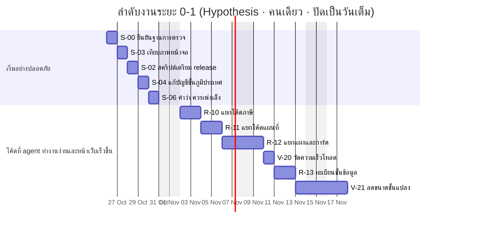

# แผนลงมือ: ศิลาสำหรับนักพัฒนาและ AI coding agent

> ฉบับ 1 · 2026-10-21 · ไซต์ revision 2.0.2 (ฐาน 2.0.1 commit `4b32208`) · สร้างจาก `tools/handoff/` ห้ามแก้ไฟล์นี้ด้วยมือ · วันประมาณทั้งหมดเป็น Hypothesis

## หลักการทำงาน

- หนึ่งงานเท่ากับหนึ่ง branch และหนึ่ง pull request ไม่รวมงานอื่นเข้ามา
- เริ่มทุกงานด้วยการอ่าน AGENTS.md และไฟล์ใน readFirst ของงาน แล้ววางพรอมป์ของงานให้ agent
- รันคำสั่งใน verify ก่อนและหลังแก้ แนบสรุปผลใน pull request ไม่เรียกว่าเสร็จจนกว่าเกณฑ์รับงานผ่านทุกข้อ
- งานที่ผูกกับคำตัดสินของเจ้าของ (ownerDecision) เริ่มได้เมื่อคำตัดสินบันทึกแล้วเท่านั้น
- งานที่แตะหน้าตาต้องพิสูจน์ด้วยการเทียบภาพหน้าจอ (S-03) ว่าเปลี่ยนเฉพาะที่ตั้งใจ
- เมื่อสถานะงานหรือคำตัดสินเปลี่ยน ให้แก้ tools/handoff/plan_data.py แล้ว build ใหม่ ไม่แก้ JSON หรือ Markdown ที่สร้างแล้วด้วยมือ

## ลำดับงาน



งานที่รอคำตัดสินหรือข้อมูลไม่มีวันที่ในแผนภาพ เพราะเริ่มเมื่อสิ่งที่รอมาถึง

| ID | งาน | รอ | ขึ้นกับ |
|---|---|---|---|
| S-01 | ตรวจทุก pull request อัตโนมัติด้วย GitHub Actions | D-15 | S-00 |
| S-05 | เอาลิงก์ Google Drive ของข้อมูลดิบออกจากไฟล์สาธารณะ (ถ้าเจ้าของเลือกตาม D-19) | D-19 | S-00 |
| F-30 | เผยแพร่ชั้นที่ลุ่มปิดล้อมหลังเจ้าของตรวจ | D-06 | S-00 |
| F-31 | ภาพจำลองระดับน้ำรายจุด (ถ้าเจ้าของอนุมัติและได้ข้อมูล) | D-07, DR-05, DR-08 | S-00 |
| F-32 | บันทึกผลอนุมัติไอคอน 11 ตัว หรือเปลี่ยนตามที่เจ้าของเลือก | D-08 | S-00 |
| F-33 | ซ่อนลิงก์ Street View ที่ไม่มีภาพ ด้วยไฟล์ตรวจล่วงหน้า | D-10 | S-00 |
| F-34 | รีเฟรชข้อมูลภาษีด้วย ภ.ด.ส.3 ปีปัจจุบัน โดยรหัสเจ้าของคงเดิม | DR-01 | S-00 |

## เกณฑ์ผ่านแต่ละระยะ

| Gate | ระยะ | ต้องเสร็จ | ไม่ต้องรอให้เสร็จ | เกณฑ์ | ผู้รับรอง |
|---|---|---|---|---|---|
| G0 | phase-0 | S-00, S-03 | S-01, S-02, S-04, S-05, S-06 | sh qa/run-unit-checks.sh: 7 of 7 Node checks pass and expected figures current; run_matrix.py: 36 cases all ready, 0 page errors (same-origin HTTP errors included), 0 sideways scroll, 0 legend over the map, 8 of 8 flows; run_a11y.py: 34 views all ready, 0 violations; run_overflow.py: 0 bad runs of 112; publication-audit.py: pass with nothing in notScanned; gen-manifest.py --check: current; build_handoff.py --check: pass; compare_shots.py reports 0 changes when a folder is compared with itself | developer runs the checks; owner reviews the S-00 pull request |
| G1 | phase-1 | R-10, R-11, R-12, V-20 | R-13, V-21 | sh qa/run-unit-checks.sh: 7 of 7 Node checks pass and expected figures current; run_matrix.py: 36 cases all ready, 0 page errors (same-origin HTTP errors included), 0 sideways scroll, 0 legend over the map, 8 of 8 flows; run_a11y.py: 34 views all ready, 0 violations; run_overflow.py: 0 bad runs of 112; publication-audit.py: pass with nothing in notScanned; gen-manifest.py --check: current; build_handoff.py --check: pass; screenshot comparison against main: 0 non-terrain images over threshold; app.js at most 1,200 lines; no new window globals except SilaApp; a performance receipt exists for the throttled phone profile | owner, after looking at the live site on a phone and a desktop |
| G2 | phase-2 | — | F-30, F-31, F-32, F-33, F-34, F-35 | the task's owner decision is recorded with VERBATIM words and a date; public risk content has a human review receipt in qa/ (SAFE-01); publication audit passes; baseline criteria still hold | owner, per task |
| G3 | phase-3 | X-50 | — | owner-reviewed design of the production path: the CityChat port package, decisions recorded 2026-10-22 (D-12); officer login, roles and access logs are built and tested in CityChat, outside this repository; this public prototype keeps its per-parcel layers by owner decision D-12 | owner |

## งานทั้งหมด

| ID | งาน | ระยะ | สำคัญ | วัน (Hyp.) | ขึ้นกับ | แก้ปัญหา | คำตัดสิน | สถานะ |
|---|---|---|---|---|---|---|---|---|
| S-00 | ตั้งเครื่องและยืนยันว่าการตรวจทั้งหมดผ่านก่อนแก้โค้ด | phase-0 | high | 0.5 | — | P-03 | — | todo |
| S-01 | ตรวจทุก pull request อัตโนมัติด้วย GitHub Actions | phase-0 | medium | 1 | S-00 | P-03 | D-15 | blocked |
| S-02 | สคริปต์เตรียม release: ขยับ cache key สร้าง manifest และตรวจก่อน push | phase-0 | medium | 1 | S-00 | P-05 | — | todo |
| S-03 | เทียบภาพหน้าจอก่อนและหลังแก้ เพื่อพิสูจน์ว่าหน้าตาไม่เปลี่ยน | phase-0 | high | 1 | S-00 | P-01 | — | todo |
| S-04 | แก้คำอธิบายชั้นภูมิประเทศใน data/catalog.json ให้ตรงกับที่หน้าเว็บแสดง | phase-0 | low | 0.5 | S-00 | P-16 | — | todo |
| S-05 | เอาลิงก์ Google Drive ของข้อมูลดิบออกจากไฟล์สาธารณะ (ถ้าเจ้าของเลือกตาม D-19) | phase-0 | low | 0.5 | S-00 | P-17 | D-19 | blocked |
| S-06 | เปลี่ยนคำว่า 'ควรเพ่งเล็ง' เป็น 'ควรติดตาม' ให้ตรงกับภาษาอังกฤษที่เป็นกลาง | phase-0 | low | 0.5 | S-00 | P-18 | — | todo |
| R-10 | ย้ายโค้ดงานภาษีออกจาก app.js โดยหน้าตาและตัวเลขไม่เปลี่ยน | phase-1 | high | 2 | S-03 | P-01 | — | todo |
| R-11 | ย้ายโค้ดวาดแผนที่ออกจาก app.js | phase-1 | high | 1.5 | R-10 | P-01 | — | todo |
| R-12 | ย้ายแผงข้อมูล การ์ด และ popup ออกจาก app.js ให้ app.js เหลือแค่ตัวเริ่มระบบ | phase-1 | high | 1.5 | R-11 | P-01 | — | todo |
| R-13 | ทะเบียนชั้นข้อมูล: เพิ่มชั้นใหม่ด้วยการลงทะเบียนที่เดียว | phase-1 | medium | 2 | R-12 | P-01 | — | todo |
| V-20 | วัดความเร็วโหลดบนมือถือจำลองก่อนลดขนาดข้อมูล | phase-1 | high | 0.5 | S-00 | P-02 | — | todo |
| V-21 | ลดขนาดชั้นแปลงที่ดินให้แผนที่ภาษีขึ้นตัวเลขเร็วขึ้น | phase-1 | medium | 3 | V-20, R-11 | P-02 | — | todo |
| F-30 | เผยแพร่ชั้นที่ลุ่มปิดล้อมหลังเจ้าของตรวจ | phase-2 | medium | 1 | S-00 | P-06 | D-06 | blocked |
| F-31 | ภาพจำลองระดับน้ำรายจุด (ถ้าเจ้าของอนุมัติและได้ข้อมูล) | phase-2 | low | 2 | S-00 | P-06 | D-07 | blocked |
| F-32 | บันทึกผลอนุมัติไอคอน 11 ตัว หรือเปลี่ยนตามที่เจ้าของเลือก | phase-2 | low | 0.5 | S-00 | P-07 | D-08 | blocked |
| F-33 | ซ่อนลิงก์ Street View ที่ไม่มีภาพ ด้วยไฟล์ตรวจล่วงหน้า | phase-2 | medium | 1 | S-00 | P-08 | D-10 | blocked |
| F-34 | รีเฟรชข้อมูลภาษีด้วย ภ.ด.ส.3 ปีปัจจุบัน โดยรหัสเจ้าของคงเดิม | phase-2 | high | 2 | S-00 | P-09, P-10 | D-11 | blocked |
| F-35 | บันทึกคำตัดสิน D-14 ในสัญญาแผนที่ดาวเทียม (คงภาพ Google แบบเดิม) | phase-2 | medium | 0.5 | S-00 | P-11 | D-14 | todo |
| X-50 | ออกแบบเส้นทางสู่ระบบจริง: เข้าสู่ระบบเจ้าหน้าที่ สิทธิ์ตามบทบาท และบันทึกการเข้าถึง | phase-3 | medium | 3 | — | P-12, P-14 | D-12 | done |

## วิธีใช้กับ vibe coding

1. เลือกงานที่สถานะ todo และงานที่ขึ้นกับเสร็จแล้ว: `python3 tools/handoff/task.py` แสดงรายการ และ `python3 tools/handoff/task.py R-10` พิมพ์ brief ของงานนั้นพร้อมวางให้ agent
2. สร้าง branch ชื่อ ID-คำสั้น (เช่น S-03-compare-shots) แล้วเปิด agent ในโฟลเดอร์ repository (Claude Code อ่าน CLAUDE.md ซึ่งนำเข้า AGENTS.md; Codex และ Cursor อ่าน AGENTS.md)
3. วางพรอมป์ของงาน (ช่อง prompt) ให้ agent ทั้งก้อน ถ้า agent ถามเรื่องนอกขอบเขต ให้ตอบว่าทำเฉพาะงานนี้
4. ให้ agent รันคำสั่งใน verify และเทียบกับ acceptance ทีละข้อ อ่านผลเองก่อนเชื่อสรุปของ agent
5. เปิด pull request แนบผลตรวจ เจ้าของงานตรวจและ merge แล้วตามขั้นตอนออก release ใน HANDOFF.md
6. อัปเดตสถานะงานใน tools/handoff/plan_data.py แล้วรัน python3 tools/handoff/build_handoff.py และ --check

## คำตัดสินของเจ้าของ

| ID | สถานะ | คำถาม | ทางเลือก | ข้อเสนอแนะ | ขวางงาน |
|---|---|---|---|---|---|
| D-01 | decided | ส่วนเพิ่มของแต่ละแปลงคิดเทียบกับอะไร (ข้อ 15 ในคำขอ 20 ต.ค. 2569) | 1: ยอดที่เรียกเก็บปี 2569 ของแปลงนั้น (ภ.ด.ส.7) / 2: ภาษีตามกฎหมายที่เครื่องคำนวณจากข้อมูลเดียวกัน (ฐานของรุ่น 1.9) | 1 | — |
| D-02 | decided | amCharts, คีย์ Google Maps สำหรับตรวจ Street View และข้อมูลน้ำท่วม (สามคำถาม 20 ต.ค. 2569) | เจ้าของเลือกเองทีละข้อ / ไม่มีความชอบ ให้ผู้เขียนเลือก | ผู้เขียนเสนอทางที่เสี่ยงน้อยที่สุดของแต่ละข้อ | — |
| D-03 | decided | หน้าเว็บสาธารณะแสดงอะไรจากข้อมูลภาษีได้บ้าง | ยอดรวมเท่านั้น / ข้อมูลรายแปลงโดยไม่มีชื่อ | ไม่มี (บันทึกคำตัดสินเดิม) | — |
| D-04 | decided | ไอคอนสำหรับ 12 บทบาท (Street View, Google AI Mode, ธุรกิจ, ทรัพย์สิน, เครื่องคิดภาษี, CSV, ค้นหา, ชั้นข้อมูล, ต้องตรวจ, ผ่าน, รอข้อมูล, พอดีพื้นที่) | อนุมัติชุดที่เสนอ / เปลี่ยนบางตัว | ไม่มี (บันทึกคำตัดสินเดิม) | — |
| D-05 | decided | ขอบเขตของรุ่น 2.0 | คำขอ 16 ข้อจากการทดสอบบนมือถือและแท็บเล็ตของเจ้าของงาน | ไม่มี (บันทึกคำตัดสินเดิม) | — |
| D-06 | open | เผยแพร่ชั้นที่ลุ่มปิดล้อม (417 แอ่งจาก FABDEM) บนเว็บสาธารณะหรือไม่ | เผยแพร่หลังดูภาพ พร้อมข้อความกำกับและบันทึกการตรวจ / เก็บไว้ใช้ภายใน (มุมมองเจ้าหน้าที่เมื่อมีระบบเข้าสู่ระบบ) / ไม่ใช้ | ดูร่างก่อน (สร้างใหม่ได้ด้วย tools/flood/) ถ้าเผยแพร่ ให้คงข้อความในคำอธิบายสีว่า 'บอกว่าน้ำขังได้ตรงไหน ไม่ใช่การพยากรณ์น้ำท่วม' และบันทึกการตรวจไว้ใน qa/ | F-30 |
| D-07 | open | เผยแพร่ภาพจำลองระดับน้ำ 10–50 ซม. รายจุดจากรายงานศึกษาหรือไม่ | เผยแพร่รายจุดพร้อมวิธีและข้อจำกัดของรายงาน / เก็บไว้ในรายงานศึกษาเท่านั้น | เก็บไว้ในรายงานก่อน จนกว่าจะมีตำแหน่งที่ตรวจในพื้นที่ของจุดตัวแทน (DR-05) | F-31 |
| D-08 | open | อนุมัติไอคอนใหม่ 11 ตัวของรุ่น 2.0 หรือไม่ | อนุมัติทั้งหมด / อนุมัติบางตัวและเปลี่ยนที่เหลือ / เปลี่ยนทั้งหมด | ดูบนเว็บจริงทั้งพื้นสว่างและมืด แล้วอนุมัติหรือระบุตัวที่ต้องการแทน | F-32 |
| D-09 | decided | ใบอนุญาต amCharts: ใช้แบบฟรีที่ต้องคงโลโก้ ซื้อแบบเชิงพาณิชย์ หรือเปลี่ยนเป็นกราฟของเราเอง | ใช้แบบฟรีและคงโลโก้ / ซื้อใบอนุญาตเชิงพาณิชย์ / เปลี่ยนเป็นกราฟ SVG ของเราเอง | ใช้แบบฟรีสำหรับต้นแบบ และตัดสินก่อนนำไปใช้เชิงพาณิชย์ | — |
| D-10 | open | ตรวจล่วงหน้าว่าตรงไหนมีภาพ Street View ด้วยคีย์ Google Maps หรือไม่ | รัน tools/streetview-coverage.py หนึ่งครั้งโดยใส่คีย์ในตัวแปรสภาพแวดล้อม / ปล่อยให้ไม่รู้ต่อไป (พฤติกรรมปัจจุบัน) | รันหนึ่งครั้ง เครื่องมือขอเฉพาะข้อมูลว่ามีภาพหรือไม่ ไม่ดึงภาพ ตรวจเงื่อนไขล่าสุดของ Google ก่อนรัน | F-33 |
| D-11 | decided | เก็บ pipeline ข้อมูลและตารางรหัสเจ้าของพร้อม salt ไว้ที่ใด | โฟลเดอร์ Google Drive ที่จำกัดสิทธิ์ (เจ้าของคนเดียว) / Git repository ส่วนตัว / เครื่องคอมพิวเตอร์ของเจ้าของงาน | ที่ที่เจ้าของเท่านั้นเข้าได้ ไม่ใช่ repository สาธารณะนี้ และเขียนไว้ว่าใครมีสิทธิ์รีเฟรชข้อมูล | F-34 |
| D-12 | decided | เส้นทางสู่ระบบจริง: คงเว็บสาธารณะแบบนี้ หรือย้ายข้อมูลรายแปลงและรายเจ้าของไปหลังการเข้าสู่ระบบของเจ้าหน้าที่ | คงต้นแบบสาธารณะแบบนี้ / สาธารณะเห็นยอดรวม เจ้าหน้าที่เข้าสู่ระบบเพื่อดูรายแปลงและรายเจ้าของ (สิทธิ์ตามบทบาท และบันทึกการเข้าถึง) / เว็บสำหรับเจ้าหน้าที่เท่านั้น | สาธารณะเห็นยอดรวม เจ้าหน้าที่เข้าสู่ระบบ ก่อนขยายการใช้ ตาม CityChat Product Brief v4 Appendix C | X-50 |
| D-13 | decided | งานภาษีอยู่ใต้ป้ายผลิตภัณฑ์ใด | คงชื่อ 'CityChat · CityMETER for Organization' / ระบุเป็น Land/property tools บนฐาน CityMETER / เจ้าของแก้ MBB section 5.1 หรือ CityChat Product Brief | ให้เจ้าของตัดสิน ระหว่างนี้เรียกไซต์ว่า 'แผนที่งานเจ้าหน้าที่' และไม่นำการประมาณการภาษีไปพูดเป็นความสามารถของ CityChat ในงานอื่น | — |
| D-14 | decided | แผนที่ดาวเทียม: ใช้ URL tile ของ Google ที่สืบทอดจาก CityChat ต่อ หรือเปลี่ยนเป็นแหล่งที่มีใบอนุญาตชัดเจน | ใช้ต่อ (ยังไม่ยืนยันใบอนุญาต) / ตั้งค่าเริ่มต้นเป็นภาพ EOX ปี 2016 ที่มีอยู่แล้ว (CC BY 4.0 ละเอียดน้อยกว่า) / ผู้ให้บริการที่มีใบอนุญาตผ่าน backend ของระบบจริง (ไม่มีคีย์ในหน้าเว็บ) | ตั้งค่าเริ่มต้นเป็นภาพ EOX ตอนนี้ แล้ววางแผนผู้ให้บริการที่มีใบอนุญาตพร้อมเส้นทางสู่ระบบจริง | F-35 |
| D-15 | open | เปิด GitHub Actions ตรวจ pull request หรือไม่ | เปิด: ตรวจอย่างเดียว ไม่ deploy ไม่มี secret / ไม่เปิด | เปิด | S-01 |
| D-16 | open | ยืนยันสถานะ Master Brand Brief v0.5.3 | อนุมัติแล้ว: บันทึกการอนุมัติใน section 0.3 / ใช้เป็นแนวทางฉบับร่างเท่านั้น | บันทึกการอนุมัติ เพื่อให้ลำดับอำนาจมีหลักฐานในเอกสาร | — |
| D-17 | decided | เผยแพร่ชุดส่งต่องานรุ่น 2.0.2 ขึ้น montri-th/sila อย่างไร | push ขึ้น main ตรง แล้วตรวจ Pages และไฟล์ทุกไฟล์กับ manifest / push ไป branch แล้วเปิด pull request ให้เจ้าของตรวจและ merge (ตาม GIT-01) / ยังไม่เผยแพร่ | pull request: เป็นข้อความสาธารณะชุดแรกของแพ็กเกจ เจ้าของได้ดู diff ก่อนขึ้นเว็บ และตรงกับ GIT-01 ที่แพ็กเกจนี้วางไว้ให้ทุกงานถัดไป | — |
| D-18 | open | รหัสระเบียนภายในของบัญชีภาษีหนึ่งรหัสยังอยู่ในประวัติ git สาธารณะ (commit ก่อน 2.0.2) จะทำอย่างไร | คงประวัติไว้ตาม GIT-01: เป็นรหัสภายในหนึ่งรหัส ไม่มีชื่อ เลขบัตร หรือที่อยู่ / เขียนประวัติใหม่: ต้องยกเว้น GIT-01 ชั่วคราว ทุกสำเนาต้อง clone ใหม่ และ GitHub อาจยังเก็บสำเนาเก่าไว้ | คงประวัติไว้ และไม่ใส่รหัสภายในในไฟล์สาธารณะอีก (การตรวจข้อมูลส่วนบุคคลจับแล้ว) | — |
| D-19 | open | ลิงก์ Google Drive ของข้อมูลดิบในไฟล์สาธารณะ (19 รายการ) จะคงไว้หรือเอาออก | คงไว้ แล้วตรวจสิทธิ์ทุกครั้งที่ release แก้ลิงก์ / เอา URL ออกจากไฟล์สาธารณะ เหลือชื่อแหล่งและวันที่ส่ง | เอา URL ออก: คนทั่วไปและเจ้าหน้าที่เทศบาลเปิดรายการเหล่านี้ไม่ได้อยู่แล้ว ลิงก์จึงไม่ช่วยผู้ใช้ แต่ถ้าวันหนึ่งสิทธิ์ใน Drive เปลี่ยน ลิงก์บนเว็บสาธารณะจะพาไปถึงข้อมูลดิบ | S-05 |

### บันทึกคำตัดสินที่มีแล้ว

**D-01 · ส่วนเพิ่มของแต่ละแปลงคิดเทียบกับอะไร (ข้อ 15 ในคำขอ 20 ต.ค. 2569)**

- คำของเจ้าของ (VERBATIM): "1 ครับ ส่วนอัตราสะสม ถ้าเก็บ 0.6% ในปี 69 ตามพรบ มันน่าจะเริ่มไม่ทำประโยชน์ตั้งแต่ปีไหนน่าจะคำนวณย้อนกลับได้นะ"
- เมื่อ: 2026-10-20 · ผู้ตัดสิน: เจ้าของงาน · มอบให้ผู้เขียนเลือก: ไม่
- สิ่งที่เปลี่ยน: คิดส่วนเพิ่มของแต่ละโฉนดเทียบกับยอดที่เรียกเก็บปี 2569 (ภ.ด.ส.7) ถ้าบัญชีเรียกเก็บต่ำกว่าภาษีตามกฎหมาย ส่วนต่างแยกเป็นรายการต้องตรวจ (ต่ำกว่า 100 บาทต่อโฉนดไม่นับ) ถ้าบัญชีสูงกว่า แสดงแยกโดยไม่หัก และอ่านจำนวนปีที่ทิ้งว่างย้อนจากอัตราที่เรียกเก็บ (0.6% หมายถึงทิ้งว่าง 4–6 ปี เริ่มราว 2564–2566 และจะเป็น 0.9% ระหว่าง 2570–2572)
- ผลในโค้ดหรือเอกสาร: tax-engine.js 2.0.0 (ฐานเปรียบเทียบ การจัดสรรให้ข้อเสนอ กลุ่ม rollBelow รายการ rollAbove และ vacancyFromRoll); reference/tax-map-method.md หัวข้อ 'รุ่น 2.0'
- ทางเลือกที่ไม่ใช้: 2: ใช้ภาษีตามกฎหมายที่เครื่องคำนวณเป็นฐาน (รุ่น 1.9) เพราะทำให้ส่วนเพิ่มสูงเกินจริง เมืองไม่ได้เรียกเก็บแบบนั้น
- ความเสี่ยงที่เหลือ: เจ้าของยังมาจากบัญชี ภ.ด.ส.3 ปี 2563 (P-09)
- ที่มา: บทสนทนางาน 2026-10-20; reference/tax-map-method.md

**D-02 · amCharts, คีย์ Google Maps สำหรับตรวจ Street View และข้อมูลน้ำท่วม (สามคำถาม 20 ต.ค. 2569)**

- คำของเจ้าของ (RECONSTRUCTED): ไม่มีถ้อยคำตรงในเอกสารนี้ (ดูที่มา)
- เมื่อ: 2026-10-20 · ผู้ตัดสิน: เจ้าของงาน (เลือกตัวเลือก 'ไม่มีความชอบ' ในแบบถาม จึงมอบให้ผู้เขียนเลือก) · มอบให้ผู้เขียนเลือก: ใช่
- สิ่งที่เปลี่ยน: ผู้เขียนเลือก: ใช้ amCharts 5 แบบฟรีโดยคงโลโก้ amCharts และรวมไว้ใน vendor/amcharts5; ลิงก์ Street View เรียงหมุดแผนที่ก่อน แล้วภาพถนนหันหน้าเข้าแปลงพร้อมคำว่า 'ถ้ามีภาพ' และมีเครื่องมือตรวจล่วงหน้าที่อ่านคีย์จากตัวแปรสภาพแวดล้อมเท่านั้น; น้ำท่วม เผยแพร่จุดศึกษา 16 จุดพร้อมสถานะพิกัด และยังไม่เผยแพร่ภาพจำลองระดับน้ำกับร่างที่ลุ่มปิดล้อมจนกว่าเจ้าของจะตรวจ
- ผลในโค้ดหรือเอกสาร: vendor/amcharts5/*, sila-charts.js, app.js streetView(), tools/streetview-coverage.py, data/flood-sites.geojson
- ทางเลือกที่ไม่ใช้: ซื้อ amCharts แบบเชิงพาณิชย์: เป็นการตัดสินเรื่องค่าใช้จ่ายของเจ้าของ (D-09); เขียนกราฟ SVG เอง: งานมากกว่าแต่ได้ภาพเท่าเดิม; เผยแพร่ภาพจำลองพร้อมจุด: ต้องให้คนตรวจก่อน (SAFE-01)
- ความเสี่ยงที่เหลือ: ใบอนุญาต amCharts สำหรับการใช้กว้างขึ้นหรือเชิงพาณิชย์ (D-09); ไม่รู้ว่าตรงไหนมีภาพ Street View จนกว่าจะมีคีย์ (D-10)
- ที่มา: คำตอบในแบบถาม บทสนทนางาน 2026-10-20

**D-03 · หน้าเว็บสาธารณะแสดงอะไรจากข้อมูลภาษีได้บ้าง**

- คำของเจ้าของ (RECONSTRUCTED): ไม่มีถ้อยคำตรงในเอกสารนี้ (ดูที่มา)
- เมื่อ: 2026-10-20 หรือก่อนหน้า (รายการ VAT ลงวันที่ 20 ต.ค. 2569 ใน receipt) · ผู้ตัดสิน: เจ้าของงาน · มอบให้ผู้เขียนเลือก: ไม่
- สิ่งที่เปลี่ยน: เผยแพร่ตามที่เจ้าของงานอนุญาต: ภาษีปี 2569 และภาพปี 2570 รายแปลง; แผนการเจรจา เกษตรราคาสูง และอันดับเจ้าของที่สร้างจากข้อมูลรายแปลงชุดเดียวกัน; พอร์ตรายเจ้าของและทรัพย์สินแปลงติดกันโดยไม่มีชื่อ (รหัสสุ่ม T-XXXXXX เจ้าของจากบัญชี ภ.ด.ส.3 ปี 2563 สมมติว่ายังไม่เปลี่ยน); สถานะการชำระเฉพาะโฉนดที่ผูกกับบัญชีลูกหนี้; รหัสแปลงในแผนที่ภาษี; และนิติบุคคลที่จดทะเบียน VAT ทุกรายที่วางบนแผนที่ได้ (ไม่เผยแพร่บุคคลธรรมดา)
- ผลในโค้ดหรือเอกสาร: qa/revision-2.0-publication-audit.json publishedByOwnerPermission
- ทางเลือกที่ไม่ใช้: เผยแพร่ผู้จดทะเบียน VAT ที่เป็นบุคคลธรรมดา; เผยแพร่ชื่อเจ้าของ
- ความเสี่ยงที่เหลือ: ข้อมูลรายแปลงบนเว็บสาธารณะขัดกับ CityChat Product Brief v4 Appendix C (P-12, D-12)
- ที่มา: qa/revision-2.0-publication-audit.json

**D-04 · ไอคอนสำหรับ 12 บทบาท (Street View, Google AI Mode, ธุรกิจ, ทรัพย์สิน, เครื่องคิดภาษี, CSV, ค้นหา, ชั้นข้อมูล, ต้องตรวจ, ผ่าน, รอข้อมูล, พอดีพื้นที่)**

- คำของเจ้าของ (RECONSTRUCTED): ไม่มีถ้อยคำตรงในเอกสารนี้ (ดูที่มา)
- เมื่อ: 2026-10-20T16:50+07:00 · ผู้ตัดสิน: เจ้าของงาน · มอบให้ผู้เขียนเลือก: ไม่
- สิ่งที่เปลี่ยน: เจ้าของงานอนุมัติไอคอนครบ 12 บทบาทเมื่อ 20 ต.ค. 2569 เวลา 16:50 โดยเป็นไอคอนใหม่ 9 ตัว
- ผลในโค้ดหรือเอกสาร: reference/ui-icons.manifest.json authority.ownerApproval20261020; ui-icons.js 1.1.0
- ทางเลือกที่ไม่ใช้: —
- ความเสี่ยงที่เหลือ: ไอคอนอีก 11 ตัวของรุ่น 2.0 ยังรออนุมัติ (D-08)
- ที่มา: reference/ui-icons.manifest.json

**D-05 · ขอบเขตของรุ่น 2.0**

- คำของเจ้าของ (RECONSTRUCTED): "สรุป 16 ข้อ: 1 ภ.ด.ส.3 ปีปัจจุบันพร้อมรหัสผู้เสียภาษี (ขอแล้ว ยังไม่ได้รับ); 2 อันดับ 1–10 ใช้ได้; 3 ทดสอบบนมือถือและแท็บเล็ต; 4 คำอธิบายสีบังแผนที่ ให้ย้ายสิ่งที่ไม่จำเป็นออก; 5 เห็น AHA ตั้งแต่หน้าแรก; 6 แผนที่ติดตามแปลงเกษตรราคาประเมินสูง; 7 เจ้าของเรียงตามมูลค่าประเมินรวม เลือกเจ้าของแล้วเห็นทุกแปลง; 8 ภาษาสั้น สะอาด คำอธิบายอยู่อีกชั้น; 9 งาน 5 กลุ่มพร้อมไอคอน และแผนที่ใหญ่ที่สุด; 10 ใช้กราฟแทนข้อความ; 11 แผนที่เจรจาตามกลุ่มข้อเสนอ; 12 ที่ลุ่มที่น้ำอาจขังและรายงานศึกษาที่แนบ; 13 Street View เปิดแล้วดำ; 14 ตัวเลขใหญ่ชัด ตรวจ LDS อีกครั้ง; 15 คิดเทียบยอดเรียกเก็บปี 2569 ก่อนใช้เจ้าของปี 2563; 16 แยกสัตว์เลี้ยงออกจากกลุ่มเปราะบาง"
- เมื่อ: 2026-10-20T21:41+07:00 · ผู้ตัดสิน: เจ้าของงาน · มอบให้ผู้เขียนเลือก: ไม่
- สิ่งที่เปลี่ยน: รุ่น 2.0 และ 2.0.1 ตอบคำขอ 16 ข้อ: ทำแล้ว 13 ข้อ; ข้อ 1 (ภ.ด.ส.3 ปีปัจจุบันพร้อมรหัสผู้เสียภาษี) รอข้อมูลจากเทศบาล; ข้อ 12 เผยแพร่จุดศึกษาน้ำท่วม 16 จุดแล้ว แต่ชั้นที่ลุ่มปิดล้อมยังไม่เผยแพร่จนกว่าเจ้าของจะตรวจ (D-06); ข้อ 13 ลดปัญหาด้วยการเรียงหมุดแผนที่ก่อนและคำว่า 'ถ้ามีภาพ' แต่ยังไม่รู้ว่าตรงไหนมีภาพ Street View (D-10)
- ผลในโค้ดหรือเอกสาร: รุ่น 2.0 (commit 4f48ecf) และรุ่นย่อย 2.0.1
- ทางเลือกที่ไม่ใช้: —
- ความเสี่ยงที่เหลือ: ข้อ 1 รอข้อมูล (DR-01); ข้อ 12 รอ D-06; ข้อ 13 รอ D-10
- ที่มา: บทสนทนางาน 2026-10-20 (สรุปโดยผู้เขียน ไม่ใช่ถ้อยคำของเจ้าของ)

**D-09 · ใบอนุญาต amCharts: ใช้แบบฟรีที่ต้องคงโลโก้ ซื้อแบบเชิงพาณิชย์ หรือเปลี่ยนเป็นกราฟของเราเอง**

- คำของเจ้าของ (VERBATIM): "ได้"
- เมื่อ: 2026-10-22 · ผู้ตัดสิน: เจ้าของงาน · มอบให้ผู้เขียนเลือก: ไม่
- สิ่งที่เปลี่ยน: ใช้ amCharts 5 แบบฟรีและคงโลโก้ amCharts (ทางเลือกแรก) ทั้งในต้นแบบนี้และในระบบจริงของ CityChat · ใบอนุญาตแบบฟรีใน vendor/amcharts5/LICENSE.md ให้ใช้ในงานเชิงพาณิชย์ได้ ถ้าไม่ซ่อนหรือแก้ลิงก์แบรนด์
- ผลในโค้ดหรือเอกสาร: vendor/amcharts5 และ sila-charts.js คงเดิม โลโก้ amCharts ต้องเห็นในทุกกราฟ
- ทางเลือกที่ไม่ใช้: ซื้อใบอนุญาตเชิงพาณิชย์: จำเป็นเฉพาะเมื่อจะเอาโลโก้ออก; เขียนกราฟ SVG เอง: งานมากกว่าแต่ได้ภาพเท่าเดิม
- ความเสี่ยงที่เหลือ: ถ้าภายหลังต้องเอาโลโก้ออก ต้องซื้อใบอนุญาตเชิงพาณิชย์ ซึ่งเป็นคำตัดสินใหม่
- ที่มา: คำตอบ 'ได้' ของเจ้าของต่อคำถามเรื่องใบอนุญาตภาพดาวเทียม amCharts และ FABDEM ในชุดส่งต่องานพอร์ตหน้าเจ้าหน้าที่เข้า CityChat (เอกสารภายใน) 2026-10-22 และคำตอบ 'ใช่' ให้บันทึกคำตัดสินนี้ใน repository นี้ วันเดียวกัน; vendor/amcharts5/LICENSE.md

**D-11 · เก็บ pipeline ข้อมูลและตารางรหัสเจ้าของพร้อม salt ไว้ที่ใด**

- คำของเจ้าของ (RECONSTRUCTED): ไม่มีถ้อยคำตรงในเอกสารนี้ (ดูที่มา)
- เมื่อ: 2026-10-21 · ผู้ตัดสิน: เจ้าของงาน · มอบให้ผู้เขียนเลือก: ไม่
- สิ่งที่เปลี่ยน: เก็บ pipeline ตารางรหัสเจ้าของ และ salt เป็นไฟล์ archive เดียวบนเครื่องคอมพิวเตอร์ของเจ้าของงาน ส่งแล้วเมื่อ 2026-10-21 และตรวจ SHA-256 บนเครื่องปลายทางตรงกับต้นฉบับ ไม่มีสิ่งใดจาก archive นี้อยู่ใน repository
- ผลในโค้ดหรือเอกสาร: งาน F-34 ทำบนเครื่องของเจ้าของ หรือเครื่องที่เจ้าของส่ง archive ให้; ไม่มีไฟล์ใน repository เปลี่ยน
- ทางเลือกที่ไม่ใช้: โฟลเดอร์ Google Drive ที่จำกัดสิทธิ์; Git repository ส่วนตัว
- ความเสี่ยงที่เหลือ: มีสำเนาเดียวบนเครื่องเดียว ถ้าหายรหัสเจ้าของจะไม่ต่อเนื่อง: ควรทำสำเนาสำรองแบบเข้ารหัส และไม่ sync โฟลเดอร์นี้ขึ้นบริการ cloud ที่แชร์
- ที่มา: คำตอบในแบบถาม บทสนทนางาน 2026-10-21 (ถ้อยคำตรงระบุตำแหน่งที่เก็บ จึงอยู่ในบันทึกส่วนตัวของเจ้าของ ไม่เผยแพร่ใน repository สาธารณะ); P-10

**D-12 · เส้นทางสู่ระบบจริง: คงเว็บสาธารณะแบบนี้ หรือย้ายข้อมูลรายแปลงและรายเจ้าของไปหลังการเข้าสู่ระบบของเจ้าหน้าที่**

- คำของเจ้าของ (VERBATIM): "คงไว้"
- เมื่อ: 2026-10-22 · ผู้ตัดสิน: เจ้าของงาน · มอบให้ผู้เขียนเลือก: ไม่
- สิ่งที่เปลี่ยน: คงเว็บต้นแบบสาธารณะนี้ตามเดิม (ทางเลือกแรก) รวมข้อมูลภาษีรายแปลงที่เผยแพร่ตาม D-03 · ระบบสำหรับเจ้าหน้าที่ทำในระบบ CityChat ซึ่งข้อมูลภาษีรายแปลงเห็นได้เฉพาะเจ้าหน้าที่ ทม.ศิลา 1+4 คนที่เจ้าของระบุ พร้อมบันทึกการเข้าถึง
- ผลในโค้ดหรือเอกสาร: งาน X-51 (เอาข้อมูลรายแปลงออกจากเว็บสาธารณะ) ออกจากแผน · งาน X-50 เสร็จ: แบบเส้นทางสู่ระบบจริงคือชุดส่งต่องานพอร์ตเข้า CityChat ซึ่งเจ้าของตรวจและตัดสินแล้ว และเก็บนอก repository สาธารณะนี้เพราะมีรายละเอียดของระบบจริง · ผู้เห็นข้อมูลภาษีในระบบจริงมาจากคำตอบ 'เจ้าหน้าที่ 1+4 คน' ของเจ้าของ (VERBATIM, 2026-10-22)
- ทางเลือกที่ไม่ใช้: สาธารณะเห็นยอดรวม และย้ายข้อมูลรายแปลงไปหลังการเข้าสู่ระบบ (ข้อเสนอของผู้เขียน); เว็บสำหรับเจ้าหน้าที่เท่านั้น
- ความเสี่ยงที่เหลือ: ข้อมูลรายแปลงบนเว็บสาธารณะอาจสืบกลับถึงเจ้าของได้ผ่านข้อมูลที่ดิน (Inference, P-12)
- ที่มา: คำตอบของเจ้าของ 2026-10-22 ต่อคำถาม 'จะให้ปิดชั้นรายแปลงให้เหลือแค่ยอดรวม หรือคงไว้เป็นต้นแบบต่อ'; P-12, P-14

**D-13 · งานภาษีอยู่ใต้ป้ายผลิตภัณฑ์ใด**

- คำของเจ้าของ (VERBATIM): "แบ่ง 5 งาน ตาม V2.0.2 อยู่ใต้งานภาษี"
- เมื่อ: 2026-10-22 · ผู้ตัดสิน: เจ้าของงาน · มอบให้ผู้เขียนเลือก: ไม่
- สิ่งที่เปลี่ยน: คงชื่อ 'CityChat · CityMETER for Organization' และให้งานภาษีเป็นหนึ่งใน 5 งานแบบรุ่น 2.0.2 (ทางเลือกแรก) · เจ้าของสั่งให้บันทึกเรื่องนี้เป็น owner amendment ของ MBB v0.5.3 section 5.1 (ทางเลือกที่สาม)
- ผลในโค้ดหรือเอกสาร: ไซต์คงชื่อและ 5 งานเดิม ไม่ต้องแก้โค้ด · ตัวเลขภาษียังเป็นการประมาณเพื่อวางแผน (DATA-04) และไม่อ้างเป็นความสามารถของ Landometer ทั้งเครือ (BRAND-01) · เมื่อถามว่าจะบันทึกเป็น owner amendment ใน MBB หรือไม่ เจ้าของตอบ 'บันทึกเลย' (VERBATIM, 2026-10-22)
- ทางเลือกที่ไม่ใช้: ระบุเป็น Land/property tools บนฐาน CityMETER
- ความเสี่ยงที่เหลือ: จนกว่า owner amendment จะอยู่ในไฟล์ MBB เอกสารสองฉบับยังเขียนไม่ตรงกัน (C-02 ใน PRODUCT_BRIEF)
- ที่มา: คำตอบของเจ้าของ 2026-10-22 ต่อคำถาม 'งานภาษีอยู่ใต้ผลิตภัณฑ์ใด' ในชุดส่งต่องานพอร์ตเข้า CityChat; P-13

**D-14 · แผนที่ดาวเทียม: ใช้ URL tile ของ Google ที่สืบทอดจาก CityChat ต่อ หรือเปลี่ยนเป็นแหล่งที่มีใบอนุญาตชัดเจน**

- คำของเจ้าของ (VERBATIM): "เลือกวิธีเดิม"
- เมื่อ: 2026-10-22 · ผู้ตัดสิน: เจ้าของงาน · มอบให้ผู้เขียนเลือก: ไม่
- สิ่งที่เปลี่ยน: ใช้ต่อ (ทางเลือกแรก): คง URL tile ของ Google ที่สืบทอดจาก CityChat เป็นแผนที่ดาวเทียมค่าเริ่มต้น แบบเดียวกับ CityChat และ CityMETER ใบอนุญาตยังไม่ยืนยัน (licenseStatus not_verified) · เว็บนี้ทำแบบนี้อยู่แล้วตาม reference/satellite-basemap-contract.json: แสดง Google Maps เป็นแหล่งภาพ ไม่ cache tile และไม่สลับแหล่งภาพเอง เมื่อ Google โหลดไม่ได้ ผู้ใช้เลือกภาพ EOX ปี 2016 ที่ติดป้ายไว้ได้เอง · งาน F-35 บันทึกคำตัดสินนี้ในสัญญา
- ผลในโค้ดหรือเอกสาร: เจ้าของตอบ 'เลือกวิธีเดิม' เมื่อถามว่าจะเปลี่ยนไปดึงภาพ Google ผ่าน Map Tiles API หรือไม่ (2026-10-22) ผู้เขียนตีความว่าใช้กับเว็บนี้ด้วย เพราะเว็บนี้ใช้ URL เดียวกันที่สืบทอดจาก CityChat (Inference) · ก่อนหน้านั้นวันเดียวกันเจ้าของตอบ 'ได้' ต่อข้อเสนอให้เลิกเรียก tile ของ Google โดยตรง คำตัดสินนี้แทนข้อนั้น
- ทางเลือกที่ไม่ใช้: ภาพ EOX ปี 2016 เป็นค่าเริ่มต้น (คำแนะนำเดิม): คงเป็นภาพย้อนหลังที่ผู้ใช้เลือกเอง; ผู้ให้บริการที่มีใบอนุญาต เช่น Google Map Tiles API ผ่าน backend ของระบบจริง: เจ้าของเลือกวิธีเดิม; EOxCloudless 2025 เป็นค่าเริ่มต้น (ฉบับแรกของ pull request นี้): เจ้าของเลือกวิธีเดิม
- ความเสี่ยงที่เหลือ: การดึง tile ของ Google ตรงไม่ผ่าน Map Tiles API จึงน่าจะอยู่นอกเงื่อนไขของ Google (Inference) Google ปิดหรือจำกัดได้ทุกเมื่อ · ห้ามเรียกว่ามีใบอนุญาต ห้าม cache หรือดาวน์โหลด tile
- ที่มา: คำตอบของเจ้าของ 2026-10-22 06:37 (+07) ในบทสนทนางานพอร์ตเข้า CityChat; landometer.com/v3/citymeter ใช้ mt1.google.com/vt/lyrs=y เช่นกัน (ตรวจ 2026-10-22); reference/satellite-basemap-contract.json (stateRules.fallback)

**D-17 · เผยแพร่ชุดส่งต่องานรุ่น 2.0.2 ขึ้น montri-th/sila อย่างไร**

- คำของเจ้าของ (RECONSTRUCTED): ไม่มีถ้อยคำตรงในเอกสารนี้ (ดูที่มา)
- เมื่อ: 2026-10-21 · ผู้ตัดสิน: เจ้าของงาน · มอบให้ผู้เขียนเลือก: ไม่
- สิ่งที่เปลี่ยน: เจ้าของเลือกตัวเลือก 'Push ขึ้น main เลย' ในแบบถามที่ระบุ repository, branch และรายการไฟล์: push รุ่น 2.0.2 ขึ้น main ครั้งเดียวหลังการตรวจทั้งหมดผ่าน แล้วรอ Pages build และตรวจไฟล์ทุกไฟล์ด้วย tools/verify-live.py งานถัดไปใช้ branch และ pull request ตาม GIT-01
- ผลในโค้ดหรือเอกสาร: commit รุ่น 2.0.2 บน main และ build-manifest.json รุ่น 2.0.2
- ทางเลือกที่ไม่ใช้: เปิด pull request ให้เจ้าของตรวจก่อน merge (ข้อเสนอของผู้เขียน); ยังไม่เผยแพร่
- ความเสี่ยงที่เหลือ: ไฟล์ทุกไฟล์ใน main เผยแพร่ทันทีและอยู่ในประวัติ git ถาวร ถ้าตรวจไฟล์บนเว็บไม่ผ่าน ต้องแก้ด้วย commit ใหม่ (GIT-01)
- ที่มา: คำตอบในแบบถาม บทสนทนางาน 2026-10-21 หลังผลตรวจอิสระรอบที่สอง (ครั้งแรกเจ้าของเลือก 'ไม่มีความชอบ' และเนื้อหาเปลี่ยนหลังจากนั้น)

## ปัญหาที่งานในแผนแก้

| ID | สถานะ | สรุป |
|---|---|---|
| P-01 | open | app.js is one 4,801-line, 486 KB IIFE holding state, URL, data loading, every layer renderer, panels, cards, charts and exports. Agents need a large context for any change and edits collide. |
| P-02 | open | Large layers load as raw GeoJSON: parcels 20.7 MB (about 2.1 MB with gzip), buildings 33.4 MB, houses 16.7 MB, parcel-tax.json 5.1 MB. The three tax maps show the no-figure dash until parcels arrive; slow on phones. |
| P-03 | open | No continuous integration: unit, browser, audit, manifest and handoff checks run by hand. |
| P-04 | partly fixed in 2.0.2 | One internal roll record id appeared in the method note inside data/parcel-tax.json (summary.limits[0]). Removed from the file in 2.0.2 and the publication audit now fails if it returns. The live file keeps it until 2.0.2 is published, and earlier commits keep it in public git history, which GIT-01 does not allow rewriting (D-18). |
| P-05 | open | Release steps are manual: ?v= keys in index.html (several local files have none), DATA_VERSION in app.js (still 1.9.0 although 2.0 changed catalog and metadata), manifest, receipts, live check. |
| P-06 | owner-gated | The closed-low-ground layer (417 areas, FABDEM) and the study's per-site 10-50 cm scenarios are built or available but unpublished pending owner review (SAFE-01). |
| P-07 | owner-gated | Eleven interface icons added in 2.0 wait for owner approval: payments, volunteer_activism, construction, explore, handshake, agriculture, leaderboard, pets, water_damage, tune, bar_chart. |
| P-08 | owner-gated | The owner reported that Street View opens black (D-05, item 13). Likely cause: Google has no imagery on many estate roads (Inference). The site already hides the link where an offline coverage file says there is none, but that file needs a Google Maps key (D-10). |
| P-09 | waiting for data | Owners come from the 2563 PDS 3 list and are assumed unchanged. The current-year PDS 3 with taxpayer codes has been requested from the municipality and not received (DR-01). |
| P-10 | open (backup) | The data pipeline and the restricted codebook that maps internal taxpayer keys to public owner codes (with its salt) live outside the repository. Since 2026-10-21 they are one archive on the owner's computer (D-11; delivered and checked by SHA-256). The salt is used only for internal matching keys inside the pipeline; public owner codes are drawn at random and kept stable through the codebook. A refresh without them would issue new owner codes and break saved links, so an encrypted backup is still needed. |
| P-11 | owner-gated | Licences to settle before wider use: amCharts free licence (logo must stay), FABDEM non-commercial, and the default satellite basemap uses direct Google tile URLs whose licence is recorded as not verified (reference/satellite-basemap-contract.json). |
| P-12 | owner-gated | The public, no-login site shows per-parcel tax estimates with random owner codes (owner-authorised). CityChat Product Brief v4 Appendix C says public views should be aggregated or de-identified, with role-based access and access logs; a parcel can be traced to its owner through land records (Inference). |
| P-13 | owner-gated | Product attribution: MBB v0.5.3 section 5.1 lists tax under Land/property tools and CityChat Product Brief v4 has no tax-estimate feature, while this site presents the tax mission under CityChat and CityMETER. |
| P-14 | owner-gated | Static prototype: no authentication, no writes, no case workflow, no production data connection. README points to theshifters/landometer-citychat for officer entitlement; access to that repository was not checked for this handoff. |
| P-15 | waiting for data | Village population needs reconciliation: the reported total (55,838) differs from male plus female (55,238) by 600 at village 11 (data/catalog.json). |
| P-16 | open | data/catalog.json still says the terrain layer is 'not available in this prototype' (status external_team_pending) although app.js marks it ready at runtime and the layer is live. |
| P-17 | owner-gated | Public files link to 19 Google Drive items: 15 folders of restricted raw municipal deliveries and 4 documents (links in data/catalog.json, data/metadata.json, data/flood-evidence.json and reference/document-catalog.json). Checked 2026-10-21: every item is shared with named accounts and one group only; none is open to anyone with the link or to a whole domain. A later sharing change in Drive would expose them through these public links (D-19). |
| P-18 | open | The Thai label of the farmland layer says 'ควรเพ่งเล็ง' (missions.js, app.js, data/catalog.json), which reads as suspicion of identifiable parcels, while the English says the neutral 'to watch'. Proposed Thai: 'ควรติดตาม' (task S-06). |

## รายละเอียดงาน

### S-00 · ตั้งเครื่องและยืนยันว่าการตรวจทั้งหมดผ่านก่อนแก้โค้ด

Set up and prove the baseline is green before changing code

| ระยะ | สำคัญ | ประมาณ (Hypothesis) | คำตัดสิน | สถานะ | ขึ้นกับ | แก้ปัญหา | ช่องทาง |
|---|---|---|---|---|---|---|---|
| phase-0 | high | 0.5 วัน | — | todo | — | P-03 | local-preview, offline-tools |

- อ่านก่อน: AGENTS.md, docs/handoff/HANDOFF.md, qa/browser/README.md
- ไฟล์ที่เกี่ยวข้อง: qa/run-unit-checks.sh, qa/browser/run_matrix.py, qa/browser/run_a11y.py, qa/browser/run_overflow.py, tools/publication-audit.py, tools/gen-manifest.py, tools/handoff/build_handoff.py, tools/handoff/plan_data.py, server.py

ขั้นตอน

1. Clone montri-th/sila and confirm the last commit is the 2.0.2 handoff commit or later.
2. Install Python 3.11+, Node 20+, Playwright 1.56 with Chromium, and axe-core 4.10.2 into qa/browser (see qa/browser/README.md). The flood tools also need python3 -m pip install numpy scipy shapely pillow (only for task F-30).
3. Run sh qa/run-unit-checks.sh.
4. Start python3 server.py --port 8768 in the background, wait until it answers, then run run_matrix.py (with --shots release-evidence/shots-before), run_a11y.py and run_overflow.py, writing to release-evidence/ (git-ignored).
5. Run python3 tools/publication-audit.py --all, python3 tools/gen-manifest.py --check and python3 tools/handoff/build_handoff.py --check.
6. Set S-00 to done in tools/handoff/plan_data.py with the date and the tool versions used, rebuild the handoff, and open a pull request with only that change.

เกณฑ์รับงาน

- sh qa/run-unit-checks.sh: 7 of 7 Node checks pass and expected figures current
- run_matrix.py: 36 cases all ready, 0 page errors (same-origin HTTP errors included), 0 sideways scroll, 0 legend over the map, 8 of 8 flows
- run_a11y.py: 34 views all ready, 0 violations
- run_overflow.py: 0 bad runs of 112
- publication-audit.py: pass with nothing in notScanned
- gen-manifest.py --check: current
- build_handoff.py --check: pass
- the pull request changes only tools/handoff/plan_data.py and the regenerated docs/handoff files

คำสั่งตรวจ

```sh
sh qa/run-unit-checks.sh
python3 server.py --port 8768 > /dev/null 2>&1 &
until curl -sf -o /dev/null http://127.0.0.1:8768/; do sleep 0.5; done
python3 qa/browser/run_matrix.py --base http://127.0.0.1:8768/ --out release-evidence/matrix.json --shots release-evidence/shots-before
python3 qa/browser/run_a11y.py --base http://127.0.0.1:8768/ --out release-evidence/a11y.json
python3 qa/browser/run_overflow.py --base http://127.0.0.1:8768/ --out release-evidence/overflow.json
python3 tools/publication-audit.py --all
python3 tools/gen-manifest.py --check
python3 tools/handoff/build_handoff.py --check
```

ห้าม

- modify application code
- commit screenshots, receipts from a dirty tree, or node_modules

พรอมป์สำหรับ agent

```text
Task S-00: onboard to the Sila officer site repository without changing application code. Read AGENTS.md and docs/handoff/HANDOFF.md. Run sh qa/run-unit-checks.sh; start python3 server.py --port 8768 in the background and wait until it answers; run qa/browser/run_matrix.py (with --shots release-evidence/shots-before), qa/browser/run_a11y.py and qa/browser/run_overflow.py against http://127.0.0.1:8768/ writing to release-evidence/; then python3 tools/publication-audit.py --all, python3 tools/gen-manifest.py --check and python3 tools/handoff/build_handoff.py --check. Report each result against the acceptance list (a check that ran nothing is not a pass). If all pass, mark S-00 done in tools/handoff/plan_data.py with today's date and the tool versions, rebuild the handoff and prepare a pull request titled 'S-00 baseline'.
```

### S-01 · ตรวจทุก pull request อัตโนมัติด้วย GitHub Actions

Check every pull request with GitHub Actions

| ระยะ | สำคัญ | ประมาณ (Hypothesis) | คำตัดสิน | สถานะ | ขึ้นกับ | แก้ปัญหา | ช่องทาง |
|---|---|---|---|---|---|---|---|
| phase-0 | medium | 1 วัน | D-15 | blocked | S-00 | P-03 | offline-tools |

- อ่านก่อน: AGENTS.md, qa/browser/README.md, tools/README.md
- ไฟล์ที่เกี่ยวข้อง: qa/run-unit-checks.sh, tools/publication-audit.py, tools/gen-manifest.py, tools/handoff/build_handoff.py, qa/browser/run_matrix.py, server.py
- ไฟล์ที่จะสร้าง: .github/workflows/checks.yml

ขั้นตอน

1. Create .github/workflows/checks.yml triggered on pull_request and workflow_dispatch, with permissions contents: read and no secrets.
2. Job unit: checkout with full history, Node 22, run sh qa/run-unit-checks.sh.
3. Job docs-and-audit: Python 3.12, run python3 tools/handoff/build_handoff.py --check and python3 tools/publication-audit.py --since origin/BASE_BRANCH.
4. Job manifest: run python3 tools/gen-manifest.py --check only when build-manifest.json is in the pull request diff.
5. Optional job browser-smoke: install playwright==1.56.0 and Chromium, start python3 server.py --port 8768 in the background and wait until it answers, run run_matrix.py --only landing,negotiate-light-en,phone-landing (flows are skipped with --only; every selected case must reach ready) and upload the JSON receipt (not screenshots) as an artifact.
6. Pin every third-party action to a full commit SHA with the version in a comment.
7. Describe the workflow in the AGENTS.md team-notes block and in qa/browser/README.md.

เกณฑ์รับงาน

- a docs-only pull request runs green
- on a throwaway branch, a broken unit assertion turns the unit job red and a planted fake mobile number turns the audit job red (the branch is not merged)
- no write permissions, secrets, deployment steps or schedule triggers in the workflow

คำสั่งตรวจ

```sh
gh workflow list
gh run list --limit 5
sh qa/run-unit-checks.sh
python3 tools/publication-audit.py --since origin/main
python3 tools/handoff/build_handoff.py --check
```

ห้าม

- add deployment steps or touch GitHub Pages settings
- add secrets or write permissions
- run on a schedule
- upload screenshots

พรอมป์สำหรับ agent

```text
Task S-01 (start only after owner decision D-15 is 'yes'). Add .github/workflows/checks.yml to montri-th/sila: on pull_request and workflow_dispatch, permissions contents: read, no secrets. Jobs: unit (Node 22, sh qa/run-unit-checks.sh); docs-and-audit (Python 3.12, python3 tools/handoff/build_handoff.py --check and python3 tools/publication-audit.py --since origin/BASE_BRANCH with full history); manifest (python3 tools/gen-manifest.py --check only when build-manifest.json changed); optional browser-smoke with Playwright 1.56 against python3 server.py --port 8768 (started in the background, then wait until it answers) running qa/browser/run_matrix.py --only landing,negotiate-light-en,phone-landing and uploading the JSON receipt. Pin actions to full commit SHAs. Prove on a throwaway branch that the unit and audit jobs fail when they should. Follow every rule in AGENTS.md (PRIV, SAFE, DATA, LDS, KEY, GIT, REL, BRAND, LIC, CLAIM). Work on a new branch, keep the change to this task only, run the verify commands listed for this task in docs/handoff/implementation-plan.json, paste their summaries into the pull request, and update this task's status in tools/handoff/plan_data.py, then rebuild with python3 tools/handoff/build_handoff.py.
```

### S-02 · สคริปต์เตรียม release: ขยับ cache key สร้าง manifest และตรวจก่อน push

Release script: bump cache keys, regenerate the manifest, run the checks

| ระยะ | สำคัญ | ประมาณ (Hypothesis) | คำตัดสิน | สถานะ | ขึ้นกับ | แก้ปัญหา | ช่องทาง |
|---|---|---|---|---|---|---|---|
| phase-0 | medium | 1 วัน | — | todo | S-00 | P-05 | offline-tools, public-site |

- อ่านก่อน: AGENTS.md, docs/handoff/HANDOFF.md, tools/README.md
- ไฟล์ที่เกี่ยวข้อง: index.html, app.js, tools/gen-manifest.py, tools/publication-audit.py, qa/run-unit-checks.sh, build-manifest.json, tools/handoff/handoff_data.py
- ไฟล์ที่จะสร้าง: tools/release.py

ขั้นตอน

1. Create tools/release.py (standard library only) with --since COMMIT, --revision, --date, --notes, --bump-data, --dry-run and --assume-staged.
2. From git diff --name-only COMMIT, set ?v=REVISION in index.html for changed local JS and CSS files; add a key to local files that have none when they change.
3. List changed data/ files that app.js reads; with --bump-data set DATA_VERSION in app.js to the revision.
4. Run sh qa/run-unit-checks.sh and python3 tools/publication-audit.py --since COMMIT; stop on failure.
5. After staging is confirmed (or --assume-staged), call tools/gen-manifest.py with --revision, --date and --notes.
6. Print, do not run, the commit, push, pull-request, Pages-status and verify-live commands.
7. Update RELEASE_STEPS in tools/handoff/handoff_data.py and tools/README.md; rebuild the handoff.

เกณฑ์รับงาน

- a dry run on a branch that changed only shell.css reports exactly one key change and no DATA_VERSION change
- a real run leaves build-manifest.json current (gen-manifest.py --check exits 0) after unit and audit checks passed
- the script never pushes, calls gh or uses the network

คำสั่งตรวจ

```sh
python3 tools/release.py --since HEAD~1 --revision 0.0.0-test --date 2026-01-01 --dry-run
python3 tools/gen-manifest.py --check
sh qa/run-unit-checks.sh
python3 tools/publication-audit.py --since origin/main
python3 tools/handoff/build_handoff.py --check
```

ห้าม

- push, merge or call GitHub
- change keys of files that did not change
- rewrite JSON files with a different indentation

พรอมป์สำหรับ agent

```text
Task S-02. Write tools/release.py for the static Sila site (standard library only). It prepares a release without publishing: bump ?v= in index.html only for local JS/CSS changed since --since (adding keys where missing), report changed data/ files and set DATA_VERSION in app.js with --bump-data, run sh qa/run-unit-checks.sh and tools/publication-audit.py --since, then regenerate build-manifest.json through tools/gen-manifest.py once staging is confirmed, and print (not run) the commit/push/PR/Pages/verify-live commands. Never push or use the network. Update RELEASE_STEPS in tools/handoff/handoff_data.py and tools/README.md, and show a dry run in the pull request. Follow every rule in AGENTS.md (PRIV, SAFE, DATA, LDS, KEY, GIT, REL, BRAND, LIC, CLAIM). Work on a new branch, keep the change to this task only, run the verify commands listed for this task in docs/handoff/implementation-plan.json, paste their summaries into the pull request, and update this task's status in tools/handoff/plan_data.py, then rebuild with python3 tools/handoff/build_handoff.py.
```

### S-03 · เทียบภาพหน้าจอก่อนและหลังแก้ เพื่อพิสูจน์ว่าหน้าตาไม่เปลี่ยน

Before/after screenshot comparison to prove no visual change

| ระยะ | สำคัญ | ประมาณ (Hypothesis) | คำตัดสิน | สถานะ | ขึ้นกับ | แก้ปัญหา | ช่องทาง |
|---|---|---|---|---|---|---|---|
| phase-0 | high | 1 วัน | — | todo | S-00 | P-01 | offline-tools |

- อ่านก่อน: qa/browser/README.md, qa/browser/run_matrix.py
- ไฟล์ที่เกี่ยวข้อง: qa/browser/run_matrix.py, qa/browser/common.py, qa/browser/README.md, .gitignore
- ไฟล์ที่จะสร้าง: qa/browser/compare_shots.py

ขั้นตอน

1. Create qa/browser/compare_shots.py --before DIR --after DIR --out report.json [--threshold 0.001] with Pillow: per PNG present in both folders, the share of pixels whose RGB differs by more than 8; list missing files.
2. Use a looser default threshold for names containing terrain (they load external FABDEM tiles, and 3D uses software WebGL) and report them separately.
3. Document the workflow in qa/browser/README.md: shots of main into release-evidence/shots-before, shots of the branch into release-evidence/shots-after, then compare.

เกณฑ์รับงาน

- a folder compared with itself reports 0 changed images
- a 1 px padding change in shell.css on a throwaway branch is reported on the affected cases
- exit status 1 when a non-terrain image exceeds the threshold

คำสั่งตรวจ

```sh
python3 qa/browser/compare_shots.py --before release-evidence/shots-before --after release-evidence/shots-before --out release-evidence/same.json
sh qa/run-unit-checks.sh
python3 tools/publication-audit.py --since origin/main
python3 tools/handoff/build_handoff.py --check
```

ห้าม

- commit screenshots
- compare views with street tiles (always basemap=none)

พรอมป์สำหรับ agent

```text
Task S-03. Add qa/browser/compare_shots.py: compare two folders of PNGs made by qa/browser/run_matrix.py --shots, report each image's changed-pixel share (RGB delta above 8), use a looser threshold for names containing terrain (external FABDEM tiles; 3D also uses software WebGL), write JSON and exit 1 when a non-terrain image exceeds --threshold (default 0.001). Pillow only. Document the before/after workflow in qa/browser/README.md using the git-ignored release-evidence/ folder, and show in the pull request that a folder compared with itself gives 0 changes. Follow every rule in AGENTS.md (PRIV, SAFE, DATA, LDS, KEY, GIT, REL, BRAND, LIC, CLAIM). Work on a new branch, keep the change to this task only, run the verify commands listed for this task in docs/handoff/implementation-plan.json, paste their summaries into the pull request, and update this task's status in tools/handoff/plan_data.py, then rebuild with python3 tools/handoff/build_handoff.py.
```

### S-04 · แก้คำอธิบายชั้นภูมิประเทศใน data/catalog.json ให้ตรงกับที่หน้าเว็บแสดง

Make the terrain entry of data/catalog.json match the live site

| ระยะ | สำคัญ | ประมาณ (Hypothesis) | คำตัดสิน | สถานะ | ขึ้นกับ | แก้ปัญหา | ช่องทาง |
|---|---|---|---|---|---|---|---|
| phase-0 | low | 0.5 วัน | — | todo | S-00 | P-16 | public-site |

- อ่านก่อน: AGENTS.md, data/catalog.json, app.js
- ไฟล์ที่เกี่ยวข้อง: data/catalog.json, app.js, data/terrain-source.json

ขั้นตอน

1. Change only the terrain dataset in data/catalog.json: status and caveats say the FABDEM layer is shown from data/terrain-source.json and data/terrain-coverage.geojson, as app.js start() sets at runtime; keep the licence note.
2. Edit with a script that keeps the 1-space indentation and key order.
3. List any other catalog statements that contradict the live site in the pull request without changing them.

เกณฑ์รับงาน

- git diff touches only the terrain entry
- browser matrix terrain cases pass
- publication audit passes

คำสั่งตรวจ

```sh
git diff --stat data/catalog.json
python3 tools/publication-audit.py --files data/catalog.json
sh qa/run-unit-checks.sh
python3 tools/publication-audit.py --since origin/main
python3 tools/handoff/build_handoff.py --check
```

ห้าม

- re-serialise the whole file
- change counts or other datasets' meaning without the owner

พรอมป์สำหรับ agent

```text
Task S-04. data/catalog.json says the terrain dataset is not available (status external_team_pending), yet app.js start() marks it ready_external_dem when data/terrain-source.json and data/terrain-coverage.geojson load, and the layer is live. Update only that entry's status and caveats, keeping the FABDEM CC BY-NC-SA 4.0 note, with a small script that preserves the 1-space indentation and key order. List other contradictions in the pull request without changing them. Follow every rule in AGENTS.md (PRIV, SAFE, DATA, LDS, KEY, GIT, REL, BRAND, LIC, CLAIM). Work on a new branch, keep the change to this task only, run the verify commands listed for this task in docs/handoff/implementation-plan.json, paste their summaries into the pull request, and update this task's status in tools/handoff/plan_data.py, then rebuild with python3 tools/handoff/build_handoff.py.
```

### S-05 · เอาลิงก์ Google Drive ของข้อมูลดิบออกจากไฟล์สาธารณะ (ถ้าเจ้าของเลือกตาม D-19)

Remove raw-source Google Drive links from public files (if D-19 says so)

| ระยะ | สำคัญ | ประมาณ (Hypothesis) | คำตัดสิน | สถานะ | ขึ้นกับ | แก้ปัญหา | ช่องทาง |
|---|---|---|---|---|---|---|---|
| phase-0 | low | 0.5 วัน | D-19 | blocked | S-00 | P-17 | public-site |

- อ่านก่อน: AGENTS.md, data/catalog.json, reference/document-catalog.json
- ไฟล์ที่เกี่ยวข้อง: data/catalog.json, data/metadata.json, data/flood-evidence.json, reference/document-catalog.json, app.js

ขั้นตอน

1. Read D-19 in tools/handoff/plan_data.py. If the owner chose to keep the links, close this task with a note and stop.
2. List every Google Drive or Docs URL in tracked files (git grep -n 'drive.google.com\/docs.google.com'), and every place app.js or another script builds such a link.
3. Remove the URL values (sourceUrl, url, fileId where it only serves a link) with a small script that keeps each file's indentation and key order; keep the source name, the delivery date and the caveats as text.
4. Make the interface show the source name without a link where it showed one; check the source tab and record cards in both languages.
5. Run every check; bump DATA_VERSION and the ?v= keys of changed files.

เกณฑ์รับงาน

- git grep finds no drive.google.com or docs.google.com URL in tracked files outside docs/handoff and tools/handoff (which only describe the decision)
- source names and dates still show
- browser checks and publication audit pass

คำสั่งตรวจ

```sh
git grep -c 'drive.google.com' -- data reference app.js || true
python3 server.py --port 8768 > /dev/null 2>&1 &
until curl -sf -o /dev/null http://127.0.0.1:8768/; do sleep 0.5; done
python3 qa/browser/run_matrix.py --base http://127.0.0.1:8768/ --out release-evidence/matrix.json --shots release-evidence/shots-after
python3 qa/browser/run_a11y.py --base http://127.0.0.1:8768/ --out release-evidence/a11y.json
python3 qa/browser/run_overflow.py --base http://127.0.0.1:8768/ --out release-evidence/overflow.json
sh qa/run-unit-checks.sh
python3 tools/publication-audit.py --since origin/main
python3 tools/handoff/build_handoff.py --check
```

ห้าม

- re-serialise files with another indentation
- delete source names, dates or caveats
- change Drive sharing yourself

พรอมป์สำหรับ agent

```text
Task S-05 (only after owner decision D-19 says remove). Public files link to 19 restricted Google Drive items of raw municipal deliveries (data/catalog.json sourceUrl, data/metadata.json, data/flood-evidence.json, reference/document-catalog.json). Remove those URLs with a script that keeps each file's indentation and key order, keep the source names, delivery dates and caveats as text, make the interface show source names without links, then run every check and bump DATA_VERSION and the changed files' ?v= keys. Follow every rule in AGENTS.md (PRIV, SAFE, DATA, LDS, KEY, GIT, REL, BRAND, LIC, CLAIM). Work on a new branch, keep the change to this task only, run the verify commands listed for this task in docs/handoff/implementation-plan.json, paste their summaries into the pull request, and update this task's status in tools/handoff/plan_data.py, then rebuild with python3 tools/handoff/build_handoff.py.
```

### S-06 · เปลี่ยนคำว่า 'ควรเพ่งเล็ง' เป็น 'ควรติดตาม' ให้ตรงกับภาษาอังกฤษที่เป็นกลาง

Replace the Thai 'ควรเพ่งเล็ง' with the neutral 'ควรติดตาม'

| ระยะ | สำคัญ | ประมาณ (Hypothesis) | คำตัดสิน | สถานะ | ขึ้นกับ | แก้ปัญหา | ช่องทาง |
|---|---|---|---|---|---|---|---|
| phase-0 | low | 0.5 วัน | — | todo | S-00 | P-18 | public-site |

- อ่านก่อน: AGENTS.md, missions.js, data/catalog.json
- ไฟล์ที่เกี่ยวข้อง: missions.js, app.js, data/catalog.json, index.html, qa/browser/run_matrix.py

ขั้นตอน

1. Find every 'เพ่งเล็ง' in tracked files (git grep -n 'เพ่งเล็ง').
2. Replace the farmland-layer wording with 'ควรติดตาม' (label, list heading, 'ไม่อยู่ในกลุ่มที่ควรติดตาม') in missions.js, app.js and data/catalog.json; keep the English unchanged and the catalog's 1-space indentation.
3. Bump ?v= for missions.js and app.js in index.html and DATA_VERSION for the catalog change; rebuild the handoff (the brief lists layer labels from missions.js).
4. Run every check; look at the farmland layer in Thai on desktop and phone.

เกณฑ์รับงาน

- git grep finds no 'เพ่งเล็ง' outside docs/handoff and tools/handoff
- the farmlandWatch flow and every browser check pass
- no change to figures or English copy

คำสั่งตรวจ

```sh
git grep -c 'เพ่งเล็ง' -- missions.js app.js data || true
python3 server.py --port 8768 > /dev/null 2>&1 &
until curl -sf -o /dev/null http://127.0.0.1:8768/; do sleep 0.5; done
python3 qa/browser/run_matrix.py --base http://127.0.0.1:8768/ --out release-evidence/matrix.json --shots release-evidence/shots-after
python3 qa/browser/run_a11y.py --base http://127.0.0.1:8768/ --out release-evidence/a11y.json
python3 qa/browser/run_overflow.py --base http://127.0.0.1:8768/ --out release-evidence/overflow.json
sh qa/run-unit-checks.sh
python3 tools/publication-audit.py --since origin/main
python3 tools/handoff/build_handoff.py --check
```

ห้าม

- change the English wording
- re-serialise data/catalog.json with another indentation
- change which parcels the layer selects

พรอมป์สำหรับ agent

```text
Task S-06. The Thai label of the farmland layer says 'ควรเพ่งเล็ง' (suspicion) while the English says 'to watch'. Replace the Thai with 'ควรติดตาม' everywhere it describes that layer (missions.js, app.js, data/catalog.json), keep the English and the catalog's 1-space indentation, bump the ?v= keys of changed files and DATA_VERSION, rebuild the handoff and run every check. Follow every rule in AGENTS.md (PRIV, SAFE, DATA, LDS, KEY, GIT, REL, BRAND, LIC, CLAIM). Work on a new branch, keep the change to this task only, run the verify commands listed for this task in docs/handoff/implementation-plan.json, paste their summaries into the pull request, and update this task's status in tools/handoff/plan_data.py, then rebuild with python3 tools/handoff/build_handoff.py.
```

### R-10 · ย้ายโค้ดงานภาษีออกจาก app.js โดยหน้าตาและตัวเลขไม่เปลี่ยน

Move the tax views out of app.js with no visible change

| ระยะ | สำคัญ | ประมาณ (Hypothesis) | คำตัดสิน | สถานะ | ขึ้นกับ | แก้ปัญหา | ช่องทาง |
|---|---|---|---|---|---|---|---|
| phase-1 | high | 2 วัน | — | todo | S-03 | P-01 | public-site |

- อ่านก่อน: AGENTS.md, app.js, reference/tax-map-method.md
- ไฟล์ที่เกี่ยวข้อง: app.js, index.html, server.py, tax-engine.js, qa/browser/run_matrix.py, tools/handoff/handoff_data.py
- ไฟล์ที่จะสร้าง: app-tax.js

ขั้นตอน

1. In app.js expose the closure helpers and state the moved code needs on one internal namespace before anything is drawn: window.SilaApp = Object.assign(window.SilaApp // {}, {S, $, text, esc, num, ...}); app.js still loads last.
2. Move the tax-only constants and functions into app-tax.js (an IIFE that reads window.SilaApp and sets window.SilaApp.tax): initiative and farmland helpers, owner ranking, LUT classing used only by tax layers, the negotiate, agriwatch, portfolio, properties, taxmap and appraisal content builders, their CSV exports, setOwner, setInitiative, runTax and the tax totals (app.js 2.0.1 lines about 1607-1910, 2484-2916 and 3074-3170).
3. Replace call sites with SilaApp.tax.NAME(...). Keep function names, logic, copy and markup unchanged.
4. Load app-tax.js before app.js in index.html with ?v=REVISION and add it to FILES in server.py. app-tax.js only defines functions at load time and reads window.SilaApp when a function runs, because app.js fills the namespace later.
5. Add app-tax.js to MODULE_ROLES in tools/handoff/handoff_data.py, update the app.js role and any GOTCHAS that mention the moved code, and rebuild the handoff so AGENTS.md lists the new file (build_handoff.py --check fails until you do).
6. Run the browser checks and compare screenshots with main (S-03).

เกณฑ์รับงาน

- screenshot comparison: 0 non-terrain images over threshold
- 8 of 8 flows, axe 0 violations, overflow 0 of 112
- node --check app.js and app-tax.js pass; unit checks pass
- no new window globals except SilaApp (Object.keys(window) on the landing page before and after)
- app.js is at least 800 lines shorter (the listed ranges total about 830 lines)
- AGENTS.md lists app-tax.js with its role

คำสั่งตรวจ

```sh
node --check app.js && node --check app-tax.js
python3 server.py --port 8768 > /dev/null 2>&1 &
until curl -sf -o /dev/null http://127.0.0.1:8768/; do sleep 0.5; done
python3 qa/browser/run_matrix.py --base http://127.0.0.1:8768/ --out release-evidence/matrix.json --shots release-evidence/shots-after
python3 qa/browser/run_a11y.py --base http://127.0.0.1:8768/ --out release-evidence/a11y.json
python3 qa/browser/run_overflow.py --base http://127.0.0.1:8768/ --out release-evidence/overflow.json
python3 qa/browser/compare_shots.py --before release-evidence/shots-before --after release-evidence/shots-after --out release-evidence/diff.json
sh qa/run-unit-checks.sh
python3 tools/publication-audit.py --since origin/main
python3 tools/handoff/build_handoff.py --check
```

ห้าม

- change any figure, wording, colour, URL parameter or CSV column
- introduce a bundler, framework, npm runtime dependency or ES modules
- change tax-engine.js or data/ files

พรอมป์สำหรับ agent

```text
Task R-10. app.js (about 4,800 lines, one IIFE) must shrink without any visible change. Create window.SilaApp in app.js exposing the state object S and the helpers the tax code uses, then move every tax-only constant and function (negotiation plan, farmland watch, owner ranking, properties, tax map, appraisal, their CSV exports, setOwner, setInitiative, runTax, tax totals and tax-only classing) into a new app-tax.js IIFE registered as window.SilaApp.tax. Replace call sites, keep names, logic, copy and markup identical, load app-tax.js before app.js with a ?v= key, add it to server.py FILES and to MODULE_ROLES in tools/handoff/handoff_data.py. Prove parity with run_matrix.py, run_a11y.py, run_overflow.py and compare_shots.py against screenshots of main. Follow every rule in AGENTS.md (PRIV, SAFE, DATA, LDS, KEY, GIT, REL, BRAND, LIC, CLAIM). Work on a new branch, keep the change to this task only, run the verify commands listed for this task in docs/handoff/implementation-plan.json, paste their summaries into the pull request, and update this task's status in tools/handoff/plan_data.py, then rebuild with python3 tools/handoff/build_handoff.py.
```

### R-11 · ย้ายโค้ดวาดแผนที่ออกจาก app.js

Move map drawing out of app.js

| ระยะ | สำคัญ | ประมาณ (Hypothesis) | คำตัดสิน | สถานะ | ขึ้นกับ | แก้ปัญหา | ช่องทาง |
|---|---|---|---|---|---|---|---|
| phase-1 | high | 1.5 วัน | — | todo | R-10 | P-01 | public-site |

- อ่านก่อน: AGENTS.md, app.js, reference/terrain-contract.md, reference/drilldown-contract.json
- ไฟล์ที่เกี่ยวข้อง: app.js, index.html, server.py, basemap.js, terrain-3d.js, fabdem-layer.js, tools/handoff/handoff_data.py
- ไฟล์ที่จะสร้าง: app-map.js

ขั้นตอน

1. Move map setup and drawing into app-map.js under window.SilaApp.map: initMap, setBasemap, fitScope, boundaries and outside mask, featureStyle and featureGroup, terrain drawing, closed-low-ground drawing, headline symbols, drawFeatures, map click and selection, overlays and the legend (app.js 2.0.1 lines about 3286-4056).
2. Keep the terrain 2D/3D switching and the ticket logic that ignores stale draws exactly as they are.
3. Load app-map.js before app.js with ?v= and add it to server.py FILES; add it to MODULE_ROLES (and update GOTCHAS) in tools/handoff/handoff_data.py and rebuild the handoff; run the checks and the screenshot comparison.

เกณฑ์รับงาน

- screenshot comparison: 0 non-terrain images over threshold
- terrain-3d cases reach state ready or partial as before
- 8 of 8 flows, axe 0, overflow 0 of 112
- no new window globals except SilaApp

คำสั่งตรวจ

```sh
node --check app-map.js
python3 server.py --port 8768 > /dev/null 2>&1 &
until curl -sf -o /dev/null http://127.0.0.1:8768/; do sleep 0.5; done
python3 qa/browser/run_matrix.py --base http://127.0.0.1:8768/ --out release-evidence/matrix.json --shots release-evidence/shots-after
python3 qa/browser/run_a11y.py --base http://127.0.0.1:8768/ --out release-evidence/a11y.json
python3 qa/browser/run_overflow.py --base http://127.0.0.1:8768/ --out release-evidence/overflow.json
python3 qa/browser/compare_shots.py --before release-evidence/shots-before --after release-evidence/shots-after --out release-evidence/diff.json
sh qa/run-unit-checks.sh
python3 tools/publication-audit.py --since origin/main
python3 tools/handoff/build_handoff.py --check
```

ห้าม

- change any figure, wording, colour, URL parameter or CSV column
- introduce a bundler, framework, npm runtime dependency or ES modules
- change tax-engine.js or data/ files
- change terrain exaggeration, palettes or contour rules

พรอมป์สำหรับ agent

```text
Task R-11 (after R-10). Move the Leaflet map setup and drawing code from app.js into a new app-map.js registered as window.SilaApp.map: initMap, setBasemap, fitScope, boundaries and the outside mask, feature styles and groups, terrain and closed-low-ground drawing, headline symbols, drawFeatures with its stale-draw ticket, map click and selection, overlays and the legend. No behaviour, copy or style change. Load it before app.js with a ?v= key, add it to server.py FILES and to MODULE_ROLES in tools/handoff/handoff_data.py, and prove parity with the browser checks and compare_shots.py. Follow every rule in AGENTS.md (PRIV, SAFE, DATA, LDS, KEY, GIT, REL, BRAND, LIC, CLAIM). Work on a new branch, keep the change to this task only, run the verify commands listed for this task in docs/handoff/implementation-plan.json, paste their summaries into the pull request, and update this task's status in tools/handoff/plan_data.py, then rebuild with python3 tools/handoff/build_handoff.py.
```

### R-12 · ย้ายแผงข้อมูล การ์ด และ popup ออกจาก app.js ให้ app.js เหลือแค่ตัวเริ่มระบบ

Move panels, cards and popups out; app.js keeps only start-up

| ระยะ | สำคัญ | ประมาณ (Hypothesis) | คำตัดสิน | สถานะ | ขึ้นกับ | แก้ปัญหา | ช่องทาง |
|---|---|---|---|---|---|---|---|
| phase-1 | high | 1.5 วัน | — | todo | R-11 | P-01 | public-site |

- อ่านก่อน: AGENTS.md, app.js, missions.js, public-aggregate.js
- ไฟล์ที่เกี่ยวข้อง: app.js, index.html, server.py, missions.js, public-aggregate.js, context-actions.js, tools/handoff/handoff_data.py
- ไฟล์ที่จะสร้าง: app-panels.js, app-core.js

ขั้นตอน

1. Move state, constants, helpers, data loading, URL sync and locale (app.js 2.0.1 lines about 1-655) into app-core.js, which creates window.SilaApp.
2. Move the header, summary, panel contents, record cards, popups, Street View and AI links, sources and caveats (lines about 656-1606 and 2023-2483) into app-panels.js under window.SilaApp.panels.
3. Leave app.js with bindEvents, the numeral and table-scroll installers, start() and window.SilaExplorer.
4. Update index.html order (app-core, app-tax, app-map, app-panels, app) with ?v= keys and server.py FILES.
5. Update MODULE_ROLES, GOTCHAS and the architecture note in tools/handoff/handoff_data.py (and ONE_LINE in build_handoff.py if it changes), rebuild the handoff, then run the checks and the screenshot comparison.

เกณฑ์รับงาน

- app.js at most 1,200 lines and every app-*.js file under 1,600 lines
- screenshot comparison: 0 non-terrain images over threshold
- 8 of 8 flows, axe 0, overflow 0 of 112
- window.SilaExplorer.getState() returns the same keys as before

คำสั่งตรวจ

```sh
wc -l app.js app-*.js
python3 server.py --port 8768 > /dev/null 2>&1 &
until curl -sf -o /dev/null http://127.0.0.1:8768/; do sleep 0.5; done
python3 qa/browser/run_matrix.py --base http://127.0.0.1:8768/ --out release-evidence/matrix.json --shots release-evidence/shots-after
python3 qa/browser/run_a11y.py --base http://127.0.0.1:8768/ --out release-evidence/a11y.json
python3 qa/browser/run_overflow.py --base http://127.0.0.1:8768/ --out release-evidence/overflow.json
python3 qa/browser/compare_shots.py --before release-evidence/shots-before --after release-evidence/shots-after --out release-evidence/diff.json
sh qa/run-unit-checks.sh
python3 tools/publication-audit.py --since origin/main
python3 tools/handoff/build_handoff.py --check
```

ห้าม

- change any figure, wording, colour, URL parameter or CSV column
- introduce a bundler, framework, npm runtime dependency or ES modules
- change tax-engine.js or data/ files
- change the public window.SilaExplorer API

พรอมป์สำหรับ agent

```text
Task R-12 (after R-11). Finish the split of app.js: move state, constants, helpers, data loading, URL sync and locale into app-core.js (creates window.SilaApp), and the header, summary, panel contents, record cards, popups, Street View and AI links, sources and caveats into app-panels.js (window.SilaApp.panels). app.js keeps bindEvents, the numeral and table-scroll installers, start() and window.SilaExplorer with the same getState() keys. Update the script order in index.html with ?v= keys, server.py FILES and MODULE_ROLES in tools/handoff/handoff_data.py, then prove parity with the browser checks and compare_shots.py. Follow every rule in AGENTS.md (PRIV, SAFE, DATA, LDS, KEY, GIT, REL, BRAND, LIC, CLAIM). Work on a new branch, keep the change to this task only, run the verify commands listed for this task in docs/handoff/implementation-plan.json, paste their summaries into the pull request, and update this task's status in tools/handoff/plan_data.py, then rebuild with python3 tools/handoff/build_handoff.py.
```

### R-13 · ทะเบียนชั้นข้อมูล: เพิ่มชั้นใหม่ด้วยการลงทะเบียนที่เดียว

Layer registry: add a layer by registering it in one place

| ระยะ | สำคัญ | ประมาณ (Hypothesis) | คำตัดสิน | สถานะ | ขึ้นกับ | แก้ปัญหา | ช่องทาง |
|---|---|---|---|---|---|---|---|
| phase-1 | medium | 2 วัน | — | todo | R-12 | P-01 | public-site |

- อ่านก่อน: AGENTS.md, missions.js, data/catalog.json
- ไฟล์ที่เกี่ยวข้อง: missions.js, data/catalog.json, index.html, server.py, tools/handoff/handoff_data.py
- ไฟล์ที่จะสร้าง: app-layers.js

ขั้นตอน

1. Define window.SilaApp.layers as a registry: one object per layer id with optional hooks load(), style(feature), legend(), summary(), content(), list(), record(feature) and csv().
2. Migrate three layers of different kinds first (floodsites, businesses, roads) from the scattered dataset checks into registry entries; leave the rest for later pull requests.
3. Write the 'add a layer' recipe for the registry into RECIPES in tools/handoff/handoff_data.py so AGENTS.md shows it; rebuild the handoff.

เกณฑ์รับงาน

- the three migrated layers look and behave the same (screenshot comparison, flows)
- adding a dummy point layer on a throwaway branch needs only a registry entry, a missions.js entry and a catalog entry

คำสั่งตรวจ

```sh
python3 server.py --port 8768 > /dev/null 2>&1 &
until curl -sf -o /dev/null http://127.0.0.1:8768/; do sleep 0.5; done
python3 qa/browser/run_matrix.py --base http://127.0.0.1:8768/ --out release-evidence/matrix.json --shots release-evidence/shots-after
python3 qa/browser/run_a11y.py --base http://127.0.0.1:8768/ --out release-evidence/a11y.json
python3 qa/browser/run_overflow.py --base http://127.0.0.1:8768/ --out release-evidence/overflow.json
python3 qa/browser/compare_shots.py --before release-evidence/shots-before --after release-evidence/shots-after --out release-evidence/diff.json
sh qa/run-unit-checks.sh
python3 tools/publication-audit.py --since origin/main
python3 tools/handoff/build_handoff.py --check
```

ห้าม

- change any figure, wording, colour, URL parameter or CSV column
- introduce a bundler, framework, npm runtime dependency or ES modules
- change tax-engine.js or data/ files
- migrate the tax layers in this task

พรอมป์สำหรับ agent

```text
Task R-13 (after R-12). Introduce window.SilaApp.layers, a registry of per-layer hooks (load, style, legend, summary, content, list, record, csv), and migrate floodsites, businesses and roads to it from the scattered dataset checks, with no visible change. Then document the 'add a layer' recipe in RECIPES in tools/handoff/handoff_data.py so AGENTS.md picks it up, and rebuild the handoff. Follow every rule in AGENTS.md (PRIV, SAFE, DATA, LDS, KEY, GIT, REL, BRAND, LIC, CLAIM). Work on a new branch, keep the change to this task only, run the verify commands listed for this task in docs/handoff/implementation-plan.json, paste their summaries into the pull request, and update this task's status in tools/handoff/plan_data.py, then rebuild with python3 tools/handoff/build_handoff.py.
```

### V-20 · วัดความเร็วโหลดบนมือถือจำลองก่อนลดขนาดข้อมูล

Measure load speed on a throttled phone before shrinking data

| ระยะ | สำคัญ | ประมาณ (Hypothesis) | คำตัดสิน | สถานะ | ขึ้นกับ | แก้ปัญหา | ช่องทาง |
|---|---|---|---|---|---|---|---|
| phase-1 | high | 0.5 วัน | — | todo | S-00 | P-02 | public-site, offline-tools |

- อ่านก่อน: qa/browser/README.md, qa/browser/common.py
- ไฟล์ที่เกี่ยวข้อง: qa/browser/common.py, qa/browser/README.md, app.js
- ไฟล์ที่จะสร้าง: qa/browser/run_perf.py, qa/performance-baseline.json

ขั้นตอน

1. Create qa/browser/run_perf.py: Chromium with CDP network throttling and CPU throttling (record the exact profile values in the receipt).
2. For landing, negotiate, taxmap (desktop) and negotiate (390 px phone), measure time to SilaExplorer ready, time until #summary-metrics shows a figure instead of the dash, and bytes transferred; 3 runs each, report medians.
3. Write the baseline receipt to qa/performance-baseline.json and document the command in qa/browser/README.md.

เกณฑ์รับงาน

- the receipt holds medians for the four views and the profile values
- two runs on the same machine agree within 15%

คำสั่งตรวจ

```sh
python3 server.py --port 8768 > /dev/null 2>&1 &
until curl -sf -o /dev/null http://127.0.0.1:8768/; do sleep 0.5; done
python3 qa/browser/run_perf.py --base http://127.0.0.1:8768/ --out release-evidence/perf.json
sh qa/run-unit-checks.sh
python3 tools/publication-audit.py --since origin/main
python3 tools/handoff/build_handoff.py --check
```

ห้าม

- change application code in this task
- measure against the live site with street tiles (use basemap=none locally)

พรอมป์สำหรับ agent

```text
Task V-20. Add qa/browser/run_perf.py (Playwright for Python) that throttles network and CPU through CDP and measures, for landing, negotiate, taxmap and a 390 px phone negotiate view: time to window.SilaExplorer.getState().ready, time until #summary-metrics shows a figure instead of the no-figure dash, and bytes transferred, as medians of three runs. Record the profile values. Commit the baseline as qa/performance-baseline.json and document the command. Follow every rule in AGENTS.md (PRIV, SAFE, DATA, LDS, KEY, GIT, REL, BRAND, LIC, CLAIM). Work on a new branch, keep the change to this task only, run the verify commands listed for this task in docs/handoff/implementation-plan.json, paste their summaries into the pull request, and update this task's status in tools/handoff/plan_data.py, then rebuild with python3 tools/handoff/build_handoff.py.
```

### V-21 · ลดขนาดชั้นแปลงที่ดินให้แผนที่ภาษีขึ้นตัวเลขเร็วขึ้น

Shrink the parcel layer so the tax maps show figures sooner

| ระยะ | สำคัญ | ประมาณ (Hypothesis) | คำตัดสิน | สถานะ | ขึ้นกับ | แก้ปัญหา | ช่องทาง |
|---|---|---|---|---|---|---|---|
| phase-1 | medium | 3 วัน | — | todo | V-20, R-11 | P-02 | public-site |

- อ่านก่อน: AGENTS.md, data/catalog.json, reference/tax-map-method.md
- ไฟล์ที่เกี่ยวข้อง: data/parcels.geojson, data/catalog.json, app.js, server.py, build-manifest.json

ขั้นตอน

1. List what each parcel view needs from data/parcels.geojson (geometry, id, code, few properties) and what record cards and CSV still need.
2. Prototype on a branch: (a) coordinates at 6 decimals and unused properties dropped; (b) TopoJSON with a vendored decoder (licence and SOURCE note under vendor/); (c) geometry split by village loaded on demand.
3. Pick the smallest change that meets the target; keep every parcel id and code identical; keep the original file only if something still needs it.
4. Update catalog, metadata and server.py only if file names change; measure with run_perf.py.

เกณฑ์รับงาน

- time to first tax figure on the throttled phone improves by at least 40% against qa/performance-baseline.json (Hypothesis target)
- parcel ids and codes identical (script check in the pull request)
- browser checks and screenshot comparison pass
- publication audit passes

คำสั่งตรวจ

```sh
python3 server.py --port 8768 > /dev/null 2>&1 &
until curl -sf -o /dev/null http://127.0.0.1:8768/; do sleep 0.5; done
python3 qa/browser/run_perf.py --base http://127.0.0.1:8768/ --out release-evidence/perf-after.json
python3 qa/browser/run_matrix.py --base http://127.0.0.1:8768/ --out release-evidence/matrix.json --shots release-evidence/shots-after
python3 qa/browser/run_a11y.py --base http://127.0.0.1:8768/ --out release-evidence/a11y.json
python3 qa/browser/run_overflow.py --base http://127.0.0.1:8768/ --out release-evidence/overflow.json
sh qa/run-unit-checks.sh
python3 tools/publication-audit.py --since origin/main
python3 tools/handoff/build_handoff.py --check
```

ห้าม

- drop properties used by record cards or CSV
- change geometry beyond the declared precision
- add a build step

พรอมป์สำหรับ agent

```text
Task V-21 (after V-20 and R-11). data/parcels.geojson is 20.7 MB raw (about 2.1 MB gzip) and the tax maps wait for it. Find the smallest change that makes the first tax figure appear at least 40% sooner on the throttled phone profile of qa/browser/run_perf.py: try coordinate precision and dropping unused properties, TopoJSON with a vendored decoder (licence noted), or per-village geometry. Keep parcel ids and codes identical, keep record cards and CSV working, and prove it with run_perf.py, the browser checks and compare_shots.py. Follow every rule in AGENTS.md (PRIV, SAFE, DATA, LDS, KEY, GIT, REL, BRAND, LIC, CLAIM). Work on a new branch, keep the change to this task only, run the verify commands listed for this task in docs/handoff/implementation-plan.json, paste their summaries into the pull request, and update this task's status in tools/handoff/plan_data.py, then rebuild with python3 tools/handoff/build_handoff.py.
```

### F-30 · เผยแพร่ชั้นที่ลุ่มปิดล้อมหลังเจ้าของตรวจ

Publish the closed-low-ground layer after owner review

| ระยะ | สำคัญ | ประมาณ (Hypothesis) | คำตัดสิน | สถานะ | ขึ้นกับ | แก้ปัญหา | ช่องทาง |
|---|---|---|---|---|---|---|---|
| phase-2 | medium | 1 วัน | D-06 | blocked | S-00 | P-06 | public-site, offline-tools |

- อ่านก่อน: tools/flood/README.md, reference/terrain-contract.md, app.js
- ไฟล์ที่เกี่ยวข้อง: tools/flood/fetch_fabdem_tiles.py, tools/flood/closed_low_ground.py, app.js, data/catalog.json, data/metadata.json, reference/terrain-contract.md, reference/terrain-contract.json
- ไฟล์ที่จะสร้าง: data/flood-lowground.geojson, qa/flood-lowground-review.json

ขั้นตอน

1. Confirm D-06 is decided 'publish' with VERBATIM owner words in tools/handoff/plan_data.py.
2. Install the flood-tool dependencies (python3 -m pip install numpy scipy shapely pillow), then rebuild into a temporary folder: python3 tools/flood/fetch_fabdem_tiles.py --cache-dir /tmp/sila-fabdem --out /tmp/sila-grid.npz and python3 tools/flood/closed_low_ground.py --grid /tmp/sila-grid.npz --out /tmp/flood-lowground.geojson; confirm 417 areas (reproduced on 2026-10-21) or explain the difference.
3. Show the owner the terrain 2D view with the layer (desktop and phone, both themes) from the local preview; record who approved what, when and with which wording in qa/flood-lowground-review.json.
4. Copy the approved file to data/flood-lowground.geojson; add catalog and metadata entries (source, method, licence, caveat) keeping the indentation; update the terrain contract status.
5. Run every check; bump DATA_VERSION if the release script says so.

เกณฑ์รับงาน

- the layer shows only in 2D terrain with the 5-class water legend and its caveat
- tooltips show depth, area and spill level
- the owner review receipt is committed
- publication audit and browser checks pass

คำสั่งตรวจ

```sh
python3 tools/flood/fetch_fabdem_tiles.py --cache-dir /tmp/sila-fabdem --out /tmp/sila-grid.npz
python3 tools/flood/closed_low_ground.py --grid /tmp/sila-grid.npz --out /tmp/flood-lowground.geojson
python3 server.py --port 8768 > /dev/null 2>&1 &
until curl -sf -o /dev/null http://127.0.0.1:8768/; do sleep 0.5; done
python3 qa/browser/run_matrix.py --base http://127.0.0.1:8768/ --out release-evidence/matrix.json --shots release-evidence/shots-after
python3 qa/browser/run_a11y.py --base http://127.0.0.1:8768/ --out release-evidence/a11y.json
python3 qa/browser/run_overflow.py --base http://127.0.0.1:8768/ --out release-evidence/overflow.json
sh qa/run-unit-checks.sh
python3 tools/publication-audit.py --since origin/main
python3 tools/handoff/build_handoff.py --check
```

ห้าม

- publish without D-06 decided and the review receipt
- change class breaks or colours
- show it in 3D
- call it a flood forecast or a risk map

พรอมป์สำหรับ agent

```text
Task F-30 (start only when owner decision D-06 says publish). Install numpy, scipy, shapely and pillow, rebuild the closed-low-ground layer into /tmp with tools/flood/fetch_fabdem_tiles.py and tools/flood/closed_low_ground.py (both stop with exit 1 instead of writing an empty result), show the owner the 2D terrain view with it on desktop and phone in both themes, record the review in qa/flood-lowground-review.json, then add data/flood-lowground.geojson with catalog and metadata entries (keep their indentation) and update reference/terrain-contract.*. The legend caveat stays: where water can stand before it spills, not a flood forecast. Follow every rule in AGENTS.md (PRIV, SAFE, DATA, LDS, KEY, GIT, REL, BRAND, LIC, CLAIM). Work on a new branch, keep the change to this task only, run the verify commands listed for this task in docs/handoff/implementation-plan.json, paste their summaries into the pull request, and update this task's status in tools/handoff/plan_data.py, then rebuild with python3 tools/handoff/build_handoff.py.
```

### F-31 · ภาพจำลองระดับน้ำรายจุด (ถ้าเจ้าของอนุมัติและได้ข้อมูล)

Per-site water-level scenarios (if approved and the data arrives)

| ระยะ | สำคัญ | ประมาณ (Hypothesis) | คำตัดสิน | สถานะ | ขึ้นกับ | แก้ปัญหา | ช่องทาง |
|---|---|---|---|---|---|---|---|
| phase-2 | low | 2 วัน | D-07 | blocked | S-00 | P-06 | public-site |

- อ่านก่อน: data/flood-sites.geojson, tools/flood/README.md, app.js
- ไฟล์ที่เกี่ยวข้อง: data/flood-sites.geojson, app.js, data/catalog.json
- ไฟล์ที่จะสร้าง: data/flood-scenarios.geojson

ขั้นตอน

1. Wait for D-07 = publish, the scenario extents from the study author (DR-08) and checked positions for the representative sites (DR-05). It does not need F-30: the scenarios come from the study, not from the FABDEM layer.
2. Write the data contract first (fields, units, method, limits, site id join) and get the owner's agreement.
3. Draw the scenario for the selected site only, with the 10-50 cm choice and the study's limit text; never city-wide colouring.
4. Human review receipt before merge (SAFE-01).

เกณฑ์รับงาน

- the scenario appears only for the selected site with its limit text
- review receipt committed
- browser checks and audit pass

คำสั่งตรวจ

```sh
python3 server.py --port 8768 > /dev/null 2>&1 &
until curl -sf -o /dev/null http://127.0.0.1:8768/; do sleep 0.5; done
python3 qa/browser/run_matrix.py --base http://127.0.0.1:8768/ --out release-evidence/matrix.json --shots release-evidence/shots-after
python3 qa/browser/run_a11y.py --base http://127.0.0.1:8768/ --out release-evidence/a11y.json
python3 qa/browser/run_overflow.py --base http://127.0.0.1:8768/ --out release-evidence/overflow.json
sh qa/run-unit-checks.sh
python3 tools/publication-audit.py --since origin/main
python3 tools/handoff/build_handoff.py --check
```

ห้าม

- publish without D-07 and the review
- present scenarios as measured flood edges

พรอมป์สำหรับ agent

```text
Task F-31 (only after D-07 = publish, DR-08 data and DR-05 positions). Add per-site 10-50 cm scenario extents from the flood study: agree a data contract with the owner, join by flood site id, draw only the selected site's scenario with the study's limit text, and commit a human review receipt before merge. Follow every rule in AGENTS.md (PRIV, SAFE, DATA, LDS, KEY, GIT, REL, BRAND, LIC, CLAIM). Work on a new branch, keep the change to this task only, run the verify commands listed for this task in docs/handoff/implementation-plan.json, paste their summaries into the pull request, and update this task's status in tools/handoff/plan_data.py, then rebuild with python3 tools/handoff/build_handoff.py.
```

### F-32 · บันทึกผลอนุมัติไอคอน 11 ตัว หรือเปลี่ยนตามที่เจ้าของเลือก

Record the approval of the 11 icons or replace them

| ระยะ | สำคัญ | ประมาณ (Hypothesis) | คำตัดสิน | สถานะ | ขึ้นกับ | แก้ปัญหา | ช่องทาง |
|---|---|---|---|---|---|---|---|
| phase-2 | low | 0.5 วัน | D-08 | blocked | S-00 | P-07 | public-site |

- อ่านก่อน: reference/ui-icons.manifest.json, ui-icons.js
- ไฟล์ที่เกี่ยวข้อง: reference/ui-icons.manifest.json, ui-icons.js, assets/ui-icons/LICENSE.txt

ขั้นตอน

1. Record D-08 in reference/ui-icons.manifest.json (authority) with date and wording.
2. For each rejected glyph, take the replacement SVG from google/material-design-icons at the pinned commit (symbols/web/NAME/materialsymbolsrounded/NAME_wght300_24px.svg), add it to assets/ui-icons/ with its SHA-256 in the manifest, and put its path data into GLYPHS in ui-icons.js.
3. Bump ui-icons.js ?v= and run the checks.

เกณฑ์รับงาน

- manifest records the decision
- every glyph in ui-icons.js has a manifest entry with a matching SHA-256
- browser checks pass

คำสั่งตรวจ

```sh
python3 server.py --port 8768 > /dev/null 2>&1 &
until curl -sf -o /dev/null http://127.0.0.1:8768/; do sleep 0.5; done
python3 qa/browser/run_matrix.py --base http://127.0.0.1:8768/ --out release-evidence/matrix.json --shots release-evidence/shots-after
python3 qa/browser/run_a11y.py --base http://127.0.0.1:8768/ --out release-evidence/a11y.json
python3 qa/browser/run_overflow.py --base http://127.0.0.1:8768/ --out release-evidence/overflow.json
sh qa/run-unit-checks.sh
python3 tools/publication-audit.py --since origin/main
python3 tools/handoff/build_handoff.py --check
```

ห้าม

- draw or edit glyph paths by hand
- use another icon family

พรอมป์สำหรับ agent

```text
Task F-32 (after owner decision D-08). Record the decision on the 11 revision-2.0 icons in reference/ui-icons.manifest.json; replace rejected glyphs with official Material Symbols Rounded SVGs from the pinned source commit (wght300, 24 px), adding each file under assets/ui-icons/ with its SHA-256 in the manifest and its path data in ui-icons.js GLYPHS. Bump the ui-icons.js cache key and run the checks. Follow every rule in AGENTS.md (PRIV, SAFE, DATA, LDS, KEY, GIT, REL, BRAND, LIC, CLAIM). Work on a new branch, keep the change to this task only, run the verify commands listed for this task in docs/handoff/implementation-plan.json, paste their summaries into the pull request, and update this task's status in tools/handoff/plan_data.py, then rebuild with python3 tools/handoff/build_handoff.py.
```

### F-33 · ซ่อนลิงก์ Street View ที่ไม่มีภาพ ด้วยไฟล์ตรวจล่วงหน้า

Hide Street View links where there is no imagery, from an offline coverage file

| ระยะ | สำคัญ | ประมาณ (Hypothesis) | คำตัดสิน | สถานะ | ขึ้นกับ | แก้ปัญหา | ช่องทาง |
|---|---|---|---|---|---|---|---|
| phase-2 | medium | 1 วัน | D-10 | blocked | S-00 | P-08 | public-site, offline-tools |

- อ่านก่อน: tools/streetview-coverage.py, app.js
- ไฟล์ที่เกี่ยวข้อง: tools/streetview-coverage.py, app.js, data/parcels.geojson, data/buildings.geojson, data/houses.geojson
- ไฟล์ที่จะสร้าง: data/streetview-coverage.json

ขั้นตอน

1. With the key only in GOOGLE_MAPS_KEY, run tools/streetview-coverage.py over the layers whose records show a Street View link; it resumes if stopped.
2. Check data/streetview-coverage.json holds record ids, booleans and dates only (no key, no URLs).
3. Confirm in the browser that records without imagery show no panorama link, records with imagery show it, and unknown records keep 'if imagery exists'.

เกณฑ์รับงาน

- coverage file committed with counts
- publication audit shows no credential-like string
- three record states behave as described

คำสั่งตรวจ

```sh
python3 tools/publication-audit.py --files data/streetview-coverage.json
python3 server.py --port 8768 > /dev/null 2>&1 &
until curl -sf -o /dev/null http://127.0.0.1:8768/; do sleep 0.5; done
python3 qa/browser/run_matrix.py --base http://127.0.0.1:8768/ --out release-evidence/matrix.json --shots release-evidence/shots-after
python3 qa/browser/run_a11y.py --base http://127.0.0.1:8768/ --out release-evidence/a11y.json
python3 qa/browser/run_overflow.py --base http://127.0.0.1:8768/ --out release-evidence/overflow.json
sh qa/run-unit-checks.sh
python3 tools/publication-audit.py --since origin/main
python3 tools/handoff/build_handoff.py --check
```

ห้าม

- commit, log or print the key
- fetch Street View images

พรอมป์สำหรับ agent

```text
Task F-33 (after D-10 and a key in the environment). Run tools/streetview-coverage.py with GOOGLE_MAPS_KEY set only in the shell to build data/streetview-coverage.json for the layers that show Street View links, verify the file holds ids, booleans and dates only, and check in the browser that panorama links hide where there is no imagery. Never write the key anywhere. Follow every rule in AGENTS.md (PRIV, SAFE, DATA, LDS, KEY, GIT, REL, BRAND, LIC, CLAIM). Work on a new branch, keep the change to this task only, run the verify commands listed for this task in docs/handoff/implementation-plan.json, paste their summaries into the pull request, and update this task's status in tools/handoff/plan_data.py, then rebuild with python3 tools/handoff/build_handoff.py.
```

### F-34 · รีเฟรชข้อมูลภาษีด้วย ภ.ด.ส.3 ปีปัจจุบัน โดยรหัสเจ้าของคงเดิม

Refresh tax data with the current-year PDS 3, keeping owner codes stable

| ระยะ | สำคัญ | ประมาณ (Hypothesis) | คำตัดสิน | สถานะ | ขึ้นกับ | แก้ปัญหา | ช่องทาง |
|---|---|---|---|---|---|---|---|
| phase-2 | high | 2 วัน | D-11 | blocked | S-00 | P-09, P-10 | private-pipeline, public-site |

- อ่านก่อน: reference/tax-map-method.md, docs/handoff/HANDOFF.md, qa/compute-figures.cjs
- ไฟล์ที่เกี่ยวข้อง: data/parcel-tax.json, tax-engine.js, qa/check-tax-engine.cjs, qa/compute-figures.cjs, qa/expected-figures.json, reference/tax-map-method.md, README.md

ขั้นตอน

1. Wait for the exports (DR-01). D-11 is decided: the pipeline, the codebook and the salt are one archive on the owner's computer; work there, or on a machine the owner hands the archive to, and nowhere else.
2. Run the private pipeline with the new exports and the existing codebook so unchanged owners keep their codes; record how many codes are new.
3. Audit the new files before they enter the repository: python3 tools/publication-audit.py --files OUTPUT_DIR --data-dir OUTPUT_DIR (OUTPUT_DIR = the pipeline's output folder).
4. Copy the public outputs; run node qa/check-tax-engine.cjs and node qa/compute-figures.cjs --out qa/expected-figures.json; update figures quoted in README.md and reference/tax-map-method.md with the new as-of date.
5. Update qa/browser/fixtures.json if sample ids disappeared; bump DATA_VERSION; run every check.

เกณฑ์รับงาน

- owner codes of unchanged owners are identical (pipeline report)
- publication audit passes
- figures updated with the as-of date
- browser flows pass

คำสั่งตรวจ

```sh
node qa/check-tax-engine.cjs
node qa/compute-figures.cjs --out qa/expected-figures.json
python3 server.py --port 8768 > /dev/null 2>&1 &
until curl -sf -o /dev/null http://127.0.0.1:8768/; do sleep 0.5; done
python3 qa/browser/run_matrix.py --base http://127.0.0.1:8768/ --out release-evidence/matrix.json --shots release-evidence/shots-after
python3 qa/browser/run_a11y.py --base http://127.0.0.1:8768/ --out release-evidence/a11y.json
python3 qa/browser/run_overflow.py --base http://127.0.0.1:8768/ --out release-evidence/overflow.json
sh qa/run-unit-checks.sh
python3 tools/publication-audit.py --since origin/main
python3 tools/handoff/build_handoff.py --check
```

ห้าม

- run the pipeline outside the restricted storage
- commit raw exports, link tables, the codebook or the salt
- issue new codes to existing owners

พรอมป์สำหรับ agent

```text
Task F-34 (after the DR-01 exports arrive; D-11 decided that the private archive stays on the owner's computer). Working only where the owner keeps that archive, run the private pipeline on the current-year PDS 3/4/7 exports with the existing owner-code codebook, audit the outputs with tools/publication-audit.py before they enter the repository, then update data/parcel-tax.json, qa/expected-figures.json and the figures quoted in README.md and reference/tax-map-method.md with the new as-of date. Never commit raw exports, link tables, the codebook or the salt. Follow every rule in AGENTS.md (PRIV, SAFE, DATA, LDS, KEY, GIT, REL, BRAND, LIC, CLAIM). Work on a new branch, keep the change to this task only, run the verify commands listed for this task in docs/handoff/implementation-plan.json, paste their summaries into the pull request, and update this task's status in tools/handoff/plan_data.py, then rebuild with python3 tools/handoff/build_handoff.py.
```

### F-35 · บันทึกคำตัดสิน D-14 ในสัญญาแผนที่ดาวเทียม (คงภาพ Google แบบเดิม)

Record decision D-14 in the satellite basemap contract (keep the inherited Google layer)

| ระยะ | สำคัญ | ประมาณ (Hypothesis) | คำตัดสิน | สถานะ | ขึ้นกับ | แก้ปัญหา | ช่องทาง |
|---|---|---|---|---|---|---|---|
| phase-2 | medium | 0.5 วัน | D-14 | todo | S-00 | P-11 | public-site |

- อ่านก่อน: reference/satellite-basemap-contract.md, basemap.js
- ไฟล์ที่เกี่ยวข้อง: basemap.js, reference/satellite-basemap-contract.json, reference/satellite-basemap-contract.md, vendor/satellite-eox-2016

ขั้นตอน

1. Owner decision D-14 (2026-10-22): keep the inherited Google satellite layer. basemap.js already does this; do not change the provider, the tile URL or the default.
2. In reference/satellite-basemap-contract.json and .md, record D-14 (date, the owner's words, decided by the owner) next to reuseAuthorization; keep licenseStatus not_verified, officialGoogleMapTilesAPI false and downloadedOrCachedGoogleImagery false.
3. Keep stateRules.fallback as it is: no silent imagery-provider switch. When Google tiles fail the map says Google imagery is unavailable, and the user may choose the labelled 2016 EOX archive (vendor/satellite-eox-2016, CC BY 4.0).
4. Check by hand on desktop and phone that the Google Maps attribution and the satellite caption (userVisibleCopy) show whenever the Google layer is visible (tests use basemap=none). If basemap.js has to change, add a ?v= key for it and run the checks.

เกณฑ์รับงาน

- contract records D-14 with the owner's words and date
- licenseStatus stays not_verified; no API key, cache or download
- no silent provider switch: Google failure shows Google unavailable and the EOX 2016 archive stays an explicit, labelled choice
- manual check of the satellite view on desktop and phone recorded in the pull request

คำสั่งตรวจ

```sh
python3 server.py --port 8768 > /dev/null 2>&1 &
until curl -sf -o /dev/null http://127.0.0.1:8768/; do sleep 0.5; done
python3 qa/browser/run_matrix.py --base http://127.0.0.1:8768/ --out release-evidence/matrix.json --shots release-evidence/shots-after
python3 qa/browser/run_a11y.py --base http://127.0.0.1:8768/ --out release-evidence/a11y.json
python3 qa/browser/run_overflow.py --base http://127.0.0.1:8768/ --out release-evidence/overflow.json
sh qa/run-unit-checks.sh
python3 tools/publication-audit.py --since origin/main
python3 tools/handoff/build_handoff.py --check
```

ห้าม

- put an API key in the page
- drop attribution
- describe the Google layer as licensed
- prefetch, cache or download Google tiles
- switch imagery providers automatically

พรอมป์สำหรับ agent

```text
Task F-35 (D-14 decided 2026-10-22: keep the inherited Google satellite layer; basemap.js already does this). Do not change the provider or the default. Record D-14 (date, the owner's words, decided by the owner) in reference/satellite-basemap-contract.json and .md, keep licenseStatus not_verified and the no-silent-switch fallback rule, check by hand on desktop and phone that the Google Maps attribution and the satellite caption show with the Google layer, and record that check in the pull request. Never cache or download Google tiles. Follow every rule in AGENTS.md (PRIV, SAFE, DATA, LDS, KEY, GIT, REL, BRAND, LIC, CLAIM). Work on a new branch, keep the change to this task only, run the verify commands listed for this task in docs/handoff/implementation-plan.json, paste their summaries into the pull request, and update this task's status in tools/handoff/plan_data.py, then rebuild with python3 tools/handoff/build_handoff.py.
```

### X-50 · ออกแบบเส้นทางสู่ระบบจริง: เข้าสู่ระบบเจ้าหน้าที่ สิทธิ์ตามบทบาท และบันทึกการเข้าถึง

Design the production path: officer login, role-based access and access log

| ระยะ | สำคัญ | ประมาณ (Hypothesis) | คำตัดสิน | สถานะ | ขึ้นกับ | แก้ปัญหา | ช่องทาง |
|---|---|---|---|---|---|---|---|
| phase-3 | medium | 3 วัน | D-12 | done | — | P-12, P-14 | public-site, private-pipeline |

- อ่านก่อน: reference/public-summary-contract.md, docs/handoff/PRODUCT_BRIEF.md, README.md
- ไฟล์ที่เกี่ยวข้อง: reference/public-summary-contract.md, data/catalog.json, README.md

ขั้นตอน

1. Done 2026-10-22 outside this repository: the production-path design is the CityChat port package for the officer views (internal, because it holds production details).
2. The owner reviewed it and decided D-12: this public prototype stays as it is, and officer login, roles, access logs and the 1 + 4 tax accounts are built in CityChat.
3. Nothing in this repository changes for this task.

เกณฑ์รับงาน

- one design note reviewed by the owner, with the decision recorded in tools/handoff/plan_data.py
- no code changes in this task

คำสั่งตรวจ

```sh
python3 tools/handoff/build_handoff.py --check
```

ห้าม

- put endpoints, keys or security details in this public repository

พรอมป์สำหรับ agent

```text
Task X-50 is done (2026-10-22): the production path is designed in the internal CityChat port package and decided by the owner (D-12). Do not start work here; changes to the officer path belong to the CityChat production repository.
```

## ส่วนที่เครื่องอ่าน

JSON ด้านล่างสำหรับโปรแกรมอ่าน ตรงกับไฟล์ .json ชื่อเดียวกันทุกตัวอักษร

| Field | ความหมาย |
|---|---|
| document | id, supersedes, changeLog, status, sources (ref, commit หรือ sha256, observedAt) |
| decision.ownerDecisions[] | id, question, options, recommendation, blocks, status, decision, ownerWords, quoteLabel, decidedBy, decidedAt, delegatedToAuthor, rejectedAlternatives, meaning, openRisk, source |
| repo | ชื่อ repo, commit ฐาน, branch, ช่องทาง review, คำสั่ง quality gate |
| surfaces[] | ช่องทางใช้งานและกติกา auth, writes, cache, analytics |
| dataContracts | ชี้ไปที่ handoff.json และรายการสัญญาที่ล็อกพร้อม SHA-256 |
| problems[] | ปัญหาที่รู้แล้ว พร้อมสถานะและป้ายหลักฐาน |
| phases[] / gates[] | ระยะงาน และเกณฑ์ผ่านแต่ละระยะ (requires, nonBlockingInPhase, criteria, signoff) |
| tasks[] | id, short, phase, priority, estimateDays (Hypothesis), ownerDecision, status, waitsFor (data requests, optional), title {th, en}, problemRefs, dependsOn, surfaces, readFirst, repoPaths, creates, steps, acceptance, verify, doNot, prompt |
| aiContext | oneLine, mustAlways, mustNever, designSystem พร้อม hash, evidenceLabels |

<!-- SILA_MACHINE_BEGIN -->
```json
{
 "schema": "sila-implementation-plan/1",
 "document": {
  "id": "sila-dev-handoff/implementation-plan",
  "title": "แผนลงมือสำหรับนักพัฒนาและ AI coding agent",
  "kind": "agent-ready implementation plan",
  "version": "1",
  "date": "2026-10-21",
  "status": "current",
  "supersedes": null,
  "siteRevision": "2.0.2",
  "baseCommit": "4b322081ef7677b0deb424727acb38d63408a37a",
  "language": "th (human prose), en (agent fields)",
  "generator": "tools/handoff/build_handoff.py",
  "evidenceLabels": [
   "Observed fact",
   "Benchmark interpretation",
   "Owner-stated",
   "Inference",
   "Hypothesis"
  ],
  "quoteLabels": [
   "VERBATIM",
   "PARTIAL",
   "RECONSTRUCTED"
  ],
  "changeLog": [
   {
    "version": "1",
    "date": "2026-10-21",
    "changes": [
     "ชุดส่งต่องานฉบับแรก: Product Brief ระดับไซต์ Handoff และแผนลงมือ (คนอ่านและเครื่องอ่าน) พร้อม AGENTS.md และ CLAUDE.md",
     "ย้ายเครื่องมือตรวจ ออก release ตรวจข้อมูลส่วนบุคคล และสคริปต์น้ำท่วม จากที่ทำงานชั่วคราวเข้า qa/ และ tools/ แล้วรันซ้ำบน tree ของรุ่น 2.0.1",
     "ลบเลขรายการภายในของบัญชีหนึ่งรายการออกจากข้อความวิธีคิดใน data/parcel-tax.json (summary.limits[0]) และให้การตรวจข้อมูลส่วนบุคคลจับถ้ากลับมาอีก",
     "แก้หมายเหตุขนาดชั้นแปลงใน README: ไฟล์ 20.7 MB ส่งจริงราว 2.1 MB เมื่อบีบอัด",
     "แก้ตามผลตรวจอิสระ: ตัวเลขภาษีที่คำนวณติดป้าย Inference หรือ Hypothesis แทน Observed fact; การตรวจหน้าเว็บล้มเมื่อหน้าไม่พร้อมหรือไฟล์ในเครื่องตอบ 404; การตรวจข้อมูลส่วนบุคคลรายงานไฟล์ที่อ่านไม่ได้และไม่ผ่านถ้าไม่ได้ตรวจอะไร; ตัวเลขทั้งเมืองมี --check; สคริปต์น้ำท่วมส่ง User-Agent และหยุดเมื่อไม่มีข้อมูล",
     "เพิ่ม SOURCE.md และ LICENSE.md ให้ภาพ EOX ปี 2016 ใน vendor/ และกันไฟล์ npm ของการตรวจ accessibility ออกจาก git",
     "ตัวเลขทั้งเมืองบอกความต่างกับหน้าเว็บขอบเขตเทศบาล: นับทุกโฉนดใน data/parcel-tax.json รวมโฉนดนอกเขต ขณะที่หน้าเว็บนับเฉพาะแปลงในเขต",
     "บันทึกคำตัดสิน D-11 (ที่เก็บ pipeline) และ D-17 (เผยแพร่รุ่น 2.0.2 ขึ้น main) และเพิ่มคำถาม D-18 (ประวัติ git) กับ D-19 (ลิงก์ Drive ในไฟล์สาธารณะ) พร้อมงาน S-05 และ S-06"
    ]
   }
  ],
  "sources": [
   {
    "ref": "montri-th/sila@main",
    "commit": "4b322081ef7677b0deb424727acb38d63408a37a",
    "observedAt": "2026-10-21"
   },
   {
    "ref": "Landometer Master Brand Brief v0.5.3",
    "sha256": "33041749f59bca930459dccc3637bad1a4884bf4cecc8e1a543f8ec3771fe87c",
    "observedAt": "2026-10-21"
   },
   {
    "ref": "CityChat Product Brief v4",
    "sha256": "0cb900937a7f0a35f78fa5212bb216b128308ecd4b7ed3af05be3301cbf166ef",
    "observedAt": "2026-10-21"
   },
   {
    "ref": "lds-0.9.7-landometer-standalone-r1",
    "sha256": "d3085cbc0a50195f1cbf0c77b1d77c0d19b84364daf2948eb367348d65432d96",
    "observedAt": "2026-10-21"
   },
   {
    "ref": "citychat-addon-0.9.2-lds-0.9.7-r1",
    "sha256": "345ef4054d7a646a73a8b369549c58c8b11d3190e39de5aa0f59704d6a3223ad",
    "observedAt": "2026-10-21"
   }
  ]
 },
 "decision": {
  "ownerDecisions": [
   {
    "id": "D-01",
    "status": "decided",
    "question": "ส่วนเพิ่มของแต่ละแปลงคิดเทียบกับอะไร (ข้อ 15 ในคำขอ 20 ต.ค. 2569)",
    "options": [
     "1: ยอดที่เรียกเก็บปี 2569 ของแปลงนั้น (ภ.ด.ส.7)",
     "2: ภาษีตามกฎหมายที่เครื่องคำนวณจากข้อมูลเดียวกัน (ฐานของรุ่น 1.9)"
    ],
    "recommendation": "1",
    "blocks": [],
    "decision": "คิดส่วนเพิ่มของแต่ละโฉนดเทียบกับยอดที่เรียกเก็บปี 2569 (ภ.ด.ส.7) ถ้าบัญชีเรียกเก็บต่ำกว่าภาษีตามกฎหมาย ส่วนต่างแยกเป็นรายการต้องตรวจ (ต่ำกว่า 100 บาทต่อโฉนดไม่นับ) ถ้าบัญชีสูงกว่า แสดงแยกโดยไม่หัก และอ่านจำนวนปีที่ทิ้งว่างย้อนจากอัตราที่เรียกเก็บ (0.6% หมายถึงทิ้งว่าง 4–6 ปี เริ่มราว 2564–2566 และจะเป็น 0.9% ระหว่าง 2570–2572)",
    "ownerWords": "1 ครับ ส่วนอัตราสะสม ถ้าเก็บ 0.6% ในปี 69 ตามพรบ มันน่าจะเริ่มไม่ทำประโยชน์ตั้งแต่ปีไหนน่าจะคำนวณย้อนกลับได้นะ",
    "quoteLabel": "VERBATIM",
    "decidedBy": "เจ้าของงาน",
    "decidedAt": "2026-10-20",
    "delegatedToAuthor": false,
    "rejectedAlternatives": [
     "2: ใช้ภาษีตามกฎหมายที่เครื่องคำนวณเป็นฐาน (รุ่น 1.9) เพราะทำให้ส่วนเพิ่มสูงเกินจริง เมืองไม่ได้เรียกเก็บแบบนั้น"
    ],
    "meaning": "tax-engine.js 2.0.0 (ฐานเปรียบเทียบ การจัดสรรให้ข้อเสนอ กลุ่ม rollBelow รายการ rollAbove และ vacancyFromRoll); reference/tax-map-method.md หัวข้อ 'รุ่น 2.0'",
    "openRisk": "เจ้าของยังมาจากบัญชี ภ.ด.ส.3 ปี 2563 (P-09)",
    "source": "บทสนทนางาน 2026-10-20; reference/tax-map-method.md"
   },
   {
    "id": "D-02",
    "status": "decided",
    "question": "amCharts, คีย์ Google Maps สำหรับตรวจ Street View และข้อมูลน้ำท่วม (สามคำถาม 20 ต.ค. 2569)",
    "options": [
     "เจ้าของเลือกเองทีละข้อ",
     "ไม่มีความชอบ ให้ผู้เขียนเลือก"
    ],
    "recommendation": "ผู้เขียนเสนอทางที่เสี่ยงน้อยที่สุดของแต่ละข้อ",
    "blocks": [],
    "decision": "ผู้เขียนเลือก: ใช้ amCharts 5 แบบฟรีโดยคงโลโก้ amCharts และรวมไว้ใน vendor/amcharts5; ลิงก์ Street View เรียงหมุดแผนที่ก่อน แล้วภาพถนนหันหน้าเข้าแปลงพร้อมคำว่า 'ถ้ามีภาพ' และมีเครื่องมือตรวจล่วงหน้าที่อ่านคีย์จากตัวแปรสภาพแวดล้อมเท่านั้น; น้ำท่วม เผยแพร่จุดศึกษา 16 จุดพร้อมสถานะพิกัด และยังไม่เผยแพร่ภาพจำลองระดับน้ำกับร่างที่ลุ่มปิดล้อมจนกว่าเจ้าของจะตรวจ",
    "ownerWords": "",
    "quoteLabel": "RECONSTRUCTED",
    "decidedBy": "เจ้าของงาน (เลือกตัวเลือก 'ไม่มีความชอบ' ในแบบถาม จึงมอบให้ผู้เขียนเลือก)",
    "decidedAt": "2026-10-20",
    "delegatedToAuthor": true,
    "rejectedAlternatives": [
     "ซื้อ amCharts แบบเชิงพาณิชย์: เป็นการตัดสินเรื่องค่าใช้จ่ายของเจ้าของ (D-09)",
     "เขียนกราฟ SVG เอง: งานมากกว่าแต่ได้ภาพเท่าเดิม",
     "เผยแพร่ภาพจำลองพร้อมจุด: ต้องให้คนตรวจก่อน (SAFE-01)"
    ],
    "meaning": "vendor/amcharts5/*, sila-charts.js, app.js streetView(), tools/streetview-coverage.py, data/flood-sites.geojson",
    "openRisk": "ใบอนุญาต amCharts สำหรับการใช้กว้างขึ้นหรือเชิงพาณิชย์ (D-09); ไม่รู้ว่าตรงไหนมีภาพ Street View จนกว่าจะมีคีย์ (D-10)",
    "source": "คำตอบในแบบถาม บทสนทนางาน 2026-10-20"
   },
   {
    "id": "D-03",
    "status": "decided",
    "question": "หน้าเว็บสาธารณะแสดงอะไรจากข้อมูลภาษีได้บ้าง",
    "options": [
     "ยอดรวมเท่านั้น",
     "ข้อมูลรายแปลงโดยไม่มีชื่อ"
    ],
    "recommendation": "ไม่มี (บันทึกคำตัดสินเดิม)",
    "blocks": [],
    "decision": "เผยแพร่ตามที่เจ้าของงานอนุญาต: ภาษีปี 2569 และภาพปี 2570 รายแปลง; แผนการเจรจา เกษตรราคาสูง และอันดับเจ้าของที่สร้างจากข้อมูลรายแปลงชุดเดียวกัน; พอร์ตรายเจ้าของและทรัพย์สินแปลงติดกันโดยไม่มีชื่อ (รหัสสุ่ม T-XXXXXX เจ้าของจากบัญชี ภ.ด.ส.3 ปี 2563 สมมติว่ายังไม่เปลี่ยน); สถานะการชำระเฉพาะโฉนดที่ผูกกับบัญชีลูกหนี้; รหัสแปลงในแผนที่ภาษี; และนิติบุคคลที่จดทะเบียน VAT ทุกรายที่วางบนแผนที่ได้ (ไม่เผยแพร่บุคคลธรรมดา)",
    "ownerWords": "",
    "quoteLabel": "RECONSTRUCTED",
    "decidedBy": "เจ้าของงาน",
    "decidedAt": "2026-10-20 หรือก่อนหน้า (รายการ VAT ลงวันที่ 20 ต.ค. 2569 ใน receipt)",
    "delegatedToAuthor": false,
    "rejectedAlternatives": [
     "เผยแพร่ผู้จดทะเบียน VAT ที่เป็นบุคคลธรรมดา",
     "เผยแพร่ชื่อเจ้าของ"
    ],
    "meaning": "qa/revision-2.0-publication-audit.json publishedByOwnerPermission",
    "openRisk": "ข้อมูลรายแปลงบนเว็บสาธารณะขัดกับ CityChat Product Brief v4 Appendix C (P-12, D-12)",
    "source": "qa/revision-2.0-publication-audit.json"
   },
   {
    "id": "D-04",
    "status": "decided",
    "question": "ไอคอนสำหรับ 12 บทบาท (Street View, Google AI Mode, ธุรกิจ, ทรัพย์สิน, เครื่องคิดภาษี, CSV, ค้นหา, ชั้นข้อมูล, ต้องตรวจ, ผ่าน, รอข้อมูล, พอดีพื้นที่)",
    "options": [
     "อนุมัติชุดที่เสนอ",
     "เปลี่ยนบางตัว"
    ],
    "recommendation": "ไม่มี (บันทึกคำตัดสินเดิม)",
    "blocks": [],
    "decision": "เจ้าของงานอนุมัติไอคอนครบ 12 บทบาทเมื่อ 20 ต.ค. 2569 เวลา 16:50 โดยเป็นไอคอนใหม่ 9 ตัว",
    "ownerWords": "",
    "quoteLabel": "RECONSTRUCTED",
    "decidedBy": "เจ้าของงาน",
    "decidedAt": "2026-10-20T16:50+07:00",
    "delegatedToAuthor": false,
    "rejectedAlternatives": [],
    "meaning": "reference/ui-icons.manifest.json authority.ownerApproval20261020; ui-icons.js 1.1.0",
    "openRisk": "ไอคอนอีก 11 ตัวของรุ่น 2.0 ยังรออนุมัติ (D-08)",
    "source": "reference/ui-icons.manifest.json"
   },
   {
    "id": "D-05",
    "status": "decided",
    "question": "ขอบเขตของรุ่น 2.0",
    "options": [
     "คำขอ 16 ข้อจากการทดสอบบนมือถือและแท็บเล็ตของเจ้าของงาน"
    ],
    "recommendation": "ไม่มี (บันทึกคำตัดสินเดิม)",
    "blocks": [],
    "decision": "รุ่น 2.0 และ 2.0.1 ตอบคำขอ 16 ข้อ: ทำแล้ว 13 ข้อ; ข้อ 1 (ภ.ด.ส.3 ปีปัจจุบันพร้อมรหัสผู้เสียภาษี) รอข้อมูลจากเทศบาล; ข้อ 12 เผยแพร่จุดศึกษาน้ำท่วม 16 จุดแล้ว แต่ชั้นที่ลุ่มปิดล้อมยังไม่เผยแพร่จนกว่าเจ้าของจะตรวจ (D-06); ข้อ 13 ลดปัญหาด้วยการเรียงหมุดแผนที่ก่อนและคำว่า 'ถ้ามีภาพ' แต่ยังไม่รู้ว่าตรงไหนมีภาพ Street View (D-10)",
    "ownerWords": "สรุป 16 ข้อ: 1 ภ.ด.ส.3 ปีปัจจุบันพร้อมรหัสผู้เสียภาษี (ขอแล้ว ยังไม่ได้รับ); 2 อันดับ 1–10 ใช้ได้; 3 ทดสอบบนมือถือและแท็บเล็ต; 4 คำอธิบายสีบังแผนที่ ให้ย้ายสิ่งที่ไม่จำเป็นออก; 5 เห็น AHA ตั้งแต่หน้าแรก; 6 แผนที่ติดตามแปลงเกษตรราคาประเมินสูง; 7 เจ้าของเรียงตามมูลค่าประเมินรวม เลือกเจ้าของแล้วเห็นทุกแปลง; 8 ภาษาสั้น สะอาด คำอธิบายอยู่อีกชั้น; 9 งาน 5 กลุ่มพร้อมไอคอน และแผนที่ใหญ่ที่สุด; 10 ใช้กราฟแทนข้อความ; 11 แผนที่เจรจาตามกลุ่มข้อเสนอ; 12 ที่ลุ่มที่น้ำอาจขังและรายงานศึกษาที่แนบ; 13 Street View เปิดแล้วดำ; 14 ตัวเลขใหญ่ชัด ตรวจ LDS อีกครั้ง; 15 คิดเทียบยอดเรียกเก็บปี 2569 ก่อนใช้เจ้าของปี 2563; 16 แยกสัตว์เลี้ยงออกจากกลุ่มเปราะบาง",
    "quoteLabel": "RECONSTRUCTED",
    "decidedBy": "เจ้าของงาน",
    "decidedAt": "2026-10-20T21:41+07:00",
    "delegatedToAuthor": false,
    "rejectedAlternatives": [],
    "meaning": "รุ่น 2.0 (commit 4f48ecf) และรุ่นย่อย 2.0.1",
    "openRisk": "ข้อ 1 รอข้อมูล (DR-01); ข้อ 12 รอ D-06; ข้อ 13 รอ D-10",
    "source": "บทสนทนางาน 2026-10-20 (สรุปโดยผู้เขียน ไม่ใช่ถ้อยคำของเจ้าของ)"
   },
   {
    "id": "D-06",
    "status": "open",
    "question": "เผยแพร่ชั้นที่ลุ่มปิดล้อม (417 แอ่งจาก FABDEM) บนเว็บสาธารณะหรือไม่",
    "options": [
     "เผยแพร่หลังดูภาพ พร้อมข้อความกำกับและบันทึกการตรวจ",
     "เก็บไว้ใช้ภายใน (มุมมองเจ้าหน้าที่เมื่อมีระบบเข้าสู่ระบบ)",
     "ไม่ใช้"
    ],
    "recommendation": "ดูร่างก่อน (สร้างใหม่ได้ด้วย tools/flood/) ถ้าเผยแพร่ ให้คงข้อความในคำอธิบายสีว่า 'บอกว่าน้ำขังได้ตรงไหน ไม่ใช่การพยากรณ์น้ำท่วม' และบันทึกการตรวจไว้ใน qa/",
    "blocks": [
     "F-30"
    ],
    "decision": "",
    "ownerWords": "",
    "quoteLabel": "",
    "decidedBy": "",
    "decidedAt": "",
    "delegatedToAuthor": false,
    "rejectedAlternatives": [],
    "meaning": "",
    "openRisk": "ผู้อ่านอาจเข้าใจว่าเป็นแผนที่เสี่ยงน้ำท่วม FABDEM คลาดเคลื่อนราว 1 ม. และไม่รวมท่อระบาย",
    "source": "reference/terrain-contract.md"
   },
   {
    "id": "D-07",
    "status": "open",
    "question": "เผยแพร่ภาพจำลองระดับน้ำ 10–50 ซม. รายจุดจากรายงานศึกษาหรือไม่",
    "options": [
     "เผยแพร่รายจุดพร้อมวิธีและข้อจำกัดของรายงาน",
     "เก็บไว้ในรายงานศึกษาเท่านั้น"
    ],
    "recommendation": "เก็บไว้ในรายงานก่อน จนกว่าจะมีตำแหน่งที่ตรวจในพื้นที่ของจุดตัวแทน (DR-05)",
    "blocks": [
     "F-31"
    ],
    "decision": "",
    "ownerWords": "",
    "quoteLabel": "",
    "decidedBy": "",
    "decidedAt": "",
    "delegatedToAuthor": false,
    "rejectedAlternatives": [],
    "meaning": "",
    "openRisk": "ภาพจำลองบนข้อมูล 30 ม. เป็นภาพทดลอง ไม่ใช่ขอบน้ำท่วมที่วัดแล้ว (ตามหมายเหตุของรายงาน)",
    "source": "data/flood-sites.geojson source.scenario"
   },
   {
    "id": "D-08",
    "status": "open",
    "question": "อนุมัติไอคอนใหม่ 11 ตัวของรุ่น 2.0 หรือไม่",
    "options": [
     "อนุมัติทั้งหมด",
     "อนุมัติบางตัวและเปลี่ยนที่เหลือ",
     "เปลี่ยนทั้งหมด"
    ],
    "recommendation": "ดูบนเว็บจริงทั้งพื้นสว่างและมืด แล้วอนุมัติหรือระบุตัวที่ต้องการแทน",
    "blocks": [
     "F-32"
    ],
    "decision": "",
    "ownerWords": "",
    "quoteLabel": "",
    "decidedBy": "",
    "decidedAt": "",
    "delegatedToAuthor": false,
    "rejectedAlternatives": [],
    "meaning": "",
    "openRisk": "ไอคอนใช้งานอยู่บนเว็บขณะที่ยังรออนุมัติ",
    "source": "reference/ui-icons.manifest.json authority.ownerRequest20261020Revision20"
   },
   {
    "id": "D-09",
    "status": "decided",
    "question": "ใบอนุญาต amCharts: ใช้แบบฟรีที่ต้องคงโลโก้ ซื้อแบบเชิงพาณิชย์ หรือเปลี่ยนเป็นกราฟของเราเอง",
    "options": [
     "ใช้แบบฟรีและคงโลโก้",
     "ซื้อใบอนุญาตเชิงพาณิชย์",
     "เปลี่ยนเป็นกราฟ SVG ของเราเอง"
    ],
    "recommendation": "ใช้แบบฟรีสำหรับต้นแบบ และตัดสินก่อนนำไปใช้เชิงพาณิชย์",
    "blocks": [],
    "decision": "ใช้ amCharts 5 แบบฟรีและคงโลโก้ amCharts (ทางเลือกแรก) ทั้งในต้นแบบนี้และในระบบจริงของ CityChat · ใบอนุญาตแบบฟรีใน vendor/amcharts5/LICENSE.md ให้ใช้ในงานเชิงพาณิชย์ได้ ถ้าไม่ซ่อนหรือแก้ลิงก์แบรนด์",
    "ownerWords": "ได้",
    "quoteLabel": "VERBATIM",
    "decidedBy": "เจ้าของงาน",
    "decidedAt": "2026-10-22",
    "delegatedToAuthor": false,
    "rejectedAlternatives": [
     "ซื้อใบอนุญาตเชิงพาณิชย์: จำเป็นเฉพาะเมื่อจะเอาโลโก้ออก",
     "เขียนกราฟ SVG เอง: งานมากกว่าแต่ได้ภาพเท่าเดิม"
    ],
    "meaning": "vendor/amcharts5 และ sila-charts.js คงเดิม โลโก้ amCharts ต้องเห็นในทุกกราฟ",
    "openRisk": "ถ้าภายหลังต้องเอาโลโก้ออก ต้องซื้อใบอนุญาตเชิงพาณิชย์ ซึ่งเป็นคำตัดสินใหม่",
    "source": "คำตอบ 'ได้' ของเจ้าของต่อคำถามเรื่องใบอนุญาตภาพดาวเทียม amCharts และ FABDEM ในชุดส่งต่องานพอร์ตหน้าเจ้าหน้าที่เข้า CityChat (เอกสารภายใน) 2026-10-22 และคำตอบ 'ใช่' ให้บันทึกคำตัดสินนี้ใน repository นี้ วันเดียวกัน; vendor/amcharts5/LICENSE.md"
   },
   {
    "id": "D-10",
    "status": "open",
    "question": "ตรวจล่วงหน้าว่าตรงไหนมีภาพ Street View ด้วยคีย์ Google Maps หรือไม่",
    "options": [
     "รัน tools/streetview-coverage.py หนึ่งครั้งโดยใส่คีย์ในตัวแปรสภาพแวดล้อม",
     "ปล่อยให้ไม่รู้ต่อไป (พฤติกรรมปัจจุบัน)"
    ],
    "recommendation": "รันหนึ่งครั้ง เครื่องมือขอเฉพาะข้อมูลว่ามีภาพหรือไม่ ไม่ดึงภาพ ตรวจเงื่อนไขล่าสุดของ Google ก่อนรัน",
    "blocks": [
     "F-33"
    ],
    "decision": "",
    "ownerWords": "",
    "quoteLabel": "",
    "decidedBy": "",
    "decidedAt": "",
    "delegatedToAuthor": false,
    "rejectedAlternatives": [],
    "meaning": "",
    "openRisk": "เจ้าหน้าที่ยังเจอภาพดำบนถนนในหมู่บ้านจัดสรร",
    "source": "tools/streetview-coverage.py"
   },
   {
    "id": "D-11",
    "status": "decided",
    "question": "เก็บ pipeline ข้อมูลและตารางรหัสเจ้าของพร้อม salt ไว้ที่ใด",
    "options": [
     "โฟลเดอร์ Google Drive ที่จำกัดสิทธิ์ (เจ้าของคนเดียว)",
     "Git repository ส่วนตัว",
     "เครื่องคอมพิวเตอร์ของเจ้าของงาน"
    ],
    "recommendation": "ที่ที่เจ้าของเท่านั้นเข้าได้ ไม่ใช่ repository สาธารณะนี้ และเขียนไว้ว่าใครมีสิทธิ์รีเฟรชข้อมูล",
    "blocks": [
     "F-34"
    ],
    "decision": "เก็บ pipeline ตารางรหัสเจ้าของ และ salt เป็นไฟล์ archive เดียวบนเครื่องคอมพิวเตอร์ของเจ้าของงาน ส่งแล้วเมื่อ 2026-10-21 และตรวจ SHA-256 บนเครื่องปลายทางตรงกับต้นฉบับ ไม่มีสิ่งใดจาก archive นี้อยู่ใน repository",
    "ownerWords": "",
    "quoteLabel": "RECONSTRUCTED",
    "decidedBy": "เจ้าของงาน",
    "decidedAt": "2026-10-21",
    "delegatedToAuthor": false,
    "rejectedAlternatives": [
     "โฟลเดอร์ Google Drive ที่จำกัดสิทธิ์",
     "Git repository ส่วนตัว"
    ],
    "meaning": "งาน F-34 ทำบนเครื่องของเจ้าของ หรือเครื่องที่เจ้าของส่ง archive ให้; ไม่มีไฟล์ใน repository เปลี่ยน",
    "openRisk": "มีสำเนาเดียวบนเครื่องเดียว ถ้าหายรหัสเจ้าของจะไม่ต่อเนื่อง: ควรทำสำเนาสำรองแบบเข้ารหัส และไม่ sync โฟลเดอร์นี้ขึ้นบริการ cloud ที่แชร์",
    "source": "คำตอบในแบบถาม บทสนทนางาน 2026-10-21 (ถ้อยคำตรงระบุตำแหน่งที่เก็บ จึงอยู่ในบันทึกส่วนตัวของเจ้าของ ไม่เผยแพร่ใน repository สาธารณะ); P-10"
   },
   {
    "id": "D-12",
    "status": "decided",
    "question": "เส้นทางสู่ระบบจริง: คงเว็บสาธารณะแบบนี้ หรือย้ายข้อมูลรายแปลงและรายเจ้าของไปหลังการเข้าสู่ระบบของเจ้าหน้าที่",
    "options": [
     "คงต้นแบบสาธารณะแบบนี้",
     "สาธารณะเห็นยอดรวม เจ้าหน้าที่เข้าสู่ระบบเพื่อดูรายแปลงและรายเจ้าของ (สิทธิ์ตามบทบาท และบันทึกการเข้าถึง)",
     "เว็บสำหรับเจ้าหน้าที่เท่านั้น"
    ],
    "recommendation": "สาธารณะเห็นยอดรวม เจ้าหน้าที่เข้าสู่ระบบ ก่อนขยายการใช้ ตาม CityChat Product Brief v4 Appendix C",
    "blocks": [
     "X-50"
    ],
    "decision": "คงเว็บต้นแบบสาธารณะนี้ตามเดิม (ทางเลือกแรก) รวมข้อมูลภาษีรายแปลงที่เผยแพร่ตาม D-03 · ระบบสำหรับเจ้าหน้าที่ทำในระบบ CityChat ซึ่งข้อมูลภาษีรายแปลงเห็นได้เฉพาะเจ้าหน้าที่ ทม.ศิลา 1+4 คนที่เจ้าของระบุ พร้อมบันทึกการเข้าถึง",
    "ownerWords": "คงไว้",
    "quoteLabel": "VERBATIM",
    "decidedBy": "เจ้าของงาน",
    "decidedAt": "2026-10-22",
    "delegatedToAuthor": false,
    "rejectedAlternatives": [
     "สาธารณะเห็นยอดรวม และย้ายข้อมูลรายแปลงไปหลังการเข้าสู่ระบบ (ข้อเสนอของผู้เขียน)",
     "เว็บสำหรับเจ้าหน้าที่เท่านั้น"
    ],
    "meaning": "งาน X-51 (เอาข้อมูลรายแปลงออกจากเว็บสาธารณะ) ออกจากแผน · งาน X-50 เสร็จ: แบบเส้นทางสู่ระบบจริงคือชุดส่งต่องานพอร์ตเข้า CityChat ซึ่งเจ้าของตรวจและตัดสินแล้ว และเก็บนอก repository สาธารณะนี้เพราะมีรายละเอียดของระบบจริง · ผู้เห็นข้อมูลภาษีในระบบจริงมาจากคำตอบ 'เจ้าหน้าที่ 1+4 คน' ของเจ้าของ (VERBATIM, 2026-10-22)",
    "openRisk": "ข้อมูลรายแปลงบนเว็บสาธารณะอาจสืบกลับถึงเจ้าของได้ผ่านข้อมูลที่ดิน (Inference, P-12)",
    "source": "คำตอบของเจ้าของ 2026-10-22 ต่อคำถาม 'จะให้ปิดชั้นรายแปลงให้เหลือแค่ยอดรวม หรือคงไว้เป็นต้นแบบต่อ'; P-12, P-14"
   },
   {
    "id": "D-13",
    "status": "decided",
    "question": "งานภาษีอยู่ใต้ป้ายผลิตภัณฑ์ใด",
    "options": [
     "คงชื่อ 'CityChat · CityMETER for Organization'",
     "ระบุเป็น Land/property tools บนฐาน CityMETER",
     "เจ้าของแก้ MBB section 5.1 หรือ CityChat Product Brief"
    ],
    "recommendation": "ให้เจ้าของตัดสิน ระหว่างนี้เรียกไซต์ว่า 'แผนที่งานเจ้าหน้าที่' และไม่นำการประมาณการภาษีไปพูดเป็นความสามารถของ CityChat ในงานอื่น",
    "blocks": [],
    "decision": "คงชื่อ 'CityChat · CityMETER for Organization' และให้งานภาษีเป็นหนึ่งใน 5 งานแบบรุ่น 2.0.2 (ทางเลือกแรก) · เจ้าของสั่งให้บันทึกเรื่องนี้เป็น owner amendment ของ MBB v0.5.3 section 5.1 (ทางเลือกที่สาม)",
    "ownerWords": "แบ่ง 5 งาน ตาม V2.0.2 อยู่ใต้งานภาษี",
    "quoteLabel": "VERBATIM",
    "decidedBy": "เจ้าของงาน",
    "decidedAt": "2026-10-22",
    "delegatedToAuthor": false,
    "rejectedAlternatives": [
     "ระบุเป็น Land/property tools บนฐาน CityMETER"
    ],
    "meaning": "ไซต์คงชื่อและ 5 งานเดิม ไม่ต้องแก้โค้ด · ตัวเลขภาษียังเป็นการประมาณเพื่อวางแผน (DATA-04) และไม่อ้างเป็นความสามารถของ Landometer ทั้งเครือ (BRAND-01) · เมื่อถามว่าจะบันทึกเป็น owner amendment ใน MBB หรือไม่ เจ้าของตอบ 'บันทึกเลย' (VERBATIM, 2026-10-22)",
    "openRisk": "จนกว่า owner amendment จะอยู่ในไฟล์ MBB เอกสารสองฉบับยังเขียนไม่ตรงกัน (C-02 ใน PRODUCT_BRIEF)",
    "source": "คำตอบของเจ้าของ 2026-10-22 ต่อคำถาม 'งานภาษีอยู่ใต้ผลิตภัณฑ์ใด' ในชุดส่งต่องานพอร์ตเข้า CityChat; P-13"
   },
   {
    "id": "D-14",
    "status": "decided",
    "question": "แผนที่ดาวเทียม: ใช้ URL tile ของ Google ที่สืบทอดจาก CityChat ต่อ หรือเปลี่ยนเป็นแหล่งที่มีใบอนุญาตชัดเจน",
    "options": [
     "ใช้ต่อ (ยังไม่ยืนยันใบอนุญาต)",
     "ตั้งค่าเริ่มต้นเป็นภาพ EOX ปี 2016 ที่มีอยู่แล้ว (CC BY 4.0 ละเอียดน้อยกว่า)",
     "ผู้ให้บริการที่มีใบอนุญาตผ่าน backend ของระบบจริง (ไม่มีคีย์ในหน้าเว็บ)"
    ],
    "recommendation": "ตั้งค่าเริ่มต้นเป็นภาพ EOX ตอนนี้ แล้ววางแผนผู้ให้บริการที่มีใบอนุญาตพร้อมเส้นทางสู่ระบบจริง",
    "blocks": [
     "F-35"
    ],
    "decision": "ใช้ต่อ (ทางเลือกแรก): คง URL tile ของ Google ที่สืบทอดจาก CityChat เป็นแผนที่ดาวเทียมค่าเริ่มต้น แบบเดียวกับ CityChat และ CityMETER ใบอนุญาตยังไม่ยืนยัน (licenseStatus not_verified) · เว็บนี้ทำแบบนี้อยู่แล้วตาม reference/satellite-basemap-contract.json: แสดง Google Maps เป็นแหล่งภาพ ไม่ cache tile และไม่สลับแหล่งภาพเอง เมื่อ Google โหลดไม่ได้ ผู้ใช้เลือกภาพ EOX ปี 2016 ที่ติดป้ายไว้ได้เอง · งาน F-35 บันทึกคำตัดสินนี้ในสัญญา",
    "ownerWords": "เลือกวิธีเดิม",
    "quoteLabel": "VERBATIM",
    "decidedBy": "เจ้าของงาน",
    "decidedAt": "2026-10-22",
    "delegatedToAuthor": false,
    "rejectedAlternatives": [
     "ภาพ EOX ปี 2016 เป็นค่าเริ่มต้น (คำแนะนำเดิม): คงเป็นภาพย้อนหลังที่ผู้ใช้เลือกเอง",
     "ผู้ให้บริการที่มีใบอนุญาต เช่น Google Map Tiles API ผ่าน backend ของระบบจริง: เจ้าของเลือกวิธีเดิม",
     "EOxCloudless 2025 เป็นค่าเริ่มต้น (ฉบับแรกของ pull request นี้): เจ้าของเลือกวิธีเดิม"
    ],
    "meaning": "เจ้าของตอบ 'เลือกวิธีเดิม' เมื่อถามว่าจะเปลี่ยนไปดึงภาพ Google ผ่าน Map Tiles API หรือไม่ (2026-10-22) ผู้เขียนตีความว่าใช้กับเว็บนี้ด้วย เพราะเว็บนี้ใช้ URL เดียวกันที่สืบทอดจาก CityChat (Inference) · ก่อนหน้านั้นวันเดียวกันเจ้าของตอบ 'ได้' ต่อข้อเสนอให้เลิกเรียก tile ของ Google โดยตรง คำตัดสินนี้แทนข้อนั้น",
    "openRisk": "การดึง tile ของ Google ตรงไม่ผ่าน Map Tiles API จึงน่าจะอยู่นอกเงื่อนไขของ Google (Inference) Google ปิดหรือจำกัดได้ทุกเมื่อ · ห้ามเรียกว่ามีใบอนุญาต ห้าม cache หรือดาวน์โหลด tile",
    "source": "คำตอบของเจ้าของ 2026-10-22 06:37 (+07) ในบทสนทนางานพอร์ตเข้า CityChat; landometer.com/v3/citymeter ใช้ mt1.google.com/vt/lyrs=y เช่นกัน (ตรวจ 2026-10-22); reference/satellite-basemap-contract.json (stateRules.fallback)"
   },
   {
    "id": "D-15",
    "status": "open",
    "question": "เปิด GitHub Actions ตรวจ pull request หรือไม่",
    "options": [
     "เปิด: ตรวจอย่างเดียว ไม่ deploy ไม่มี secret",
     "ไม่เปิด"
    ],
    "recommendation": "เปิด",
    "blocks": [
     "S-01"
    ],
    "decision": "",
    "ownerWords": "",
    "quoteLabel": "",
    "decidedBy": "",
    "decidedAt": "",
    "delegatedToAuthor": false,
    "rejectedAlternatives": [],
    "meaning": "",
    "openRisk": "ถ้าไม่มี CI การตรวจขึ้นกับนักพัฒนาแต่ละคน",
    "source": "P-03"
   },
   {
    "id": "D-16",
    "status": "open",
    "question": "ยืนยันสถานะ Master Brand Brief v0.5.3",
    "options": [
     "อนุมัติแล้ว: บันทึกการอนุมัติใน section 0.3",
     "ใช้เป็นแนวทางฉบับร่างเท่านั้น"
    ],
    "recommendation": "บันทึกการอนุมัติ เพื่อให้ลำดับอำนาจมีหลักฐานในเอกสาร",
    "blocks": [],
    "decision": "",
    "ownerWords": "",
    "quoteLabel": "",
    "decidedBy": "",
    "decidedAt": "",
    "delegatedToAuthor": false,
    "rejectedAlternatives": [],
    "meaning": "",
    "openRisk": "ไฟล์ระบุว่าใช้บังคับเมื่ออนุมัติแล้ว แต่ Project instructions ถือเป็นแหล่งอ้างอิงอยู่แล้ว",
    "source": "MBB v0.5.3 front matter"
   },
   {
    "id": "D-17",
    "status": "decided",
    "question": "เผยแพร่ชุดส่งต่องานรุ่น 2.0.2 ขึ้น montri-th/sila อย่างไร",
    "options": [
     "push ขึ้น main ตรง แล้วตรวจ Pages และไฟล์ทุกไฟล์กับ manifest",
     "push ไป branch แล้วเปิด pull request ให้เจ้าของตรวจและ merge (ตาม GIT-01)",
     "ยังไม่เผยแพร่"
    ],
    "recommendation": "pull request: เป็นข้อความสาธารณะชุดแรกของแพ็กเกจ เจ้าของได้ดู diff ก่อนขึ้นเว็บ และตรงกับ GIT-01 ที่แพ็กเกจนี้วางไว้ให้ทุกงานถัดไป",
    "blocks": [],
    "decision": "เจ้าของเลือกตัวเลือก 'Push ขึ้น main เลย' ในแบบถามที่ระบุ repository, branch และรายการไฟล์: push รุ่น 2.0.2 ขึ้น main ครั้งเดียวหลังการตรวจทั้งหมดผ่าน แล้วรอ Pages build และตรวจไฟล์ทุกไฟล์ด้วย tools/verify-live.py งานถัดไปใช้ branch และ pull request ตาม GIT-01",
    "ownerWords": "",
    "quoteLabel": "RECONSTRUCTED",
    "decidedBy": "เจ้าของงาน",
    "decidedAt": "2026-10-21",
    "delegatedToAuthor": false,
    "rejectedAlternatives": [
     "เปิด pull request ให้เจ้าของตรวจก่อน merge (ข้อเสนอของผู้เขียน)",
     "ยังไม่เผยแพร่"
    ],
    "meaning": "commit รุ่น 2.0.2 บน main และ build-manifest.json รุ่น 2.0.2",
    "openRisk": "ไฟล์ทุกไฟล์ใน main เผยแพร่ทันทีและอยู่ในประวัติ git ถาวร ถ้าตรวจไฟล์บนเว็บไม่ผ่าน ต้องแก้ด้วย commit ใหม่ (GIT-01)",
    "source": "คำตอบในแบบถาม บทสนทนางาน 2026-10-21 หลังผลตรวจอิสระรอบที่สอง (ครั้งแรกเจ้าของเลือก 'ไม่มีความชอบ' และเนื้อหาเปลี่ยนหลังจากนั้น)"
   },
   {
    "id": "D-18",
    "status": "open",
    "question": "รหัสระเบียนภายในของบัญชีภาษีหนึ่งรหัสยังอยู่ในประวัติ git สาธารณะ (commit ก่อน 2.0.2) จะทำอย่างไร",
    "options": [
     "คงประวัติไว้ตาม GIT-01: เป็นรหัสภายในหนึ่งรหัส ไม่มีชื่อ เลขบัตร หรือที่อยู่",
     "เขียนประวัติใหม่: ต้องยกเว้น GIT-01 ชั่วคราว ทุกสำเนาต้อง clone ใหม่ และ GitHub อาจยังเก็บสำเนาเก่าไว้"
    ],
    "recommendation": "คงประวัติไว้ และไม่ใส่รหัสภายในในไฟล์สาธารณะอีก (การตรวจข้อมูลส่วนบุคคลจับแล้ว)",
    "blocks": [],
    "decision": "",
    "ownerWords": "",
    "quoteLabel": "",
    "decidedBy": "",
    "decidedAt": "",
    "delegatedToAuthor": false,
    "rejectedAlternatives": [],
    "meaning": "",
    "openRisk": "คนที่รู้วิธีอ่านประวัติ git ยังเห็นรหัสนี้ได้ (Inference)",
    "source": "P-04"
   },
   {
    "id": "D-19",
    "status": "open",
    "question": "ลิงก์ Google Drive ของข้อมูลดิบในไฟล์สาธารณะ (19 รายการ) จะคงไว้หรือเอาออก",
    "options": [
     "คงไว้ แล้วตรวจสิทธิ์ทุกครั้งที่ release แก้ลิงก์",
     "เอา URL ออกจากไฟล์สาธารณะ เหลือชื่อแหล่งและวันที่ส่ง"
    ],
    "recommendation": "เอา URL ออก: คนทั่วไปและเจ้าหน้าที่เทศบาลเปิดรายการเหล่านี้ไม่ได้อยู่แล้ว ลิงก์จึงไม่ช่วยผู้ใช้ แต่ถ้าวันหนึ่งสิทธิ์ใน Drive เปลี่ยน ลิงก์บนเว็บสาธารณะจะพาไปถึงข้อมูลดิบ",
    "blocks": [
     "S-05"
    ],
    "decision": "",
    "ownerWords": "",
    "quoteLabel": "",
    "decidedBy": "",
    "decidedAt": "",
    "delegatedToAuthor": false,
    "rejectedAlternatives": [],
    "meaning": "",
    "openRisk": "สิทธิ์ใน Drive เปลี่ยนได้โดยไม่มีใครเห็นจาก repository นี้",
    "source": "P-17"
   }
  ]
 },
 "repo": {
  "name": "montri-th/sila",
  "baseCommit": "4b322081ef7677b0deb424727acb38d63408a37a",
  "branch": "main",
  "reviewChannel": "GitHub pull request to main; the owner reviews and merges; never force-push main",
  "qualityGates": [
   "sh qa/run-unit-checks.sh",
   "python3 qa/browser/run_matrix.py --base http://127.0.0.1:8768/ --out RECEIPT.json",
   "python3 qa/browser/run_a11y.py --base http://127.0.0.1:8768/ --out RECEIPT.json",
   "python3 qa/browser/run_overflow.py --base http://127.0.0.1:8768/ --out RECEIPT.json",
   "python3 tools/publication-audit.py --since PUBLISHED_COMMIT --out RECEIPT.json",
   "node qa/compute-figures.cjs --check",
   "python3 tools/gen-manifest.py --check",
   "python3 tools/handoff/build_handoff.py --check",
   "python3 tools/verify-live.py --base-url https://montri-th.github.io/sila/ --output OUTPUT.json"
  ],
  "agentGuide": "AGENTS.md (CLAUDE.md imports it)"
 },
 "surfaces": [
  {
   "id": "public-site",
   "name": "Public officer site (GitHub Pages from main)",
   "auth": "none",
   "writes": "none",
   "data": "static files under data/, reference/ and vendor/ (including the EOX 2016 archive tiles, served from this host), loaded in the browser",
   "cache": "GitHub Pages sends Cache-Control max-age=600 (observed 2026-10-21); ?v= keys in index.html and DATA_VERSION in app.js bust caches",
   "analytics": "none (no analytics script in index.html or app.js, observed 2026-10-21)",
   "externalRequests": [
    "OpenFreeMap vector tiles (street basemap)",
    "OpenStreetMap raster tiles only as a fallback",
    "Google hybrid tiles for the satellite basemap (licence not verified)",
    "landometer.com FABDEM terrain tiles",
    "links the user opens: Google Maps, Street View, Google search and AI"
   ],
   "downloads": "CSV built in the browser from published fields only"
  },
  {
   "id": "local-preview",
   "name": "Loopback preview (server.py)",
   "auth": "loopback only (127.0.0.1)",
   "writes": "none",
   "data": "root site files plus assets/, vendor/, data/, reference/ and docs/; scripts and raw GIS are not served",
   "cache": "Cache-Control no-cache",
   "analytics": "none"
  },
  {
   "id": "offline-tools",
   "name": "Offline tools (qa/, tools/)",
   "auth": "developer machine",
   "writes": "files the developer reviews before committing",
   "data": "repository files; keys only from environment variables",
   "cache": "n/a",
   "analytics": "none"
  },
  {
   "id": "private-pipeline",
   "name": "Private data pipeline (outside this repository)",
   "auth": "the owner's own computer (decision D-11); nothing from it is committed here",
   "writes": "rebuilds data/parcel-tax.json and the parcel, building and house layers from restricted municipal exports",
   "data": "LTAX and PDS exports, internal link tables, the owner-code codebook and its salt",
   "cache": "n/a",
   "analytics": "none"
  }
 ],
 "dataContracts": {
  "ref": "handoff.json#/dataContracts",
  "locked": [
   {
    "path": "reference/tax-map-method.md",
    "sha256": "f82c48be28e92e249dc62f477613c589885feffe2b371e6977a89d87766734b8",
    "governs": "tax method, baseline rule, what is not published, requests to the municipality"
   },
   {
    "path": "reference/tax-calculator-rules.md",
    "sha256": "9228ade4763009f3c872e6953e575e149c405b05a5230c3ee6c4be177d047f3e",
    "governs": "one-parcel calculator rules and legal sources"
   },
   {
    "path": "reference/public-summary-contract.md",
    "sha256": "01d7fc428db576068c1791897bfddfee817b4ed21734133fe6911b7339db87fb",
    "governs": "municipality-level summaries and the public versus officer boundary"
   },
   {
    "path": "reference/public-summary-contract.json",
    "sha256": "6688ed1f0b9b3f4626be458740186694babd5f4ef9ea5832c01f4e86b180d7f4",
    "governs": "machine form of the public summary contract"
   },
   {
    "path": "reference/drilldown-contract.json",
    "sha256": "b047aab284098a220291551b212a7efd64d1c8f4cb9f59a3444d816fc9aa22da",
    "governs": "scope drilldown behaviour (municipality, village or election, record)"
   },
   {
    "path": "reference/context-actions-contract.json",
    "sha256": "ba31d153c4a97d2534f8eab7eeee2781c30171c832a455d1f2ada08d6434ccf4",
    "governs": "search and AI-question actions without personal data"
   },
   {
    "path": "reference/terrain-contract.json",
    "sha256": "40c9e847559afe999a089266a4ac9d090d1b4fd25de30dd0ac8c091bf7092aec",
    "governs": "terrain 2D/3D and closed-low-ground contract"
   },
   {
    "path": "reference/terrain-contract.md",
    "sha256": "5ed8301ddbf1b3e87850ac00f37aa72a480b91d85c6b6b52dcbad697d2285c5b",
    "governs": "terrain contract (Thai)"
   },
   {
    "path": "reference/lds-analytical-subset.json",
    "sha256": "77b4a2958fb81278d008e197d5d49d3c9c8bc95aa7fdb65ce728b75ecc125298",
    "governs": "LDS 0.9.7 analytical scales used by the site"
   },
   {
    "path": "reference/design-tokens.json",
    "sha256": "b203db089ab50cae16bea666016540bf50f01b012999476cfdb132bb27adb62e",
    "governs": "LDS 0.9.7 and CityChat Add-on 0.9.2 values used by the site"
   },
   {
    "path": "reference/ui-icons.manifest.json",
    "sha256": "312b54242c303816f8ad23b4a2518955e1bc4419e182ca5a2954f48c835b2cda",
    "governs": "interface icon subset, sources, hashes and approvals"
   },
   {
    "path": "reference/satellite-basemap-contract.json",
    "sha256": "dbae7bc6a8df2c5ad3a947e6303d20cbf372f35197dce9061927eed00474ff02",
    "governs": "satellite basemap providers and licence status"
   },
   {
    "path": "assets/brand/manifest.json",
    "sha256": "e02411c8fba8aa38f447b4100d72a00e5c147dfdac124d81d882bbf46d314cb9",
    "governs": "official brand asset bytes and approved roles"
   },
   {
    "path": "data/terrain-source.json",
    "sha256": "b6ddd968f4cad37f4798c7c6a9de473e5cb84f2d923a7041344364acac47f7a3",
    "governs": "FABDEM service, licence and attribution"
   }
  ]
 },
 "problems": [
  {
   "id": "P-01",
   "status": "open",
   "label": "Observed fact",
   "summary": "app.js is one 4,801-line, 486 KB IIFE holding state, URL, data loading, every layer renderer, panels, cards, charts and exports. Agents need a large context for any change and edits collide."
  },
  {
   "id": "P-02",
   "status": "open",
   "label": "Observed fact",
   "summary": "Large layers load as raw GeoJSON: parcels 20.7 MB (about 2.1 MB with gzip), buildings 33.4 MB, houses 16.7 MB, parcel-tax.json 5.1 MB. The three tax maps show the no-figure dash until parcels arrive; slow on phones."
  },
  {
   "id": "P-03",
   "status": "open",
   "label": "Observed fact",
   "summary": "No continuous integration: unit, browser, audit, manifest and handoff checks run by hand."
  },
  {
   "id": "P-04",
   "status": "partly fixed in 2.0.2",
   "label": "Observed fact",
   "summary": "One internal roll record id appeared in the method note inside data/parcel-tax.json (summary.limits[0]). Removed from the file in 2.0.2 and the publication audit now fails if it returns. The live file keeps it until 2.0.2 is published, and earlier commits keep it in public git history, which GIT-01 does not allow rewriting (D-18)."
  },
  {
   "id": "P-05",
   "status": "open",
   "label": "Observed fact",
   "summary": "Release steps are manual: ?v= keys in index.html (several local files have none), DATA_VERSION in app.js (still 1.9.0 although 2.0 changed catalog and metadata), manifest, receipts, live check."
  },
  {
   "id": "P-06",
   "status": "owner-gated",
   "label": "Observed fact",
   "summary": "The closed-low-ground layer (417 areas, FABDEM) and the study's per-site 10-50 cm scenarios are built or available but unpublished pending owner review (SAFE-01)."
  },
  {
   "id": "P-07",
   "status": "owner-gated",
   "label": "Observed fact",
   "summary": "Eleven interface icons added in 2.0 wait for owner approval: payments, volunteer_activism, construction, explore, handshake, agriculture, leaderboard, pets, water_damage, tune, bar_chart."
  },
  {
   "id": "P-08",
   "status": "owner-gated",
   "label": "Owner-stated",
   "summary": "The owner reported that Street View opens black (D-05, item 13). Likely cause: Google has no imagery on many estate roads (Inference). The site already hides the link where an offline coverage file says there is none, but that file needs a Google Maps key (D-10)."
  },
  {
   "id": "P-09",
   "status": "waiting for data",
   "label": "Observed fact",
   "summary": "Owners come from the 2563 PDS 3 list and are assumed unchanged. The current-year PDS 3 with taxpayer codes has been requested from the municipality and not received (DR-01)."
  },
  {
   "id": "P-10",
   "status": "open (backup)",
   "label": "Observed fact",
   "summary": "The data pipeline and the restricted codebook that maps internal taxpayer keys to public owner codes (with its salt) live outside the repository. Since 2026-10-21 they are one archive on the owner's computer (D-11; delivered and checked by SHA-256). The salt is used only for internal matching keys inside the pipeline; public owner codes are drawn at random and kept stable through the codebook. A refresh without them would issue new owner codes and break saved links, so an encrypted backup is still needed."
  },
  {
   "id": "P-11",
   "status": "owner-gated",
   "label": "Observed fact",
   "summary": "Licences to settle before wider use: amCharts free licence (logo must stay), FABDEM non-commercial, and the default satellite basemap uses direct Google tile URLs whose licence is recorded as not verified (reference/satellite-basemap-contract.json)."
  },
  {
   "id": "P-12",
   "status": "owner-gated",
   "label": "Observed fact",
   "summary": "The public, no-login site shows per-parcel tax estimates with random owner codes (owner-authorised). CityChat Product Brief v4 Appendix C says public views should be aggregated or de-identified, with role-based access and access logs; a parcel can be traced to its owner through land records (Inference)."
  },
  {
   "id": "P-13",
   "status": "owner-gated",
   "label": "Observed fact",
   "summary": "Product attribution: MBB v0.5.3 section 5.1 lists tax under Land/property tools and CityChat Product Brief v4 has no tax-estimate feature, while this site presents the tax mission under CityChat and CityMETER."
  },
  {
   "id": "P-14",
   "status": "owner-gated",
   "label": "Observed fact",
   "summary": "Static prototype: no authentication, no writes, no case workflow, no production data connection. README points to theshifters/landometer-citychat for officer entitlement; access to that repository was not checked for this handoff."
  },
  {
   "id": "P-15",
   "status": "waiting for data",
   "label": "Observed fact",
   "summary": "Village population needs reconciliation: the reported total (55,838) differs from male plus female (55,238) by 600 at village 11 (data/catalog.json)."
  },
  {
   "id": "P-16",
   "status": "open",
   "label": "Observed fact",
   "summary": "data/catalog.json still says the terrain layer is 'not available in this prototype' (status external_team_pending) although app.js marks it ready at runtime and the layer is live."
  },
  {
   "id": "P-17",
   "status": "owner-gated",
   "label": "Observed fact",
   "summary": "Public files link to 19 Google Drive items: 15 folders of restricted raw municipal deliveries and 4 documents (links in data/catalog.json, data/metadata.json, data/flood-evidence.json and reference/document-catalog.json). Checked 2026-10-21: every item is shared with named accounts and one group only; none is open to anyone with the link or to a whole domain. A later sharing change in Drive would expose them through these public links (D-19)."
  },
  {
   "id": "P-18",
   "status": "open",
   "label": "Observed fact",
   "summary": "The Thai label of the farmland layer says 'ควรเพ่งเล็ง' (missions.js, app.js, data/catalog.json), which reads as suspicion of identifiable parcels, while the English says the neutral 'to watch'. Proposed Thai: 'ควรติดตาม' (task S-06)."
  }
 ],
 "phases": [
  {
   "id": "phase-0",
   "name": {
    "th": "เริ่มอย่างปลอดภัย",
    "en": "Safe start"
   },
   "goal": "Reproduce every check, add the safety nets that later work relies on.",
   "gate": "G0"
  },
  {
   "id": "phase-1",
   "name": {
    "th": "โค้ดที่ agent ทำงานง่ายและหน้าเว็บเร็วขึ้น",
    "en": "Agent-friendly code and faster loads"
   },
   "goal": "Split app.js without visible change, then make the tax maps load faster.",
   "gate": "G1"
  },
  {
   "id": "phase-2",
   "name": {
    "th": "งานที่รอคำตัดสินหรือข้อมูล",
    "en": "Owner-gated and data-gated work"
   },
   "goal": "Each task starts only when its decision or data arrives.",
   "gate": "G2"
  },
  {
   "id": "phase-3",
   "name": {
    "th": "เส้นทางสู่ระบบจริง",
    "en": "Production path"
   },
   "goal": "The production path (officer login, role-based access, access logs, the 1 + 4 tax accounts) is built in CityChat per D-12; this public prototype stays as it is.",
   "gate": "G3"
  }
 ],
 "gates": [
  {
   "id": "G0",
   "phase": "phase-0",
   "requires": [
    "S-00",
    "S-03"
   ],
   "nonBlockingInPhase": [
    "S-01",
    "S-02",
    "S-04",
    "S-05",
    "S-06"
   ],
   "criteria": [
    "sh qa/run-unit-checks.sh: 7 of 7 Node checks pass and expected figures current",
    "run_matrix.py: 36 cases all ready, 0 page errors (same-origin HTTP errors included), 0 sideways scroll, 0 legend over the map, 8 of 8 flows",
    "run_a11y.py: 34 views all ready, 0 violations",
    "run_overflow.py: 0 bad runs of 112",
    "publication-audit.py: pass with nothing in notScanned",
    "gen-manifest.py --check: current",
    "build_handoff.py --check: pass",
    "compare_shots.py reports 0 changes when a folder is compared with itself"
   ],
   "signoff": "developer runs the checks; owner reviews the S-00 pull request"
  },
  {
   "id": "G1",
   "phase": "phase-1",
   "requires": [
    "R-10",
    "R-11",
    "R-12",
    "V-20"
   ],
   "nonBlockingInPhase": [
    "R-13",
    "V-21"
   ],
   "criteria": [
    "sh qa/run-unit-checks.sh: 7 of 7 Node checks pass and expected figures current",
    "run_matrix.py: 36 cases all ready, 0 page errors (same-origin HTTP errors included), 0 sideways scroll, 0 legend over the map, 8 of 8 flows",
    "run_a11y.py: 34 views all ready, 0 violations",
    "run_overflow.py: 0 bad runs of 112",
    "publication-audit.py: pass with nothing in notScanned",
    "gen-manifest.py --check: current",
    "build_handoff.py --check: pass",
    "screenshot comparison against main: 0 non-terrain images over threshold",
    "app.js at most 1,200 lines",
    "no new window globals except SilaApp",
    "a performance receipt exists for the throttled phone profile"
   ],
   "signoff": "owner, after looking at the live site on a phone and a desktop"
  },
  {
   "id": "G2",
   "phase": "phase-2",
   "requires": [],
   "nonBlockingInPhase": [
    "F-30",
    "F-31",
    "F-32",
    "F-33",
    "F-34",
    "F-35"
   ],
   "criteria": [
    "the task's owner decision is recorded with VERBATIM words and a date",
    "public risk content has a human review receipt in qa/ (SAFE-01)",
    "publication audit passes",
    "baseline criteria still hold"
   ],
   "signoff": "owner, per task"
  },
  {
   "id": "G3",
   "phase": "phase-3",
   "requires": [
    "X-50"
   ],
   "nonBlockingInPhase": [],
   "criteria": [
    "owner-reviewed design of the production path: the CityChat port package, decisions recorded 2026-10-22 (D-12)",
    "officer login, roles and access logs are built and tested in CityChat, outside this repository",
    "this public prototype keeps its per-parcel layers by owner decision D-12"
   ],
   "signoff": "owner"
  }
 ],
 "tasks": [
  {
   "id": "S-00",
   "short": "ยืนยันฐานการตรวจ",
   "phase": "phase-0",
   "priority": "high",
   "estimateDays": 0.5,
   "ownerDecision": null,
   "status": "todo",
   "title": {
    "th": "ตั้งเครื่องและยืนยันว่าการตรวจทั้งหมดผ่านก่อนแก้โค้ด",
    "en": "Set up and prove the baseline is green before changing code"
   },
   "problemRefs": [
    "P-03"
   ],
   "dependsOn": [],
   "surfaces": [
    "local-preview",
    "offline-tools"
   ],
   "readFirst": [
    "AGENTS.md",
    "docs/handoff/HANDOFF.md",
    "qa/browser/README.md"
   ],
   "repoPaths": [
    "qa/run-unit-checks.sh",
    "qa/browser/run_matrix.py",
    "qa/browser/run_a11y.py",
    "qa/browser/run_overflow.py",
    "tools/publication-audit.py",
    "tools/gen-manifest.py",
    "tools/handoff/build_handoff.py",
    "tools/handoff/plan_data.py",
    "server.py"
   ],
   "creates": [],
   "steps": [
    "Clone montri-th/sila and confirm the last commit is the 2.0.2 handoff commit or later.",
    "Install Python 3.11+, Node 20+, Playwright 1.56 with Chromium, and axe-core 4.10.2 into qa/browser (see qa/browser/README.md). The flood tools also need python3 -m pip install numpy scipy shapely pillow (only for task F-30).",
    "Run sh qa/run-unit-checks.sh.",
    "Start python3 server.py --port 8768 in the background, wait until it answers, then run run_matrix.py (with --shots release-evidence/shots-before), run_a11y.py and run_overflow.py, writing to release-evidence/ (git-ignored).",
    "Run python3 tools/publication-audit.py --all, python3 tools/gen-manifest.py --check and python3 tools/handoff/build_handoff.py --check.",
    "Set S-00 to done in tools/handoff/plan_data.py with the date and the tool versions used, rebuild the handoff, and open a pull request with only that change."
   ],
   "acceptance": [
    "sh qa/run-unit-checks.sh: 7 of 7 Node checks pass and expected figures current",
    "run_matrix.py: 36 cases all ready, 0 page errors (same-origin HTTP errors included), 0 sideways scroll, 0 legend over the map, 8 of 8 flows",
    "run_a11y.py: 34 views all ready, 0 violations",
    "run_overflow.py: 0 bad runs of 112",
    "publication-audit.py: pass with nothing in notScanned",
    "gen-manifest.py --check: current",
    "build_handoff.py --check: pass",
    "the pull request changes only tools/handoff/plan_data.py and the regenerated docs/handoff files"
   ],
   "verify": [
    "sh qa/run-unit-checks.sh",
    "python3 server.py --port 8768 > /dev/null 2>&1 &",
    "until curl -sf -o /dev/null http://127.0.0.1:8768/; do sleep 0.5; done",
    "python3 qa/browser/run_matrix.py --base http://127.0.0.1:8768/ --out release-evidence/matrix.json --shots release-evidence/shots-before",
    "python3 qa/browser/run_a11y.py --base http://127.0.0.1:8768/ --out release-evidence/a11y.json",
    "python3 qa/browser/run_overflow.py --base http://127.0.0.1:8768/ --out release-evidence/overflow.json",
    "python3 tools/publication-audit.py --all",
    "python3 tools/gen-manifest.py --check",
    "python3 tools/handoff/build_handoff.py --check"
   ],
   "doNot": [
    "modify application code",
    "commit screenshots, receipts from a dirty tree, or node_modules"
   ],
   "prompt": "Task S-00: onboard to the Sila officer site repository without changing application code. Read AGENTS.md and docs/handoff/HANDOFF.md. Run sh qa/run-unit-checks.sh; start python3 server.py --port 8768 in the background and wait until it answers; run qa/browser/run_matrix.py (with --shots release-evidence/shots-before), qa/browser/run_a11y.py and qa/browser/run_overflow.py against http://127.0.0.1:8768/ writing to release-evidence/; then python3 tools/publication-audit.py --all, python3 tools/gen-manifest.py --check and python3 tools/handoff/build_handoff.py --check. Report each result against the acceptance list (a check that ran nothing is not a pass). If all pass, mark S-00 done in tools/handoff/plan_data.py with today's date and the tool versions, rebuild the handoff and prepare a pull request titled 'S-00 baseline'."
  },
  {
   "id": "S-01",
   "short": "CI ตรวจ pull request",
   "phase": "phase-0",
   "priority": "medium",
   "estimateDays": 1,
   "ownerDecision": "D-15",
   "status": "blocked",
   "title": {
    "th": "ตรวจทุก pull request อัตโนมัติด้วย GitHub Actions",
    "en": "Check every pull request with GitHub Actions"
   },
   "problemRefs": [
    "P-03"
   ],
   "dependsOn": [
    "S-00"
   ],
   "surfaces": [
    "offline-tools"
   ],
   "readFirst": [
    "AGENTS.md",
    "qa/browser/README.md",
    "tools/README.md"
   ],
   "repoPaths": [
    "qa/run-unit-checks.sh",
    "tools/publication-audit.py",
    "tools/gen-manifest.py",
    "tools/handoff/build_handoff.py",
    "qa/browser/run_matrix.py",
    "server.py"
   ],
   "creates": [
    ".github/workflows/checks.yml"
   ],
   "steps": [
    "Create .github/workflows/checks.yml triggered on pull_request and workflow_dispatch, with permissions contents: read and no secrets.",
    "Job unit: checkout with full history, Node 22, run sh qa/run-unit-checks.sh.",
    "Job docs-and-audit: Python 3.12, run python3 tools/handoff/build_handoff.py --check and python3 tools/publication-audit.py --since origin/BASE_BRANCH.",
    "Job manifest: run python3 tools/gen-manifest.py --check only when build-manifest.json is in the pull request diff.",
    "Optional job browser-smoke: install playwright==1.56.0 and Chromium, start python3 server.py --port 8768 in the background and wait until it answers, run run_matrix.py --only landing,negotiate-light-en,phone-landing (flows are skipped with --only; every selected case must reach ready) and upload the JSON receipt (not screenshots) as an artifact.",
    "Pin every third-party action to a full commit SHA with the version in a comment.",
    "Describe the workflow in the AGENTS.md team-notes block and in qa/browser/README.md."
   ],
   "acceptance": [
    "a docs-only pull request runs green",
    "on a throwaway branch, a broken unit assertion turns the unit job red and a planted fake mobile number turns the audit job red (the branch is not merged)",
    "no write permissions, secrets, deployment steps or schedule triggers in the workflow"
   ],
   "verify": [
    "gh workflow list",
    "gh run list --limit 5",
    "sh qa/run-unit-checks.sh",
    "python3 tools/publication-audit.py --since origin/main",
    "python3 tools/handoff/build_handoff.py --check"
   ],
   "doNot": [
    "add deployment steps or touch GitHub Pages settings",
    "add secrets or write permissions",
    "run on a schedule",
    "upload screenshots"
   ],
   "prompt": "Task S-01 (start only after owner decision D-15 is 'yes'). Add .github/workflows/checks.yml to montri-th/sila: on pull_request and workflow_dispatch, permissions contents: read, no secrets. Jobs: unit (Node 22, sh qa/run-unit-checks.sh); docs-and-audit (Python 3.12, python3 tools/handoff/build_handoff.py --check and python3 tools/publication-audit.py --since origin/BASE_BRANCH with full history); manifest (python3 tools/gen-manifest.py --check only when build-manifest.json changed); optional browser-smoke with Playwright 1.56 against python3 server.py --port 8768 (started in the background, then wait until it answers) running qa/browser/run_matrix.py --only landing,negotiate-light-en,phone-landing and uploading the JSON receipt. Pin actions to full commit SHAs. Prove on a throwaway branch that the unit and audit jobs fail when they should. Follow every rule in AGENTS.md (PRIV, SAFE, DATA, LDS, KEY, GIT, REL, BRAND, LIC, CLAIM). Work on a new branch, keep the change to this task only, run the verify commands listed for this task in docs/handoff/implementation-plan.json, paste their summaries into the pull request, and update this task's status in tools/handoff/plan_data.py, then rebuild with python3 tools/handoff/build_handoff.py."
  },
  {
   "id": "S-02",
   "short": "สคริปต์เตรียม release",
   "phase": "phase-0",
   "priority": "medium",
   "estimateDays": 1,
   "ownerDecision": null,
   "status": "todo",
   "title": {
    "th": "สคริปต์เตรียม release: ขยับ cache key สร้าง manifest และตรวจก่อน push",
    "en": "Release script: bump cache keys, regenerate the manifest, run the checks"
   },
   "problemRefs": [
    "P-05"
   ],
   "dependsOn": [
    "S-00"
   ],
   "surfaces": [
    "offline-tools",
    "public-site"
   ],
   "readFirst": [
    "AGENTS.md",
    "docs/handoff/HANDOFF.md",
    "tools/README.md"
   ],
   "repoPaths": [
    "index.html",
    "app.js",
    "tools/gen-manifest.py",
    "tools/publication-audit.py",
    "qa/run-unit-checks.sh",
    "build-manifest.json",
    "tools/handoff/handoff_data.py"
   ],
   "creates": [
    "tools/release.py"
   ],
   "steps": [
    "Create tools/release.py (standard library only) with --since COMMIT, --revision, --date, --notes, --bump-data, --dry-run and --assume-staged.",
    "From git diff --name-only COMMIT, set ?v=REVISION in index.html for changed local JS and CSS files; add a key to local files that have none when they change.",
    "List changed data/ files that app.js reads; with --bump-data set DATA_VERSION in app.js to the revision.",
    "Run sh qa/run-unit-checks.sh and python3 tools/publication-audit.py --since COMMIT; stop on failure.",
    "After staging is confirmed (or --assume-staged), call tools/gen-manifest.py with --revision, --date and --notes.",
    "Print, do not run, the commit, push, pull-request, Pages-status and verify-live commands.",
    "Update RELEASE_STEPS in tools/handoff/handoff_data.py and tools/README.md; rebuild the handoff."
   ],
   "acceptance": [
    "a dry run on a branch that changed only shell.css reports exactly one key change and no DATA_VERSION change",
    "a real run leaves build-manifest.json current (gen-manifest.py --check exits 0) after unit and audit checks passed",
    "the script never pushes, calls gh or uses the network"
   ],
   "verify": [
    "python3 tools/release.py --since HEAD~1 --revision 0.0.0-test --date 2026-01-01 --dry-run",
    "python3 tools/gen-manifest.py --check",
    "sh qa/run-unit-checks.sh",
    "python3 tools/publication-audit.py --since origin/main",
    "python3 tools/handoff/build_handoff.py --check"
   ],
   "doNot": [
    "push, merge or call GitHub",
    "change keys of files that did not change",
    "rewrite JSON files with a different indentation"
   ],
   "prompt": "Task S-02. Write tools/release.py for the static Sila site (standard library only). It prepares a release without publishing: bump ?v= in index.html only for local JS/CSS changed since --since (adding keys where missing), report changed data/ files and set DATA_VERSION in app.js with --bump-data, run sh qa/run-unit-checks.sh and tools/publication-audit.py --since, then regenerate build-manifest.json through tools/gen-manifest.py once staging is confirmed, and print (not run) the commit/push/PR/Pages/verify-live commands. Never push or use the network. Update RELEASE_STEPS in tools/handoff/handoff_data.py and tools/README.md, and show a dry run in the pull request. Follow every rule in AGENTS.md (PRIV, SAFE, DATA, LDS, KEY, GIT, REL, BRAND, LIC, CLAIM). Work on a new branch, keep the change to this task only, run the verify commands listed for this task in docs/handoff/implementation-plan.json, paste their summaries into the pull request, and update this task's status in tools/handoff/plan_data.py, then rebuild with python3 tools/handoff/build_handoff.py."
  },
  {
   "id": "S-03",
   "short": "เทียบภาพหน้าจอ",
   "phase": "phase-0",
   "priority": "high",
   "estimateDays": 1,
   "ownerDecision": null,
   "status": "todo",
   "title": {
    "th": "เทียบภาพหน้าจอก่อนและหลังแก้ เพื่อพิสูจน์ว่าหน้าตาไม่เปลี่ยน",
    "en": "Before/after screenshot comparison to prove no visual change"
   },
   "problemRefs": [
    "P-01"
   ],
   "dependsOn": [
    "S-00"
   ],
   "surfaces": [
    "offline-tools"
   ],
   "readFirst": [
    "qa/browser/README.md",
    "qa/browser/run_matrix.py"
   ],
   "repoPaths": [
    "qa/browser/run_matrix.py",
    "qa/browser/common.py",
    "qa/browser/README.md",
    ".gitignore"
   ],
   "creates": [
    "qa/browser/compare_shots.py"
   ],
   "steps": [
    "Create qa/browser/compare_shots.py --before DIR --after DIR --out report.json [--threshold 0.001] with Pillow: per PNG present in both folders, the share of pixels whose RGB differs by more than 8; list missing files.",
    "Use a looser default threshold for names containing terrain (they load external FABDEM tiles, and 3D uses software WebGL) and report them separately.",
    "Document the workflow in qa/browser/README.md: shots of main into release-evidence/shots-before, shots of the branch into release-evidence/shots-after, then compare."
   ],
   "acceptance": [
    "a folder compared with itself reports 0 changed images",
    "a 1 px padding change in shell.css on a throwaway branch is reported on the affected cases",
    "exit status 1 when a non-terrain image exceeds the threshold"
   ],
   "verify": [
    "python3 qa/browser/compare_shots.py --before release-evidence/shots-before --after release-evidence/shots-before --out release-evidence/same.json",
    "sh qa/run-unit-checks.sh",
    "python3 tools/publication-audit.py --since origin/main",
    "python3 tools/handoff/build_handoff.py --check"
   ],
   "doNot": [
    "commit screenshots",
    "compare views with street tiles (always basemap=none)"
   ],
   "prompt": "Task S-03. Add qa/browser/compare_shots.py: compare two folders of PNGs made by qa/browser/run_matrix.py --shots, report each image's changed-pixel share (RGB delta above 8), use a looser threshold for names containing terrain (external FABDEM tiles; 3D also uses software WebGL), write JSON and exit 1 when a non-terrain image exceeds --threshold (default 0.001). Pillow only. Document the before/after workflow in qa/browser/README.md using the git-ignored release-evidence/ folder, and show in the pull request that a folder compared with itself gives 0 changes. Follow every rule in AGENTS.md (PRIV, SAFE, DATA, LDS, KEY, GIT, REL, BRAND, LIC, CLAIM). Work on a new branch, keep the change to this task only, run the verify commands listed for this task in docs/handoff/implementation-plan.json, paste their summaries into the pull request, and update this task's status in tools/handoff/plan_data.py, then rebuild with python3 tools/handoff/build_handoff.py."
  },
  {
   "id": "S-04",
   "short": "แก้บัญชีชั้นภูมิประเทศ",
   "phase": "phase-0",
   "priority": "low",
   "estimateDays": 0.5,
   "ownerDecision": null,
   "status": "todo",
   "title": {
    "th": "แก้คำอธิบายชั้นภูมิประเทศใน data/catalog.json ให้ตรงกับที่หน้าเว็บแสดง",
    "en": "Make the terrain entry of data/catalog.json match the live site"
   },
   "problemRefs": [
    "P-16"
   ],
   "dependsOn": [
    "S-00"
   ],
   "surfaces": [
    "public-site"
   ],
   "readFirst": [
    "AGENTS.md",
    "data/catalog.json",
    "app.js"
   ],
   "repoPaths": [
    "data/catalog.json",
    "app.js",
    "data/terrain-source.json"
   ],
   "creates": [],
   "steps": [
    "Change only the terrain dataset in data/catalog.json: status and caveats say the FABDEM layer is shown from data/terrain-source.json and data/terrain-coverage.geojson, as app.js start() sets at runtime; keep the licence note.",
    "Edit with a script that keeps the 1-space indentation and key order.",
    "List any other catalog statements that contradict the live site in the pull request without changing them."
   ],
   "acceptance": [
    "git diff touches only the terrain entry",
    "browser matrix terrain cases pass",
    "publication audit passes"
   ],
   "verify": [
    "git diff --stat data/catalog.json",
    "python3 tools/publication-audit.py --files data/catalog.json",
    "sh qa/run-unit-checks.sh",
    "python3 tools/publication-audit.py --since origin/main",
    "python3 tools/handoff/build_handoff.py --check"
   ],
   "doNot": [
    "re-serialise the whole file",
    "change counts or other datasets' meaning without the owner"
   ],
   "prompt": "Task S-04. data/catalog.json says the terrain dataset is not available (status external_team_pending), yet app.js start() marks it ready_external_dem when data/terrain-source.json and data/terrain-coverage.geojson load, and the layer is live. Update only that entry's status and caveats, keeping the FABDEM CC BY-NC-SA 4.0 note, with a small script that preserves the 1-space indentation and key order. List other contradictions in the pull request without changing them. Follow every rule in AGENTS.md (PRIV, SAFE, DATA, LDS, KEY, GIT, REL, BRAND, LIC, CLAIM). Work on a new branch, keep the change to this task only, run the verify commands listed for this task in docs/handoff/implementation-plan.json, paste their summaries into the pull request, and update this task's status in tools/handoff/plan_data.py, then rebuild with python3 tools/handoff/build_handoff.py."
  },
  {
   "id": "S-05",
   "short": "ลิงก์ Drive ในไฟล์สาธารณะ",
   "phase": "phase-0",
   "priority": "low",
   "estimateDays": 0.5,
   "ownerDecision": "D-19",
   "status": "blocked",
   "title": {
    "th": "เอาลิงก์ Google Drive ของข้อมูลดิบออกจากไฟล์สาธารณะ (ถ้าเจ้าของเลือกตาม D-19)",
    "en": "Remove raw-source Google Drive links from public files (if D-19 says so)"
   },
   "problemRefs": [
    "P-17"
   ],
   "dependsOn": [
    "S-00"
   ],
   "surfaces": [
    "public-site"
   ],
   "readFirst": [
    "AGENTS.md",
    "data/catalog.json",
    "reference/document-catalog.json"
   ],
   "repoPaths": [
    "data/catalog.json",
    "data/metadata.json",
    "data/flood-evidence.json",
    "reference/document-catalog.json",
    "app.js"
   ],
   "creates": [],
   "steps": [
    "Read D-19 in tools/handoff/plan_data.py. If the owner chose to keep the links, close this task with a note and stop.",
    "List every Google Drive or Docs URL in tracked files (git grep -n 'drive.google.com\\|docs.google.com'), and every place app.js or another script builds such a link.",
    "Remove the URL values (sourceUrl, url, fileId where it only serves a link) with a small script that keeps each file's indentation and key order; keep the source name, the delivery date and the caveats as text.",
    "Make the interface show the source name without a link where it showed one; check the source tab and record cards in both languages.",
    "Run every check; bump DATA_VERSION and the ?v= keys of changed files."
   ],
   "acceptance": [
    "git grep finds no drive.google.com or docs.google.com URL in tracked files outside docs/handoff and tools/handoff (which only describe the decision)",
    "source names and dates still show",
    "browser checks and publication audit pass"
   ],
   "verify": [
    "git grep -c 'drive.google.com' -- data reference app.js || true",
    "python3 server.py --port 8768 > /dev/null 2>&1 &",
    "until curl -sf -o /dev/null http://127.0.0.1:8768/; do sleep 0.5; done",
    "python3 qa/browser/run_matrix.py --base http://127.0.0.1:8768/ --out release-evidence/matrix.json --shots release-evidence/shots-after",
    "python3 qa/browser/run_a11y.py --base http://127.0.0.1:8768/ --out release-evidence/a11y.json",
    "python3 qa/browser/run_overflow.py --base http://127.0.0.1:8768/ --out release-evidence/overflow.json",
    "sh qa/run-unit-checks.sh",
    "python3 tools/publication-audit.py --since origin/main",
    "python3 tools/handoff/build_handoff.py --check"
   ],
   "doNot": [
    "re-serialise files with another indentation",
    "delete source names, dates or caveats",
    "change Drive sharing yourself"
   ],
   "prompt": "Task S-05 (only after owner decision D-19 says remove). Public files link to 19 restricted Google Drive items of raw municipal deliveries (data/catalog.json sourceUrl, data/metadata.json, data/flood-evidence.json, reference/document-catalog.json). Remove those URLs with a script that keeps each file's indentation and key order, keep the source names, delivery dates and caveats as text, make the interface show source names without links, then run every check and bump DATA_VERSION and the changed files' ?v= keys. Follow every rule in AGENTS.md (PRIV, SAFE, DATA, LDS, KEY, GIT, REL, BRAND, LIC, CLAIM). Work on a new branch, keep the change to this task only, run the verify commands listed for this task in docs/handoff/implementation-plan.json, paste their summaries into the pull request, and update this task's status in tools/handoff/plan_data.py, then rebuild with python3 tools/handoff/build_handoff.py."
  },
  {
   "id": "S-06",
   "short": "คำว่า ควรเพ่งเล็ง",
   "phase": "phase-0",
   "priority": "low",
   "estimateDays": 0.5,
   "ownerDecision": null,
   "status": "todo",
   "title": {
    "th": "เปลี่ยนคำว่า 'ควรเพ่งเล็ง' เป็น 'ควรติดตาม' ให้ตรงกับภาษาอังกฤษที่เป็นกลาง",
    "en": "Replace the Thai 'ควรเพ่งเล็ง' with the neutral 'ควรติดตาม'"
   },
   "problemRefs": [
    "P-18"
   ],
   "dependsOn": [
    "S-00"
   ],
   "surfaces": [
    "public-site"
   ],
   "readFirst": [
    "AGENTS.md",
    "missions.js",
    "data/catalog.json"
   ],
   "repoPaths": [
    "missions.js",
    "app.js",
    "data/catalog.json",
    "index.html",
    "qa/browser/run_matrix.py"
   ],
   "creates": [],
   "steps": [
    "Find every 'เพ่งเล็ง' in tracked files (git grep -n 'เพ่งเล็ง').",
    "Replace the farmland-layer wording with 'ควรติดตาม' (label, list heading, 'ไม่อยู่ในกลุ่มที่ควรติดตาม') in missions.js, app.js and data/catalog.json; keep the English unchanged and the catalog's 1-space indentation.",
    "Bump ?v= for missions.js and app.js in index.html and DATA_VERSION for the catalog change; rebuild the handoff (the brief lists layer labels from missions.js).",
    "Run every check; look at the farmland layer in Thai on desktop and phone."
   ],
   "acceptance": [
    "git grep finds no 'เพ่งเล็ง' outside docs/handoff and tools/handoff",
    "the farmlandWatch flow and every browser check pass",
    "no change to figures or English copy"
   ],
   "verify": [
    "git grep -c 'เพ่งเล็ง' -- missions.js app.js data || true",
    "python3 server.py --port 8768 > /dev/null 2>&1 &",
    "until curl -sf -o /dev/null http://127.0.0.1:8768/; do sleep 0.5; done",
    "python3 qa/browser/run_matrix.py --base http://127.0.0.1:8768/ --out release-evidence/matrix.json --shots release-evidence/shots-after",
    "python3 qa/browser/run_a11y.py --base http://127.0.0.1:8768/ --out release-evidence/a11y.json",
    "python3 qa/browser/run_overflow.py --base http://127.0.0.1:8768/ --out release-evidence/overflow.json",
    "sh qa/run-unit-checks.sh",
    "python3 tools/publication-audit.py --since origin/main",
    "python3 tools/handoff/build_handoff.py --check"
   ],
   "doNot": [
    "change the English wording",
    "re-serialise data/catalog.json with another indentation",
    "change which parcels the layer selects"
   ],
   "prompt": "Task S-06. The Thai label of the farmland layer says 'ควรเพ่งเล็ง' (suspicion) while the English says 'to watch'. Replace the Thai with 'ควรติดตาม' everywhere it describes that layer (missions.js, app.js, data/catalog.json), keep the English and the catalog's 1-space indentation, bump the ?v= keys of changed files and DATA_VERSION, rebuild the handoff and run every check. Follow every rule in AGENTS.md (PRIV, SAFE, DATA, LDS, KEY, GIT, REL, BRAND, LIC, CLAIM). Work on a new branch, keep the change to this task only, run the verify commands listed for this task in docs/handoff/implementation-plan.json, paste their summaries into the pull request, and update this task's status in tools/handoff/plan_data.py, then rebuild with python3 tools/handoff/build_handoff.py."
  },
  {
   "id": "R-10",
   "short": "แยกโค้ดภาษี",
   "phase": "phase-1",
   "priority": "high",
   "estimateDays": 2,
   "ownerDecision": null,
   "status": "todo",
   "title": {
    "th": "ย้ายโค้ดงานภาษีออกจาก app.js โดยหน้าตาและตัวเลขไม่เปลี่ยน",
    "en": "Move the tax views out of app.js with no visible change"
   },
   "problemRefs": [
    "P-01"
   ],
   "dependsOn": [
    "S-03"
   ],
   "surfaces": [
    "public-site"
   ],
   "readFirst": [
    "AGENTS.md",
    "app.js",
    "reference/tax-map-method.md"
   ],
   "repoPaths": [
    "app.js",
    "index.html",
    "server.py",
    "tax-engine.js",
    "qa/browser/run_matrix.py",
    "tools/handoff/handoff_data.py"
   ],
   "creates": [
    "app-tax.js"
   ],
   "steps": [
    "In app.js expose the closure helpers and state the moved code needs on one internal namespace before anything is drawn: window.SilaApp = Object.assign(window.SilaApp || {}, {S, $, text, esc, num, ...}); app.js still loads last.",
    "Move the tax-only constants and functions into app-tax.js (an IIFE that reads window.SilaApp and sets window.SilaApp.tax): initiative and farmland helpers, owner ranking, LUT classing used only by tax layers, the negotiate, agriwatch, portfolio, properties, taxmap and appraisal content builders, their CSV exports, setOwner, setInitiative, runTax and the tax totals (app.js 2.0.1 lines about 1607-1910, 2484-2916 and 3074-3170).",
    "Replace call sites with SilaApp.tax.NAME(...). Keep function names, logic, copy and markup unchanged.",
    "Load app-tax.js before app.js in index.html with ?v=REVISION and add it to FILES in server.py. app-tax.js only defines functions at load time and reads window.SilaApp when a function runs, because app.js fills the namespace later.",
    "Add app-tax.js to MODULE_ROLES in tools/handoff/handoff_data.py, update the app.js role and any GOTCHAS that mention the moved code, and rebuild the handoff so AGENTS.md lists the new file (build_handoff.py --check fails until you do).",
    "Run the browser checks and compare screenshots with main (S-03)."
   ],
   "acceptance": [
    "screenshot comparison: 0 non-terrain images over threshold",
    "8 of 8 flows, axe 0 violations, overflow 0 of 112",
    "node --check app.js and app-tax.js pass; unit checks pass",
    "no new window globals except SilaApp (Object.keys(window) on the landing page before and after)",
    "app.js is at least 800 lines shorter (the listed ranges total about 830 lines)",
    "AGENTS.md lists app-tax.js with its role"
   ],
   "verify": [
    "node --check app.js && node --check app-tax.js",
    "python3 server.py --port 8768 > /dev/null 2>&1 &",
    "until curl -sf -o /dev/null http://127.0.0.1:8768/; do sleep 0.5; done",
    "python3 qa/browser/run_matrix.py --base http://127.0.0.1:8768/ --out release-evidence/matrix.json --shots release-evidence/shots-after",
    "python3 qa/browser/run_a11y.py --base http://127.0.0.1:8768/ --out release-evidence/a11y.json",
    "python3 qa/browser/run_overflow.py --base http://127.0.0.1:8768/ --out release-evidence/overflow.json",
    "python3 qa/browser/compare_shots.py --before release-evidence/shots-before --after release-evidence/shots-after --out release-evidence/diff.json",
    "sh qa/run-unit-checks.sh",
    "python3 tools/publication-audit.py --since origin/main",
    "python3 tools/handoff/build_handoff.py --check"
   ],
   "doNot": [
    "change any figure, wording, colour, URL parameter or CSV column",
    "introduce a bundler, framework, npm runtime dependency or ES modules",
    "change tax-engine.js or data/ files"
   ],
   "prompt": "Task R-10. app.js (about 4,800 lines, one IIFE) must shrink without any visible change. Create window.SilaApp in app.js exposing the state object S and the helpers the tax code uses, then move every tax-only constant and function (negotiation plan, farmland watch, owner ranking, properties, tax map, appraisal, their CSV exports, setOwner, setInitiative, runTax, tax totals and tax-only classing) into a new app-tax.js IIFE registered as window.SilaApp.tax. Replace call sites, keep names, logic, copy and markup identical, load app-tax.js before app.js with a ?v= key, add it to server.py FILES and to MODULE_ROLES in tools/handoff/handoff_data.py. Prove parity with run_matrix.py, run_a11y.py, run_overflow.py and compare_shots.py against screenshots of main. Follow every rule in AGENTS.md (PRIV, SAFE, DATA, LDS, KEY, GIT, REL, BRAND, LIC, CLAIM). Work on a new branch, keep the change to this task only, run the verify commands listed for this task in docs/handoff/implementation-plan.json, paste their summaries into the pull request, and update this task's status in tools/handoff/plan_data.py, then rebuild with python3 tools/handoff/build_handoff.py."
  },
  {
   "id": "R-11",
   "short": "แยกโค้ดแผนที่",
   "phase": "phase-1",
   "priority": "high",
   "estimateDays": 1.5,
   "ownerDecision": null,
   "status": "todo",
   "title": {
    "th": "ย้ายโค้ดวาดแผนที่ออกจาก app.js",
    "en": "Move map drawing out of app.js"
   },
   "problemRefs": [
    "P-01"
   ],
   "dependsOn": [
    "R-10"
   ],
   "surfaces": [
    "public-site"
   ],
   "readFirst": [
    "AGENTS.md",
    "app.js",
    "reference/terrain-contract.md",
    "reference/drilldown-contract.json"
   ],
   "repoPaths": [
    "app.js",
    "index.html",
    "server.py",
    "basemap.js",
    "terrain-3d.js",
    "fabdem-layer.js",
    "tools/handoff/handoff_data.py"
   ],
   "creates": [
    "app-map.js"
   ],
   "steps": [
    "Move map setup and drawing into app-map.js under window.SilaApp.map: initMap, setBasemap, fitScope, boundaries and outside mask, featureStyle and featureGroup, terrain drawing, closed-low-ground drawing, headline symbols, drawFeatures, map click and selection, overlays and the legend (app.js 2.0.1 lines about 3286-4056).",
    "Keep the terrain 2D/3D switching and the ticket logic that ignores stale draws exactly as they are.",
    "Load app-map.js before app.js with ?v= and add it to server.py FILES; add it to MODULE_ROLES (and update GOTCHAS) in tools/handoff/handoff_data.py and rebuild the handoff; run the checks and the screenshot comparison."
   ],
   "acceptance": [
    "screenshot comparison: 0 non-terrain images over threshold",
    "terrain-3d cases reach state ready or partial as before",
    "8 of 8 flows, axe 0, overflow 0 of 112",
    "no new window globals except SilaApp"
   ],
   "verify": [
    "node --check app-map.js",
    "python3 server.py --port 8768 > /dev/null 2>&1 &",
    "until curl -sf -o /dev/null http://127.0.0.1:8768/; do sleep 0.5; done",
    "python3 qa/browser/run_matrix.py --base http://127.0.0.1:8768/ --out release-evidence/matrix.json --shots release-evidence/shots-after",
    "python3 qa/browser/run_a11y.py --base http://127.0.0.1:8768/ --out release-evidence/a11y.json",
    "python3 qa/browser/run_overflow.py --base http://127.0.0.1:8768/ --out release-evidence/overflow.json",
    "python3 qa/browser/compare_shots.py --before release-evidence/shots-before --after release-evidence/shots-after --out release-evidence/diff.json",
    "sh qa/run-unit-checks.sh",
    "python3 tools/publication-audit.py --since origin/main",
    "python3 tools/handoff/build_handoff.py --check"
   ],
   "doNot": [
    "change any figure, wording, colour, URL parameter or CSV column",
    "introduce a bundler, framework, npm runtime dependency or ES modules",
    "change tax-engine.js or data/ files",
    "change terrain exaggeration, palettes or contour rules"
   ],
   "prompt": "Task R-11 (after R-10). Move the Leaflet map setup and drawing code from app.js into a new app-map.js registered as window.SilaApp.map: initMap, setBasemap, fitScope, boundaries and the outside mask, feature styles and groups, terrain and closed-low-ground drawing, headline symbols, drawFeatures with its stale-draw ticket, map click and selection, overlays and the legend. No behaviour, copy or style change. Load it before app.js with a ?v= key, add it to server.py FILES and to MODULE_ROLES in tools/handoff/handoff_data.py, and prove parity with the browser checks and compare_shots.py. Follow every rule in AGENTS.md (PRIV, SAFE, DATA, LDS, KEY, GIT, REL, BRAND, LIC, CLAIM). Work on a new branch, keep the change to this task only, run the verify commands listed for this task in docs/handoff/implementation-plan.json, paste their summaries into the pull request, and update this task's status in tools/handoff/plan_data.py, then rebuild with python3 tools/handoff/build_handoff.py."
  },
  {
   "id": "R-12",
   "short": "แยกแผงและการ์ด",
   "phase": "phase-1",
   "priority": "high",
   "estimateDays": 1.5,
   "ownerDecision": null,
   "status": "todo",
   "title": {
    "th": "ย้ายแผงข้อมูล การ์ด และ popup ออกจาก app.js ให้ app.js เหลือแค่ตัวเริ่มระบบ",
    "en": "Move panels, cards and popups out; app.js keeps only start-up"
   },
   "problemRefs": [
    "P-01"
   ],
   "dependsOn": [
    "R-11"
   ],
   "surfaces": [
    "public-site"
   ],
   "readFirst": [
    "AGENTS.md",
    "app.js",
    "missions.js",
    "public-aggregate.js"
   ],
   "repoPaths": [
    "app.js",
    "index.html",
    "server.py",
    "missions.js",
    "public-aggregate.js",
    "context-actions.js",
    "tools/handoff/handoff_data.py"
   ],
   "creates": [
    "app-panels.js",
    "app-core.js"
   ],
   "steps": [
    "Move state, constants, helpers, data loading, URL sync and locale (app.js 2.0.1 lines about 1-655) into app-core.js, which creates window.SilaApp.",
    "Move the header, summary, panel contents, record cards, popups, Street View and AI links, sources and caveats (lines about 656-1606 and 2023-2483) into app-panels.js under window.SilaApp.panels.",
    "Leave app.js with bindEvents, the numeral and table-scroll installers, start() and window.SilaExplorer.",
    "Update index.html order (app-core, app-tax, app-map, app-panels, app) with ?v= keys and server.py FILES.",
    "Update MODULE_ROLES, GOTCHAS and the architecture note in tools/handoff/handoff_data.py (and ONE_LINE in build_handoff.py if it changes), rebuild the handoff, then run the checks and the screenshot comparison."
   ],
   "acceptance": [
    "app.js at most 1,200 lines and every app-*.js file under 1,600 lines",
    "screenshot comparison: 0 non-terrain images over threshold",
    "8 of 8 flows, axe 0, overflow 0 of 112",
    "window.SilaExplorer.getState() returns the same keys as before"
   ],
   "verify": [
    "wc -l app.js app-*.js",
    "python3 server.py --port 8768 > /dev/null 2>&1 &",
    "until curl -sf -o /dev/null http://127.0.0.1:8768/; do sleep 0.5; done",
    "python3 qa/browser/run_matrix.py --base http://127.0.0.1:8768/ --out release-evidence/matrix.json --shots release-evidence/shots-after",
    "python3 qa/browser/run_a11y.py --base http://127.0.0.1:8768/ --out release-evidence/a11y.json",
    "python3 qa/browser/run_overflow.py --base http://127.0.0.1:8768/ --out release-evidence/overflow.json",
    "python3 qa/browser/compare_shots.py --before release-evidence/shots-before --after release-evidence/shots-after --out release-evidence/diff.json",
    "sh qa/run-unit-checks.sh",
    "python3 tools/publication-audit.py --since origin/main",
    "python3 tools/handoff/build_handoff.py --check"
   ],
   "doNot": [
    "change any figure, wording, colour, URL parameter or CSV column",
    "introduce a bundler, framework, npm runtime dependency or ES modules",
    "change tax-engine.js or data/ files",
    "change the public window.SilaExplorer API"
   ],
   "prompt": "Task R-12 (after R-11). Finish the split of app.js: move state, constants, helpers, data loading, URL sync and locale into app-core.js (creates window.SilaApp), and the header, summary, panel contents, record cards, popups, Street View and AI links, sources and caveats into app-panels.js (window.SilaApp.panels). app.js keeps bindEvents, the numeral and table-scroll installers, start() and window.SilaExplorer with the same getState() keys. Update the script order in index.html with ?v= keys, server.py FILES and MODULE_ROLES in tools/handoff/handoff_data.py, then prove parity with the browser checks and compare_shots.py. Follow every rule in AGENTS.md (PRIV, SAFE, DATA, LDS, KEY, GIT, REL, BRAND, LIC, CLAIM). Work on a new branch, keep the change to this task only, run the verify commands listed for this task in docs/handoff/implementation-plan.json, paste their summaries into the pull request, and update this task's status in tools/handoff/plan_data.py, then rebuild with python3 tools/handoff/build_handoff.py."
  },
  {
   "id": "R-13",
   "short": "ทะเบียนชั้นข้อมูล",
   "phase": "phase-1",
   "priority": "medium",
   "estimateDays": 2,
   "ownerDecision": null,
   "status": "todo",
   "title": {
    "th": "ทะเบียนชั้นข้อมูล: เพิ่มชั้นใหม่ด้วยการลงทะเบียนที่เดียว",
    "en": "Layer registry: add a layer by registering it in one place"
   },
   "problemRefs": [
    "P-01"
   ],
   "dependsOn": [
    "R-12"
   ],
   "surfaces": [
    "public-site"
   ],
   "readFirst": [
    "AGENTS.md",
    "missions.js",
    "data/catalog.json"
   ],
   "repoPaths": [
    "missions.js",
    "data/catalog.json",
    "index.html",
    "server.py",
    "tools/handoff/handoff_data.py"
   ],
   "creates": [
    "app-layers.js"
   ],
   "steps": [
    "Define window.SilaApp.layers as a registry: one object per layer id with optional hooks load(), style(feature), legend(), summary(), content(), list(), record(feature) and csv().",
    "Migrate three layers of different kinds first (floodsites, businesses, roads) from the scattered dataset checks into registry entries; leave the rest for later pull requests.",
    "Write the 'add a layer' recipe for the registry into RECIPES in tools/handoff/handoff_data.py so AGENTS.md shows it; rebuild the handoff."
   ],
   "acceptance": [
    "the three migrated layers look and behave the same (screenshot comparison, flows)",
    "adding a dummy point layer on a throwaway branch needs only a registry entry, a missions.js entry and a catalog entry"
   ],
   "verify": [
    "python3 server.py --port 8768 > /dev/null 2>&1 &",
    "until curl -sf -o /dev/null http://127.0.0.1:8768/; do sleep 0.5; done",
    "python3 qa/browser/run_matrix.py --base http://127.0.0.1:8768/ --out release-evidence/matrix.json --shots release-evidence/shots-after",
    "python3 qa/browser/run_a11y.py --base http://127.0.0.1:8768/ --out release-evidence/a11y.json",
    "python3 qa/browser/run_overflow.py --base http://127.0.0.1:8768/ --out release-evidence/overflow.json",
    "python3 qa/browser/compare_shots.py --before release-evidence/shots-before --after release-evidence/shots-after --out release-evidence/diff.json",
    "sh qa/run-unit-checks.sh",
    "python3 tools/publication-audit.py --since origin/main",
    "python3 tools/handoff/build_handoff.py --check"
   ],
   "doNot": [
    "change any figure, wording, colour, URL parameter or CSV column",
    "introduce a bundler, framework, npm runtime dependency or ES modules",
    "change tax-engine.js or data/ files",
    "migrate the tax layers in this task"
   ],
   "prompt": "Task R-13 (after R-12). Introduce window.SilaApp.layers, a registry of per-layer hooks (load, style, legend, summary, content, list, record, csv), and migrate floodsites, businesses and roads to it from the scattered dataset checks, with no visible change. Then document the 'add a layer' recipe in RECIPES in tools/handoff/handoff_data.py so AGENTS.md picks it up, and rebuild the handoff. Follow every rule in AGENTS.md (PRIV, SAFE, DATA, LDS, KEY, GIT, REL, BRAND, LIC, CLAIM). Work on a new branch, keep the change to this task only, run the verify commands listed for this task in docs/handoff/implementation-plan.json, paste their summaries into the pull request, and update this task's status in tools/handoff/plan_data.py, then rebuild with python3 tools/handoff/build_handoff.py."
  },
  {
   "id": "V-20",
   "short": "วัดความเร็วโหลด",
   "phase": "phase-1",
   "priority": "high",
   "estimateDays": 0.5,
   "ownerDecision": null,
   "status": "todo",
   "title": {
    "th": "วัดความเร็วโหลดบนมือถือจำลองก่อนลดขนาดข้อมูล",
    "en": "Measure load speed on a throttled phone before shrinking data"
   },
   "problemRefs": [
    "P-02"
   ],
   "dependsOn": [
    "S-00"
   ],
   "surfaces": [
    "public-site",
    "offline-tools"
   ],
   "readFirst": [
    "qa/browser/README.md",
    "qa/browser/common.py"
   ],
   "repoPaths": [
    "qa/browser/common.py",
    "qa/browser/README.md",
    "app.js"
   ],
   "creates": [
    "qa/browser/run_perf.py",
    "qa/performance-baseline.json"
   ],
   "steps": [
    "Create qa/browser/run_perf.py: Chromium with CDP network throttling and CPU throttling (record the exact profile values in the receipt).",
    "For landing, negotiate, taxmap (desktop) and negotiate (390 px phone), measure time to SilaExplorer ready, time until #summary-metrics shows a figure instead of the dash, and bytes transferred; 3 runs each, report medians.",
    "Write the baseline receipt to qa/performance-baseline.json and document the command in qa/browser/README.md."
   ],
   "acceptance": [
    "the receipt holds medians for the four views and the profile values",
    "two runs on the same machine agree within 15%"
   ],
   "verify": [
    "python3 server.py --port 8768 > /dev/null 2>&1 &",
    "until curl -sf -o /dev/null http://127.0.0.1:8768/; do sleep 0.5; done",
    "python3 qa/browser/run_perf.py --base http://127.0.0.1:8768/ --out release-evidence/perf.json",
    "sh qa/run-unit-checks.sh",
    "python3 tools/publication-audit.py --since origin/main",
    "python3 tools/handoff/build_handoff.py --check"
   ],
   "doNot": [
    "change application code in this task",
    "measure against the live site with street tiles (use basemap=none locally)"
   ],
   "prompt": "Task V-20. Add qa/browser/run_perf.py (Playwright for Python) that throttles network and CPU through CDP and measures, for landing, negotiate, taxmap and a 390 px phone negotiate view: time to window.SilaExplorer.getState().ready, time until #summary-metrics shows a figure instead of the no-figure dash, and bytes transferred, as medians of three runs. Record the profile values. Commit the baseline as qa/performance-baseline.json and document the command. Follow every rule in AGENTS.md (PRIV, SAFE, DATA, LDS, KEY, GIT, REL, BRAND, LIC, CLAIM). Work on a new branch, keep the change to this task only, run the verify commands listed for this task in docs/handoff/implementation-plan.json, paste their summaries into the pull request, and update this task's status in tools/handoff/plan_data.py, then rebuild with python3 tools/handoff/build_handoff.py."
  },
  {
   "id": "V-21",
   "short": "ลดขนาดชั้นแปลง",
   "phase": "phase-1",
   "priority": "medium",
   "estimateDays": 3,
   "ownerDecision": null,
   "status": "todo",
   "title": {
    "th": "ลดขนาดชั้นแปลงที่ดินให้แผนที่ภาษีขึ้นตัวเลขเร็วขึ้น",
    "en": "Shrink the parcel layer so the tax maps show figures sooner"
   },
   "problemRefs": [
    "P-02"
   ],
   "dependsOn": [
    "V-20",
    "R-11"
   ],
   "surfaces": [
    "public-site"
   ],
   "readFirst": [
    "AGENTS.md",
    "data/catalog.json",
    "reference/tax-map-method.md"
   ],
   "repoPaths": [
    "data/parcels.geojson",
    "data/catalog.json",
    "app.js",
    "server.py",
    "build-manifest.json"
   ],
   "creates": [],
   "steps": [
    "List what each parcel view needs from data/parcels.geojson (geometry, id, code, few properties) and what record cards and CSV still need.",
    "Prototype on a branch: (a) coordinates at 6 decimals and unused properties dropped; (b) TopoJSON with a vendored decoder (licence and SOURCE note under vendor/); (c) geometry split by village loaded on demand.",
    "Pick the smallest change that meets the target; keep every parcel id and code identical; keep the original file only if something still needs it.",
    "Update catalog, metadata and server.py only if file names change; measure with run_perf.py."
   ],
   "acceptance": [
    "time to first tax figure on the throttled phone improves by at least 40% against qa/performance-baseline.json (Hypothesis target)",
    "parcel ids and codes identical (script check in the pull request)",
    "browser checks and screenshot comparison pass",
    "publication audit passes"
   ],
   "verify": [
    "python3 server.py --port 8768 > /dev/null 2>&1 &",
    "until curl -sf -o /dev/null http://127.0.0.1:8768/; do sleep 0.5; done",
    "python3 qa/browser/run_perf.py --base http://127.0.0.1:8768/ --out release-evidence/perf-after.json",
    "python3 qa/browser/run_matrix.py --base http://127.0.0.1:8768/ --out release-evidence/matrix.json --shots release-evidence/shots-after",
    "python3 qa/browser/run_a11y.py --base http://127.0.0.1:8768/ --out release-evidence/a11y.json",
    "python3 qa/browser/run_overflow.py --base http://127.0.0.1:8768/ --out release-evidence/overflow.json",
    "sh qa/run-unit-checks.sh",
    "python3 tools/publication-audit.py --since origin/main",
    "python3 tools/handoff/build_handoff.py --check"
   ],
   "doNot": [
    "drop properties used by record cards or CSV",
    "change geometry beyond the declared precision",
    "add a build step"
   ],
   "prompt": "Task V-21 (after V-20 and R-11). data/parcels.geojson is 20.7 MB raw (about 2.1 MB gzip) and the tax maps wait for it. Find the smallest change that makes the first tax figure appear at least 40% sooner on the throttled phone profile of qa/browser/run_perf.py: try coordinate precision and dropping unused properties, TopoJSON with a vendored decoder (licence noted), or per-village geometry. Keep parcel ids and codes identical, keep record cards and CSV working, and prove it with run_perf.py, the browser checks and compare_shots.py. Follow every rule in AGENTS.md (PRIV, SAFE, DATA, LDS, KEY, GIT, REL, BRAND, LIC, CLAIM). Work on a new branch, keep the change to this task only, run the verify commands listed for this task in docs/handoff/implementation-plan.json, paste their summaries into the pull request, and update this task's status in tools/handoff/plan_data.py, then rebuild with python3 tools/handoff/build_handoff.py."
  },
  {
   "id": "F-30",
   "short": "เผยแพร่ที่ลุ่มปิดล้อม",
   "phase": "phase-2",
   "priority": "medium",
   "estimateDays": 1,
   "ownerDecision": "D-06",
   "status": "blocked",
   "title": {
    "th": "เผยแพร่ชั้นที่ลุ่มปิดล้อมหลังเจ้าของตรวจ",
    "en": "Publish the closed-low-ground layer after owner review"
   },
   "problemRefs": [
    "P-06"
   ],
   "dependsOn": [
    "S-00"
   ],
   "surfaces": [
    "public-site",
    "offline-tools"
   ],
   "readFirst": [
    "tools/flood/README.md",
    "reference/terrain-contract.md",
    "app.js"
   ],
   "repoPaths": [
    "tools/flood/fetch_fabdem_tiles.py",
    "tools/flood/closed_low_ground.py",
    "app.js",
    "data/catalog.json",
    "data/metadata.json",
    "reference/terrain-contract.md",
    "reference/terrain-contract.json"
   ],
   "creates": [
    "data/flood-lowground.geojson",
    "qa/flood-lowground-review.json"
   ],
   "steps": [
    "Confirm D-06 is decided 'publish' with VERBATIM owner words in tools/handoff/plan_data.py.",
    "Install the flood-tool dependencies (python3 -m pip install numpy scipy shapely pillow), then rebuild into a temporary folder: python3 tools/flood/fetch_fabdem_tiles.py --cache-dir /tmp/sila-fabdem --out /tmp/sila-grid.npz and python3 tools/flood/closed_low_ground.py --grid /tmp/sila-grid.npz --out /tmp/flood-lowground.geojson; confirm 417 areas (reproduced on 2026-10-21) or explain the difference.",
    "Show the owner the terrain 2D view with the layer (desktop and phone, both themes) from the local preview; record who approved what, when and with which wording in qa/flood-lowground-review.json.",
    "Copy the approved file to data/flood-lowground.geojson; add catalog and metadata entries (source, method, licence, caveat) keeping the indentation; update the terrain contract status.",
    "Run every check; bump DATA_VERSION if the release script says so."
   ],
   "acceptance": [
    "the layer shows only in 2D terrain with the 5-class water legend and its caveat",
    "tooltips show depth, area and spill level",
    "the owner review receipt is committed",
    "publication audit and browser checks pass"
   ],
   "verify": [
    "python3 tools/flood/fetch_fabdem_tiles.py --cache-dir /tmp/sila-fabdem --out /tmp/sila-grid.npz",
    "python3 tools/flood/closed_low_ground.py --grid /tmp/sila-grid.npz --out /tmp/flood-lowground.geojson",
    "python3 server.py --port 8768 > /dev/null 2>&1 &",
    "until curl -sf -o /dev/null http://127.0.0.1:8768/; do sleep 0.5; done",
    "python3 qa/browser/run_matrix.py --base http://127.0.0.1:8768/ --out release-evidence/matrix.json --shots release-evidence/shots-after",
    "python3 qa/browser/run_a11y.py --base http://127.0.0.1:8768/ --out release-evidence/a11y.json",
    "python3 qa/browser/run_overflow.py --base http://127.0.0.1:8768/ --out release-evidence/overflow.json",
    "sh qa/run-unit-checks.sh",
    "python3 tools/publication-audit.py --since origin/main",
    "python3 tools/handoff/build_handoff.py --check"
   ],
   "doNot": [
    "publish without D-06 decided and the review receipt",
    "change class breaks or colours",
    "show it in 3D",
    "call it a flood forecast or a risk map"
   ],
   "prompt": "Task F-30 (start only when owner decision D-06 says publish). Install numpy, scipy, shapely and pillow, rebuild the closed-low-ground layer into /tmp with tools/flood/fetch_fabdem_tiles.py and tools/flood/closed_low_ground.py (both stop with exit 1 instead of writing an empty result), show the owner the 2D terrain view with it on desktop and phone in both themes, record the review in qa/flood-lowground-review.json, then add data/flood-lowground.geojson with catalog and metadata entries (keep their indentation) and update reference/terrain-contract.*. The legend caveat stays: where water can stand before it spills, not a flood forecast. Follow every rule in AGENTS.md (PRIV, SAFE, DATA, LDS, KEY, GIT, REL, BRAND, LIC, CLAIM). Work on a new branch, keep the change to this task only, run the verify commands listed for this task in docs/handoff/implementation-plan.json, paste their summaries into the pull request, and update this task's status in tools/handoff/plan_data.py, then rebuild with python3 tools/handoff/build_handoff.py."
  },
  {
   "id": "F-31",
   "short": "ภาพจำลองระดับน้ำ",
   "phase": "phase-2",
   "priority": "low",
   "estimateDays": 2,
   "ownerDecision": "D-07",
   "status": "blocked",
   "waitsFor": [
    "DR-05",
    "DR-08"
   ],
   "title": {
    "th": "ภาพจำลองระดับน้ำรายจุด (ถ้าเจ้าของอนุมัติและได้ข้อมูล)",
    "en": "Per-site water-level scenarios (if approved and the data arrives)"
   },
   "problemRefs": [
    "P-06"
   ],
   "dependsOn": [
    "S-00"
   ],
   "surfaces": [
    "public-site"
   ],
   "readFirst": [
    "data/flood-sites.geojson",
    "tools/flood/README.md",
    "app.js"
   ],
   "repoPaths": [
    "data/flood-sites.geojson",
    "app.js",
    "data/catalog.json"
   ],
   "creates": [
    "data/flood-scenarios.geojson"
   ],
   "steps": [
    "Wait for D-07 = publish, the scenario extents from the study author (DR-08) and checked positions for the representative sites (DR-05). It does not need F-30: the scenarios come from the study, not from the FABDEM layer.",
    "Write the data contract first (fields, units, method, limits, site id join) and get the owner's agreement.",
    "Draw the scenario for the selected site only, with the 10-50 cm choice and the study's limit text; never city-wide colouring.",
    "Human review receipt before merge (SAFE-01)."
   ],
   "acceptance": [
    "the scenario appears only for the selected site with its limit text",
    "review receipt committed",
    "browser checks and audit pass"
   ],
   "verify": [
    "python3 server.py --port 8768 > /dev/null 2>&1 &",
    "until curl -sf -o /dev/null http://127.0.0.1:8768/; do sleep 0.5; done",
    "python3 qa/browser/run_matrix.py --base http://127.0.0.1:8768/ --out release-evidence/matrix.json --shots release-evidence/shots-after",
    "python3 qa/browser/run_a11y.py --base http://127.0.0.1:8768/ --out release-evidence/a11y.json",
    "python3 qa/browser/run_overflow.py --base http://127.0.0.1:8768/ --out release-evidence/overflow.json",
    "sh qa/run-unit-checks.sh",
    "python3 tools/publication-audit.py --since origin/main",
    "python3 tools/handoff/build_handoff.py --check"
   ],
   "doNot": [
    "publish without D-07 and the review",
    "present scenarios as measured flood edges"
   ],
   "prompt": "Task F-31 (only after D-07 = publish, DR-08 data and DR-05 positions). Add per-site 10-50 cm scenario extents from the flood study: agree a data contract with the owner, join by flood site id, draw only the selected site's scenario with the study's limit text, and commit a human review receipt before merge. Follow every rule in AGENTS.md (PRIV, SAFE, DATA, LDS, KEY, GIT, REL, BRAND, LIC, CLAIM). Work on a new branch, keep the change to this task only, run the verify commands listed for this task in docs/handoff/implementation-plan.json, paste their summaries into the pull request, and update this task's status in tools/handoff/plan_data.py, then rebuild with python3 tools/handoff/build_handoff.py."
  },
  {
   "id": "F-32",
   "short": "อนุมัติไอคอน",
   "phase": "phase-2",
   "priority": "low",
   "estimateDays": 0.5,
   "ownerDecision": "D-08",
   "status": "blocked",
   "title": {
    "th": "บันทึกผลอนุมัติไอคอน 11 ตัว หรือเปลี่ยนตามที่เจ้าของเลือก",
    "en": "Record the approval of the 11 icons or replace them"
   },
   "problemRefs": [
    "P-07"
   ],
   "dependsOn": [
    "S-00"
   ],
   "surfaces": [
    "public-site"
   ],
   "readFirst": [
    "reference/ui-icons.manifest.json",
    "ui-icons.js"
   ],
   "repoPaths": [
    "reference/ui-icons.manifest.json",
    "ui-icons.js",
    "assets/ui-icons/LICENSE.txt"
   ],
   "creates": [],
   "steps": [
    "Record D-08 in reference/ui-icons.manifest.json (authority) with date and wording.",
    "For each rejected glyph, take the replacement SVG from google/material-design-icons at the pinned commit (symbols/web/NAME/materialsymbolsrounded/NAME_wght300_24px.svg), add it to assets/ui-icons/ with its SHA-256 in the manifest, and put its path data into GLYPHS in ui-icons.js.",
    "Bump ui-icons.js ?v= and run the checks."
   ],
   "acceptance": [
    "manifest records the decision",
    "every glyph in ui-icons.js has a manifest entry with a matching SHA-256",
    "browser checks pass"
   ],
   "verify": [
    "python3 server.py --port 8768 > /dev/null 2>&1 &",
    "until curl -sf -o /dev/null http://127.0.0.1:8768/; do sleep 0.5; done",
    "python3 qa/browser/run_matrix.py --base http://127.0.0.1:8768/ --out release-evidence/matrix.json --shots release-evidence/shots-after",
    "python3 qa/browser/run_a11y.py --base http://127.0.0.1:8768/ --out release-evidence/a11y.json",
    "python3 qa/browser/run_overflow.py --base http://127.0.0.1:8768/ --out release-evidence/overflow.json",
    "sh qa/run-unit-checks.sh",
    "python3 tools/publication-audit.py --since origin/main",
    "python3 tools/handoff/build_handoff.py --check"
   ],
   "doNot": [
    "draw or edit glyph paths by hand",
    "use another icon family"
   ],
   "prompt": "Task F-32 (after owner decision D-08). Record the decision on the 11 revision-2.0 icons in reference/ui-icons.manifest.json; replace rejected glyphs with official Material Symbols Rounded SVGs from the pinned source commit (wght300, 24 px), adding each file under assets/ui-icons/ with its SHA-256 in the manifest and its path data in ui-icons.js GLYPHS. Bump the ui-icons.js cache key and run the checks. Follow every rule in AGENTS.md (PRIV, SAFE, DATA, LDS, KEY, GIT, REL, BRAND, LIC, CLAIM). Work on a new branch, keep the change to this task only, run the verify commands listed for this task in docs/handoff/implementation-plan.json, paste their summaries into the pull request, and update this task's status in tools/handoff/plan_data.py, then rebuild with python3 tools/handoff/build_handoff.py."
  },
  {
   "id": "F-33",
   "short": "ความครอบคลุม Street View",
   "phase": "phase-2",
   "priority": "medium",
   "estimateDays": 1,
   "ownerDecision": "D-10",
   "status": "blocked",
   "title": {
    "th": "ซ่อนลิงก์ Street View ที่ไม่มีภาพ ด้วยไฟล์ตรวจล่วงหน้า",
    "en": "Hide Street View links where there is no imagery, from an offline coverage file"
   },
   "problemRefs": [
    "P-08"
   ],
   "dependsOn": [
    "S-00"
   ],
   "surfaces": [
    "public-site",
    "offline-tools"
   ],
   "readFirst": [
    "tools/streetview-coverage.py",
    "app.js"
   ],
   "repoPaths": [
    "tools/streetview-coverage.py",
    "app.js",
    "data/parcels.geojson",
    "data/buildings.geojson",
    "data/houses.geojson"
   ],
   "creates": [
    "data/streetview-coverage.json"
   ],
   "steps": [
    "With the key only in GOOGLE_MAPS_KEY, run tools/streetview-coverage.py over the layers whose records show a Street View link; it resumes if stopped.",
    "Check data/streetview-coverage.json holds record ids, booleans and dates only (no key, no URLs).",
    "Confirm in the browser that records without imagery show no panorama link, records with imagery show it, and unknown records keep 'if imagery exists'."
   ],
   "acceptance": [
    "coverage file committed with counts",
    "publication audit shows no credential-like string",
    "three record states behave as described"
   ],
   "verify": [
    "python3 tools/publication-audit.py --files data/streetview-coverage.json",
    "python3 server.py --port 8768 > /dev/null 2>&1 &",
    "until curl -sf -o /dev/null http://127.0.0.1:8768/; do sleep 0.5; done",
    "python3 qa/browser/run_matrix.py --base http://127.0.0.1:8768/ --out release-evidence/matrix.json --shots release-evidence/shots-after",
    "python3 qa/browser/run_a11y.py --base http://127.0.0.1:8768/ --out release-evidence/a11y.json",
    "python3 qa/browser/run_overflow.py --base http://127.0.0.1:8768/ --out release-evidence/overflow.json",
    "sh qa/run-unit-checks.sh",
    "python3 tools/publication-audit.py --since origin/main",
    "python3 tools/handoff/build_handoff.py --check"
   ],
   "doNot": [
    "commit, log or print the key",
    "fetch Street View images"
   ],
   "prompt": "Task F-33 (after D-10 and a key in the environment). Run tools/streetview-coverage.py with GOOGLE_MAPS_KEY set only in the shell to build data/streetview-coverage.json for the layers that show Street View links, verify the file holds ids, booleans and dates only, and check in the browser that panorama links hide where there is no imagery. Never write the key anywhere. Follow every rule in AGENTS.md (PRIV, SAFE, DATA, LDS, KEY, GIT, REL, BRAND, LIC, CLAIM). Work on a new branch, keep the change to this task only, run the verify commands listed for this task in docs/handoff/implementation-plan.json, paste their summaries into the pull request, and update this task's status in tools/handoff/plan_data.py, then rebuild with python3 tools/handoff/build_handoff.py."
  },
  {
   "id": "F-34",
   "short": "รีเฟรช ภ.ด.ส.3",
   "phase": "phase-2",
   "priority": "high",
   "estimateDays": 2,
   "ownerDecision": "D-11",
   "status": "blocked",
   "waitsFor": [
    "DR-01"
   ],
   "title": {
    "th": "รีเฟรชข้อมูลภาษีด้วย ภ.ด.ส.3 ปีปัจจุบัน โดยรหัสเจ้าของคงเดิม",
    "en": "Refresh tax data with the current-year PDS 3, keeping owner codes stable"
   },
   "problemRefs": [
    "P-09",
    "P-10"
   ],
   "dependsOn": [
    "S-00"
   ],
   "surfaces": [
    "private-pipeline",
    "public-site"
   ],
   "readFirst": [
    "reference/tax-map-method.md",
    "docs/handoff/HANDOFF.md",
    "qa/compute-figures.cjs"
   ],
   "repoPaths": [
    "data/parcel-tax.json",
    "tax-engine.js",
    "qa/check-tax-engine.cjs",
    "qa/compute-figures.cjs",
    "qa/expected-figures.json",
    "reference/tax-map-method.md",
    "README.md"
   ],
   "creates": [],
   "steps": [
    "Wait for the exports (DR-01). D-11 is decided: the pipeline, the codebook and the salt are one archive on the owner's computer; work there, or on a machine the owner hands the archive to, and nowhere else.",
    "Run the private pipeline with the new exports and the existing codebook so unchanged owners keep their codes; record how many codes are new.",
    "Audit the new files before they enter the repository: python3 tools/publication-audit.py --files OUTPUT_DIR --data-dir OUTPUT_DIR (OUTPUT_DIR = the pipeline's output folder).",
    "Copy the public outputs; run node qa/check-tax-engine.cjs and node qa/compute-figures.cjs --out qa/expected-figures.json; update figures quoted in README.md and reference/tax-map-method.md with the new as-of date.",
    "Update qa/browser/fixtures.json if sample ids disappeared; bump DATA_VERSION; run every check."
   ],
   "acceptance": [
    "owner codes of unchanged owners are identical (pipeline report)",
    "publication audit passes",
    "figures updated with the as-of date",
    "browser flows pass"
   ],
   "verify": [
    "node qa/check-tax-engine.cjs",
    "node qa/compute-figures.cjs --out qa/expected-figures.json",
    "python3 server.py --port 8768 > /dev/null 2>&1 &",
    "until curl -sf -o /dev/null http://127.0.0.1:8768/; do sleep 0.5; done",
    "python3 qa/browser/run_matrix.py --base http://127.0.0.1:8768/ --out release-evidence/matrix.json --shots release-evidence/shots-after",
    "python3 qa/browser/run_a11y.py --base http://127.0.0.1:8768/ --out release-evidence/a11y.json",
    "python3 qa/browser/run_overflow.py --base http://127.0.0.1:8768/ --out release-evidence/overflow.json",
    "sh qa/run-unit-checks.sh",
    "python3 tools/publication-audit.py --since origin/main",
    "python3 tools/handoff/build_handoff.py --check"
   ],
   "doNot": [
    "run the pipeline outside the restricted storage",
    "commit raw exports, link tables, the codebook or the salt",
    "issue new codes to existing owners"
   ],
   "prompt": "Task F-34 (after the DR-01 exports arrive; D-11 decided that the private archive stays on the owner's computer). Working only where the owner keeps that archive, run the private pipeline on the current-year PDS 3/4/7 exports with the existing owner-code codebook, audit the outputs with tools/publication-audit.py before they enter the repository, then update data/parcel-tax.json, qa/expected-figures.json and the figures quoted in README.md and reference/tax-map-method.md with the new as-of date. Never commit raw exports, link tables, the codebook or the salt. Follow every rule in AGENTS.md (PRIV, SAFE, DATA, LDS, KEY, GIT, REL, BRAND, LIC, CLAIM). Work on a new branch, keep the change to this task only, run the verify commands listed for this task in docs/handoff/implementation-plan.json, paste their summaries into the pull request, and update this task's status in tools/handoff/plan_data.py, then rebuild with python3 tools/handoff/build_handoff.py."
  },
  {
   "id": "F-35",
   "short": "แผนที่ดาวเทียม",
   "phase": "phase-2",
   "priority": "medium",
   "estimateDays": 0.5,
   "ownerDecision": "D-14",
   "status": "todo",
   "title": {
    "th": "บันทึกคำตัดสิน D-14 ในสัญญาแผนที่ดาวเทียม (คงภาพ Google แบบเดิม)",
    "en": "Record decision D-14 in the satellite basemap contract (keep the inherited Google layer)"
   },
   "problemRefs": [
    "P-11"
   ],
   "dependsOn": [
    "S-00"
   ],
   "surfaces": [
    "public-site"
   ],
   "readFirst": [
    "reference/satellite-basemap-contract.md",
    "basemap.js"
   ],
   "repoPaths": [
    "basemap.js",
    "reference/satellite-basemap-contract.json",
    "reference/satellite-basemap-contract.md",
    "vendor/satellite-eox-2016"
   ],
   "creates": [],
   "steps": [
    "Owner decision D-14 (2026-10-22): keep the inherited Google satellite layer. basemap.js already does this; do not change the provider, the tile URL or the default.",
    "In reference/satellite-basemap-contract.json and .md, record D-14 (date, the owner's words, decided by the owner) next to reuseAuthorization; keep licenseStatus not_verified, officialGoogleMapTilesAPI false and downloadedOrCachedGoogleImagery false.",
    "Keep stateRules.fallback as it is: no silent imagery-provider switch. When Google tiles fail the map says Google imagery is unavailable, and the user may choose the labelled 2016 EOX archive (vendor/satellite-eox-2016, CC BY 4.0).",
    "Check by hand on desktop and phone that the Google Maps attribution and the satellite caption (userVisibleCopy) show whenever the Google layer is visible (tests use basemap=none). If basemap.js has to change, add a ?v= key for it and run the checks."
   ],
   "acceptance": [
    "contract records D-14 with the owner's words and date",
    "licenseStatus stays not_verified; no API key, cache or download",
    "no silent provider switch: Google failure shows Google unavailable and the EOX 2016 archive stays an explicit, labelled choice",
    "manual check of the satellite view on desktop and phone recorded in the pull request"
   ],
   "verify": [
    "python3 server.py --port 8768 > /dev/null 2>&1 &",
    "until curl -sf -o /dev/null http://127.0.0.1:8768/; do sleep 0.5; done",
    "python3 qa/browser/run_matrix.py --base http://127.0.0.1:8768/ --out release-evidence/matrix.json --shots release-evidence/shots-after",
    "python3 qa/browser/run_a11y.py --base http://127.0.0.1:8768/ --out release-evidence/a11y.json",
    "python3 qa/browser/run_overflow.py --base http://127.0.0.1:8768/ --out release-evidence/overflow.json",
    "sh qa/run-unit-checks.sh",
    "python3 tools/publication-audit.py --since origin/main",
    "python3 tools/handoff/build_handoff.py --check"
   ],
   "doNot": [
    "put an API key in the page",
    "drop attribution",
    "describe the Google layer as licensed",
    "prefetch, cache or download Google tiles",
    "switch imagery providers automatically"
   ],
   "prompt": "Task F-35 (D-14 decided 2026-10-22: keep the inherited Google satellite layer; basemap.js already does this). Do not change the provider or the default. Record D-14 (date, the owner's words, decided by the owner) in reference/satellite-basemap-contract.json and .md, keep licenseStatus not_verified and the no-silent-switch fallback rule, check by hand on desktop and phone that the Google Maps attribution and the satellite caption show with the Google layer, and record that check in the pull request. Never cache or download Google tiles. Follow every rule in AGENTS.md (PRIV, SAFE, DATA, LDS, KEY, GIT, REL, BRAND, LIC, CLAIM). Work on a new branch, keep the change to this task only, run the verify commands listed for this task in docs/handoff/implementation-plan.json, paste their summaries into the pull request, and update this task's status in tools/handoff/plan_data.py, then rebuild with python3 tools/handoff/build_handoff.py."
  },
  {
   "id": "X-50",
   "short": "ออกแบบระบบจริง",
   "phase": "phase-3",
   "priority": "medium",
   "estimateDays": 3,
   "ownerDecision": "D-12",
   "status": "done",
   "title": {
    "th": "ออกแบบเส้นทางสู่ระบบจริง: เข้าสู่ระบบเจ้าหน้าที่ สิทธิ์ตามบทบาท และบันทึกการเข้าถึง",
    "en": "Design the production path: officer login, role-based access and access log"
   },
   "problemRefs": [
    "P-12",
    "P-14"
   ],
   "dependsOn": [],
   "surfaces": [
    "public-site",
    "private-pipeline"
   ],
   "readFirst": [
    "reference/public-summary-contract.md",
    "docs/handoff/PRODUCT_BRIEF.md",
    "README.md"
   ],
   "repoPaths": [
    "reference/public-summary-contract.md",
    "data/catalog.json",
    "README.md"
   ],
   "creates": [],
   "steps": [
    "Done 2026-10-22 outside this repository: the production-path design is the CityChat port package for the officer views (internal, because it holds production details).",
    "The owner reviewed it and decided D-12: this public prototype stays as it is, and officer login, roles, access logs and the 1 + 4 tax accounts are built in CityChat.",
    "Nothing in this repository changes for this task."
   ],
   "acceptance": [
    "one design note reviewed by the owner, with the decision recorded in tools/handoff/plan_data.py",
    "no code changes in this task"
   ],
   "verify": [
    "python3 tools/handoff/build_handoff.py --check"
   ],
   "doNot": [
    "put endpoints, keys or security details in this public repository"
   ],
   "prompt": "Task X-50 is done (2026-10-22): the production path is designed in the internal CityChat port package and decided by the owner (D-12). Do not start work here; changes to the officer path belong to the CityChat production repository."
  }
 ],
 "aiContext": {
  "oneLine": "Public, static, no-login officer map for Sila Municipality (CityChat · CityMETER for Organization): five work missions, map layers for tax planning estimates, flood study points, aggregated care data, public works and area basics; vanilla JS IIFE modules with window globals, Leaflet plus MapLibre for 3D, no build step, served by GitHub Pages from main.",
  "mustAlways": [
   "SAFE-01: Public risk communication (flood layers, warnings, risk wording) is reviewed by a person before publishing, with no exceptions. The closed-low-ground layer and the study's 10-50 cm scenarios stay unpublished until the owner approves them.",
   "SAFE-02: Consent and permission are separate from technical ability. That the code can show something does not mean it may be shown. New kinds of published data need the owner's go-ahead, recorded in the decision log.",
   "DATA-01: Missing is not zero. Unknown values show the no-figure dash or 'ยังไม่มีข้อมูล' with a reason; never coerce null or undefined to 0 in sums, colours, charts or CSV.",
   "DATA-02: Join on ids only: record ids (parcels-NNNNNN, buildings-NNNNNN), parcel map codes, owner codes T-XXXXXX, village and election ids. Names are for search only.",
   "DATA-03: Every position carries its source and confidence (placedBy, coordStatus, match evidence). Never present a modelled or LLM-derived coordinate as verified.",
   "DATA-04: Tax figures are planning estimates from the 2569 roll and reference/tax-map-method.md, not official assessments. Gain = law-based 2570 tax with the selected fixes minus the 2569 bill; bills above the law-based figure are listed, not deducted; gaps under 100 THB per title are noise; vacancy years are inferred from the billed rate. Changing the rule needs an owner decision.",
   "DATA-05: Label evidence with Observed fact, Benchmark interpretation, Owner-stated, Inference or Hypothesis. Modelled is not observed, planned is not available, a prototype is not a final result.",
   "LDS-01: Colours, fonts and scales come from LDS 0.9.7 and CityChat Add-on 0.9.2 through reference/design-tokens.json and reference/lds-analytical-subset.json. Analytical colours keep the same HEX in light and dark themes (no dark formulas, inversion or opacity on data colours); every legend states unit and denominator and has a non-colour cue. No decorative bracket or coloured left rail on menus, tabs, cards or callouts. Keep a visible keyboard focus. The CityChat identity gradient is never a data scale.",
   "LDS-02: Every map view answers 'what should I notice and what can I do next'. Charts carry title, unit, period, source and limit; big numbers carry label, unit and context.",
   "REL-01: A release is done only after: cache keys bumped for changed JS and CSS (?v= in index.html; DATA_VERSION in app.js when the interface must see new data at once), unit, browser, accessibility and phone-overflow checks pass, the publication audit passes, the manifest is regenerated, the push is built by Pages and tools/verify-live.py matches every file. Do not call anything done, published or live before that."
  ],
  "mustNever": [
   "PRIV-01: No personal data in the repository or on the site: owner names, natural-person VAT registrants, national ID or tax numbers, phone numbers, owner or business addresses, deed numbers, municipal taxpayer codes, roll record ids, house-register codes, photos or surveyor remarks. Owners appear only as random public codes T-XXXXXX.",
   "PRIV-02: Care and vulnerable-group data are aggregates only: 250 m cells with at least 10 listed people and 3 households, groups of 1-4 shown as <5, secondary suppression. Never per-house age, sex, care status or health, including in examples, fixtures and screenshots.",
   "PRIV-03: Bring no data from other municipalities' projects or internal registers into this repository. It holds Sila data the owner has cleared for publication, nothing else.",
   "PRIV-04: Links to outside services carry no personal data. Map and Street View links carry only a place coordinate; AI question links carry only a place in words, a registered business name or a general legal question (no coordinates, owner codes, tax figures, house numbers or personal names).",
   "KEY-01: No API keys, tokens or credentials in the repository, the site or fixtures. Offline tools read keys from environment variables only (for example GOOGLE_MAPS_KEY).",
   "GIT-01: Never force-push or rewrite main, never purge history, never push the revision-1.8-history branch. Work on a branch and open a pull request; the owner merges.",
   "BRAND-01: CityChat and CityStory are separate products; CityScan is part of CityChat; do not present one product's capability as Landometer's as a whole. Logo and motif files are locked artwork: exact bytes from assets/brand/, no recolour, crop or redraw.",
   "LIC-01: Keep licences intact: FABDEM CC BY-NC-SA 4.0 (non-commercial; commercial permission not verified), amCharts 5 free licence (the amCharts logo stays), OpenStreetMap and OpenFreeMap attribution, EOX Sentinel-2 cloudless 2016 CC BY 4.0 (attribution shown with the archive basemap), Material Symbols Apache-2.0. Vendor a new library or data set only with its LICENSE and a SOURCE note under vendor/NAME/.",
   "CLAIM-01: Nothing public states prices, contracts, sales pipeline or traction. Pilots, letters of intent and test sites are not customers; do not describe Sila as a customer."
  ],
  "designSystem": {
   "lds": {
    "documentId": "lds-0.9.7-landometer-standalone-r1",
    "release": "v0.9.7-owner.1",
    "colorSet": "color-srgb-10",
    "sha256": "d3085cbc0a50195f1cbf0c77b1d77c0d19b84364daf2948eb367348d65432d96",
    "url": "https://montri-th.github.io/Landometer/v0.9.7/normative/Landometer-Design-System-v0.9.7.md"
   },
   "addon": {
    "documentId": "citychat-addon-0.9.2-lds-0.9.7-r1",
    "sha256": "345ef4054d7a646a73a8b369549c58c8b11d3190e39de5aa0f59704d6a3223ad"
   }
  },
  "evidenceLabels": [
   {
    "label": "Observed fact",
    "meaning": "วัดหรืออ่านได้จากแหล่งจริง ใช้ได้ใน scope ของแหล่งนั้นเท่านั้น"
   },
   {
    "label": "Benchmark interpretation",
    "meaning": "ต้องมีจักรวาลเทียบและขนาด peer group กำกับเสมอ"
   },
   {
    "label": "Owner-stated",
    "meaning": "เจ้าของหรือผู้รู้ในงานยืนยัน ยังไม่มีเอกสารรองรับ"
   },
   {
    "label": "Inference",
    "meaning": "ข้อสรุปของผู้เขียน ไม่ใช่สิ่งที่แหล่งข้อมูลพูด"
   },
   {
    "label": "Hypothesis",
    "meaning": "ใช้ตัดสินใจว่าจะทดสอบอะไร ไม่ใช่ยืนยันว่าจริง"
   }
  ]
 }
}
```
<!-- SILA_MACHINE_END -->
